[C++言語2026 後期 第01回]

# シューティングゲームの基礎を作る

## 1 プロジェクトを作る

今回から5回かけて、簡単な縦方向2Dシューティングゲームを作ります。<br>
プレイヤーは移動と射撃を使って敵を倒し、ステージ最後に待ち受けるボスの破壊を目指します。

各回では以下の内容を予定しています。

&emsp;**今回: 背景の表示、敵の表示、敵のクラス化、敵を増やす**<br>
&emsp;2回目: 流れる星の表示、敵を動かす、敵の発生を制御する、敵の行動パターンを増やす<br>
&emsp;3回目: 自機の表示、弾丸を発射する、敵と弾丸の衝突判定、爆発を表示<br>
&emsp;4回目: 自機のパワーアップ、敵の弾丸を発射する、自機と敵の弾丸の衝突判定、ゲームオーバー、敵の調整<br>
&emsp;5回目: 得点の表示、敵出現順の制御、ボス敵の表示、ステージクリア、ステージを増やす

### 1.1 Windowsデスクトップアプリを作成する

何をするにも、Visual Studioのプロジェクトがないと話が進みません。<br>
プロジェクト名は **ShootEmUp** (シューテム・アップ、「撃ちまくれ」という意味)とします。<br>
以下の手順にしたがって、新しいプロジェクトを作成してください。

1. Visual Studioを起動して「新しいプロジェクトの作成」をクリック
2. 「新しいプロジェクトの作成」画面になったら、右上の検索ボックスに「アプリ」と入力
3. テンプレート一覧から「Windowsデスクトップアプリケーション」を選択して「次へ」をクリック
4. 「プロジェクト名」を`ShootEmUp`(シューテム・アップ)に変更
5. 「場所」は「自分で作った他のプロジェクトのあるフォルダ」を選択
6. 「ソリューションとプロジェクトを同じディレクトリに配置する」にチェックを入れ、「次へ」をクリック

手順を終えると、プロジェクト用のファイルが作成された後、プロジェクトが開きます。<br>
Visual Sutidoの上部の`ローカルWindowsデバッガー`ボタンをクリックし、アプリを実行してください。<br>
何もないウィンドウが表示されたら成功です。ウィンドウ右上の`X`ボタンでウィンドウを閉じてください。

<div style="page-break-after: always"></div>

### 1.2 ゲーム状態を扱う機能を作る

プログラムの分量が少ないあいだは、ひとつのファイルにすべてを書くほうが簡単で便利です。<br>
ですが、ある程度プログラムの行数が増えると **どこに何を書いたのか** が分からなくなってきます。

「どこに何を書いたのか分からない」問題に対処するために、今回はプログラムを複数のファイルに分散します。<br>
手始めに、メインループを以下のように分担します。

* **Game.cpp** : ゲーム状態の初期化、ゲーム状態の更新、画面の描画(びょうが)
* **ShootEmUp.cpp** : メインループ

まずは`Game.h`と`Game.cpp`を追加し、「初期化」、「更新」、「描画」を行う関数を作ります。<br>
以下の手順で`Game.h`を追加してください。

1. ソリューションエクスプローラーの「ヘッダーファイル」を右クリック
2. 「追加→新しい項目」の順でクリック
3. 中央の空欄(`FileName.cpp`となっている部分)を`Game.h`に書き換える
4. 「追加」ボタンをクリック

`Game.h`が開いたら、以下のプログラムを入力してください。

```diff
 #pragma once
+
+// 先行宣言
+namespace Gdiplus {
+class Graphics;
+}
+
+constexpr int RenderWidth = 1024; // 横のピクセル数
+constexpr int RenderHeight = 896; // 縦のピクセル数
+
+// ゲーム状態を初期化する
+bool Init();
+
+// ゲームを終了する
+void Final();
+
+// ゲーム状態を更新する
+void Tick(float deltaTime);
+
+// 画面を描く
+void OnPaint(Gdiplus::Graphics&);
```

`Gdiplus`(GDI+、ジーディーアイ・プラス)は、Windowsの文字や画像を描く機能をまとめた「ライブラリ」です。<br>
今回のプログラムでは、`GDI+`を使って画像や文字を描画します。

`RenderWidth`(レンダー・ウィス、「描画する幅」という意味)と`RenderHeight`(レンダー・ハイト、「描画する高さ」という意味)は、ウィンドウの描画領域の大きさです。

今回作成する縦方向2Dシューティングの場合、縦方向に広い画面のほうが見やすいです。<br>
そこで、横を短め(1024ドット)にして、縦を長め(896ドット)にしてみました。

次に、`Game.h`と同じ手順で、「ソースファイル」フィルタ内に`Game.cpp`を追加してください。<br>
追加した`Game.cpp`を開き、以下のプログラムを入力してください。

```diff
+#include "Game.h"
+#include <objidl.h>
+#include <gdiplus.h>
+using namespace Gdiplus;
+
+// ゲーム状態を初期化する
+bool Init()
+{
+  return true;
+}
+// ゲームを終了する
+void Final()
+{
+}
+
+// ゲーム状態を更新する
+void Tick()
+{
+}
+
+// 画面を描く
+void OnPaint(Graphics& g)
+{
+}
```

### 1.3 メインループを作る

次にメインループを作ります。<br>
その前に、必要なヘッダファイルをインクルードしましょう。<br>
`ShootEmUp.cpp`を開き、以下のプログラムを追加してください。

```diff
 #include "framework.h"
 #include "ShootEmUpCPP.h"
+#include "Game.h"
+#include <chrono>
+#include <timeapi.h> // timeBeginPeriodのヘッダ
+#include <objidl.h>  // gdiplus.hの前に読み込む必要がある
+#include <gdiplus.h> // 画像を描くライブラリ
+using namespace std::chrono;
+
+#pragma comment(lib, "winmm.lib") // timerBeginPeriodを使えるようにする
+#pragma comment(lib,"Gdiplus.lib") // GDI+を使えるようにする

 #define MAX_LOADSTRING 100

 // グローバル変数:
```

`chrono`(クロノ)ヘッダは、時間を扱う機能をまとめたファイルです。<br>
`#pragma comment(lib, ファイル名)`(プラグマ・コメント・リブ)は、ライブラリをアプリに「リンク」できるようにします。

次に変数を追加します。`pragma`指令の下に、次のプログラムを追加してください。

```diff
 #pragma comment(lib, "winmm.lib") // timerBeginPeriodを使えるようにする
 #pragma comment(lib,"Gdiplus.lib") // GDI+を使えるようにする
+
+// ウィンドウに画像を描くための変数
+void* pDIB;
+HBITMAP hBackBufferBmp;
+HDC hBackBuffer;
+Gdiplus::Graphics* graphics;
+HWND hWnd;

 #define MAX_LOADSTRING 100

 // グローバル変数:
```

続いて、GDI+を初期化します。 `wWinMain`関数の「TODO: ここにコードを挿入してください」というコメントの下に、グラフィックスの初期化を行う以下のプログラムを追加してください。

```diff
   UNREFERENCED_PARAMETER(hPrevInstance);
   UNREFERENCED_PARAMETER(lpCmdLine);

   // TODO: ここにコードを挿入してください。
+  timeBeginPeriod(1); // スリープの精度を1ミリ秒に設定
+
+  // GDI+の初期化
+  Gdiplus::GdiplusStartupInput gdiSI;
+  ULONG_PTR gdiToken = 0;
+  GdiplusStartup(&gdiToken, &gdiSI, NULL);
+
+  // バックバッファを作成
+  BITMAPINFO bmi = {};
+  bmi.bmiHeader.biSize = sizeof(BITMAPINFOHEADER);
+  bmi.bmiHeader.biWidth = RenderWidth;
+  bmi.bmiHeader.biHeight = -RenderHeight; // マイナスなことに注意
+  bmi.bmiHeader.biPlanes = 1;
+  bmi.bmiHeader.biBitCount = 24;
+  hBackBufferBmp = CreateDIBSection(0, &bmi, DIB_RGB_COLORS, &pDIB, 0, 0);
+  hBackBuffer = CreateCompatibleDC(NULL);
+  if (hBackBufferBmp == 0) {
+    return 1;
+  }
+  SelectObject(hBackBuffer, hBackBufferBmp);
+
+  // GDI+のグラフィックスオブジェクトを作成
+  graphics = new Gdiplus::Graphics(hBackBuffer);

   // グローバル文字列を初期化する
   LoadStringW(hInstance, IDS_APP_TITLE, szTitle, MAX_LOADSTRING);
   LoadStringW(hInstance, IDC_SHOOTEMUPCPP, szWindowClass, MAX_LOADSTRING);
```

GDI+ライブラリを使うには、最初に`GdiplusStartup`(ジーディーアイプラス・スタートアップ)関数を実行する必要があります。

画像を描くには`Graphics`(グラフィックス)オブジェクトのコンストラクタ引数に、ビットマップを指定します。

> この部分は今回の主要部分ではないので、詳しい説明は省略します。<br>
> 気になる場合は`CreateDIBSection`や`SelectObject`などの関数名で検索してください。

それでは、メインループを作りましょう。<br>
メインループでは以下の処理を繰り返し実行します。

* 1/60秒ごとにゲームを更新するための時間計測
* ウィンドウメッセージの処理
* ゲーム状態の更新と描画
* 1/60秒が経過するまで待つ

時間計測には、`chrono`(クロノ)ライブラリの`high_resolution_clock`(ハイ・レゾリューション・クロック、「高精度時計」という意味)を使います。

ウィンドウメッセージの処理には、以下の3つの関数を使います。

* `PeekMessage`(ピーク・メッセージ、「メッセージを取り出す」という意味)関数
* `TranslateMessage`(トランスレート・メッセージ、「メッセージを翻訳する」という意味)関数<br>
  仮想キーメッセージを文字メッセージに変換します。
* `DispatchMessage`(ディスパッチ・メッセージ、「メッセージを発送する」という意味)関数<br>
  ウィンドウプロシージャにメッセージを送ります。

<div style="page-break-after: always"></div>

`wWinMain`関数の「メイン メッセージループ」というコメントの部分を、次のように変更してください。

```diff
   HACCEL hAccelTable = LoadAccelerators(hInstance, MAKEINTRESOURCE(IDC_SHOOTEMUPCPP));

   MSG msg;
 
   // メイン メッセージ ループ:
-  while (GetMessage(&msg, nullptr, 0, 0))
-  {
-    if (!TranslateAccelerator(msg.hwnd, hAccelTable, &msg))
-    {
-      TranslateMessage(&msg);
-      DispatchMessage(&msg);
-    }
-  }
+  if (Init()) { // ゲーム状態を初期化
+    bool isRunning = true; // ループ継続フラグ
+    const auto startTime = high_resolution_clock::now(); // 計測開始時刻を取得
+    int frameCount = 0; // 繰り返し回数
+    while (isRunning) {
+      // Windowsのメッセージを処理する
+      while (PeekMessage(&msg, nullptr, 0, 0, PM_REMOVE)) {
+        if (msg.message == WM_QUIT) {
+          isRunning = false; // 終了メッセージが来たらループを終了
+        }
+        TranslateMessage(&msg);
+        DispatchMessage(&msg);
+      }
+
+      Tick(1.0f / 60.0f); // ゲーム状態の更新
+      OnPaint(*graphics); // 画面を描く
+
+      InvalidateRect(hWnd, nullptr, FALSE); // ウィンドウ全体を再描画対象にする
+      UpdateWindow(hWnd); // ウィンドウに再描画を指示する
+
+      // 経過時間を計る
+      auto currentTime = high_resolution_clock::now(); // 現在時刻を取得
+      auto elapsedTime = duration_cast<milliseconds>(currentTime - startTime).count();
+
+      // 経過時間が1/60秒未満の場合、1/60秒が経過するまで待つ
+      frameCount++; // 繰り返し回数を1増やす
+      auto sleepTime = (frameCount * 1000 / 60) - elapsedTime;
+      if (sleepTime > 0) {
+        Sleep(static_cast<DWORD>(sleepTime));
+      }
+    }
+    Final(); // ゲームを終了
+  } // メインループの終わり

   return (int) msg.wParam;
 }
```

`high_resolution_clock`クラスの`now`(ナウ、「現在」という意味)関数を使って、開始時刻と現在時刻を取得します。その差分が「繰り返し回数/60秒」未満なら、`Sleep`(スリープ)関数で1/60秒たつまで待ちます。この待機があることで、ゲームの処理がおよそ1/60秒間隔で実行されます。

メインループの下に、GDI+の終了処理を書きます。メインループの下に、次のプログラムを追加してください。

```diff
     }
     Final(); // ゲームを終了
   } // メインループの終わり
+
+  // GDI+の終了
+  delete graphics;
+  Gdiplus::GdiplusShutdown(gdiToken);
+  timeEndPeriod(1); // Sleepの精度を元に戻す

   return (int) msg.wParam;
 }
```

### 1.4 ウィンドウサイズを変更する

現在はデフォルトのウィンドウサイズになっているので、サイズを指定します。<br>
`InitInstance`(イニット・インスタンス)関数のプログラムを、次のように変更してください。

```diff
 BOOL InitInstance(HINSTANCE hInstance, int nCmdShow)
 {
   hInst = hInstance; // グローバル変数にインスタンス ハンドルを格納する
+
+  // 描画領域のサイズからウィンドウサイズを再計算
+  RECT rect = { 0, 0, RenderWidth, RenderHeight };
+  AdjustWindowRect(&rect, WS_OVERLAPPEDWINDOW, FALSE);

-  HWND hWnd = CreateWindowW(szWindowClass, szTitle, WS_OVERLAPPEDWINDOW,
-  CW_USEDEFAULT, 0, CW_USEDEFAULT, 0, nullptr, nullptr, hInstance, nullptr);
+  hWnd = CreateWindowW(szWindowClass, szTitle, WS_OVERLAPPEDWINDOW,
+   CW_USEDEFAULT, CW_USEDEFAULT,rect.right - rect.left, rect.bottom - rect.top,
+   nullptr, nullptr, hInstance, nullptr);

   if (!hWnd)
   {
      return FALSE;
```

### 1.5 バックバッファをウィンドウに反映する

最後に、バックバッファの内容をウィンドウに反映します。<br>
`BitBlt`(ビット・ブリット、「ビットデータを転送する」という意味)関数を使って、バックバッファ全体をウィンドウにコピーします。

`WndProc`(ウィンドウ・プロック)関数にある、`WM_PAINT`(ダブリューエム・ペイント)の`case`節に、次のプログラムを追加してください。

```diff
   case WM_PAINT:
     {
       PAINTSTRUCT ps;
       HDC hdc = BeginPaint(hWnd, &ps);
       // TODO: HDC を使用する描画コードをここに追加してください...
+      // バックバッファをウィンドウに反映
+      BitBlt(hdc, 0, 0, RenderWidth, RenderHeight, hBackBuffer, 0, 0, SRCCOPY);
       EndPaint(hWnd, &ps);
     }
     break;
```

プログラムが書けたら、`>ローカルWindowsデバッガー`ボタンをクリックしてアプリを実行してください。<br>
何もないウィンドウが表示されたら成功です。ウィンドウ右上の`X`ボタンでウィンドウを閉じてください。

<div align="center">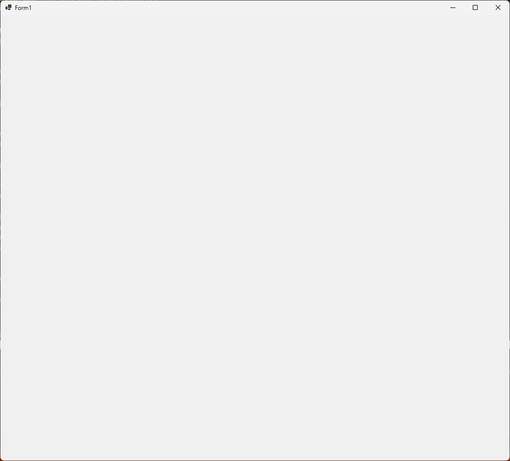</div>

### 1.6 ゲーム状態を作る

それでは、ゲーム本体を作っていきましょう。<br>
今回作るシューティングゲームは、以下の3つのゲーム状態を取れるものとします。

* **プレイ状態**: ゲームを遊んでいる状態
* **ステージクリア状態**: プレイヤーがボスを倒した状態
* **死亡状態**: プレイヤーが敵や敵弾に当たった状態

最初に、これらのゲーム状態をあらわす変数を作ります。<br>
`Game.cpp`を開き、インクルード文の下に次のプログラムを追加してください。

```diff
 #include "Game.h"
 #include <objidl.h>
 #include <gdiplus.h>
 using namespace Gdiplus;
+
+// ゲーム状態
+const int gsPlay = 0;   // プレイ状態
+const int gsClear = 1;  // ステージクリア状態
+const int gsDead = 2;   // 死亡状態
+int gameState = gsPlay; // 現在のゲーム状態

 // ゲーム状態を初期化する
 bool Init()
```

最初は「プレイ状態」で始めます。

### 1.7 状態を扱う関数を作る

次に、ゲーム状態に対応する「状態更新」関数を定義します。<br>
`Final`関数の下に、次のプログラムを追加してください。

```diff
 // ゲームを終了する
 void Final()
 {
 }
+
+// プレイ状態を更新する
+//   deltaTime  状態を進める秒数
+void UpdatePlay(float deltaTime)
+{
+}
+
+// クリア状態を更新する
+//   deltaTime  状態を進める秒数
+void UpdateClear(float deltaTime)
+{
+}
+
+// 死亡状態を更新する
+//   deltaTime  状態を進める秒数
+void UpdateDead(float deltaTime)
+{
+}

 // ゲーム状態を更新する
 void Tick(float deltaTime)
```

> `deltaTime`(デルタ・タイム)は「時間の差分」をあらわす単語です。<br>
>「デルタ」は **変化** や **差分** という意味で、物理や数学の`Δ`(「デルタ」と読む)記号と同じものです。

そして、作成した更新関数を`Tick`関数から呼び出します。<br>
`Tick`関数の定義に、次のプログラムを追加してください。

```diff
 // ゲーム状態を更新する
 void Tick(float deltaTime)
 {
+  // ゲーム状態に対応する更新関数を実行
+  if (gameState == gsPlay) {
+    UpdatePlay(deltaTime);
+  }
+  else if (gameState == gsClear) {
+    UpdateClear(deltaTime);
+  }
+  else if (gameState == gsDead) {
+    UpdateDead(deltaTime);
+  }
 }

 // 画面を描く
 void OnPaint(Gdiplus::Graphics& g)
```

変数`deltaTime`(デルタ・タイム)は「ゲームの更新間隔」をあらわします。<br>
この数値を小さくすればスローモーションになり、大きくすれば高速化されます。<br>
最初は、これまでのゲームと同じ1/60秒にしておきます。<br>

次に、ゲーム状態を描く関数を定義します。<br>
`UpdateDead`関数の下に、次のプログラムを追加してください。

```diff
 void UpdateDead(float deltaTime)
 {
 }
+
+// プレイ状態を描く
+void PaintPlay(Graphics& g)
+{
+}
+
+// クリア状態を描く
+void PaintClear(Graphics& g)
+{
+}
+
+// 死亡状態を描く
+void PaintDead(Graphics& g)
+{
+}

 // ゲーム状態を更新する
 void Tick(float deltaTime)
```

続いて、作成した画面を描く関数を`OnPaint`関数から呼び出します。<br>
`OnPaint`関数の定義に、次のプログラムを追加してください。

```diff
 // 画面を描く
 void OnPaint(Gdiplus::Graphics& g)
 {
+  // 描く速度を上げるための設定
+  g.SetInterpolationMode(InterpolationModeNearestNeighbor);
+  g.SetPixelOffsetMode(PixelOffsetModeHalf);
+
+  // ゲーム状態に対応する描画関数を実行
+  if (gameState == gsPlay) {
+    PaintPlay(g);
+  }
+  else if (gameState == gsClear) {
+    PaintClear(g);
+  }
+  else if (gameState == gsDead) {
+    PaintDead(g);
+  }
 }

 // プレイ状態を更新する
 //   deltaTime  状態を進める秒数
 void UpdatePlay(float deltaTime)
```

このプログラムでは、絵を描く前に、以下の2つのモードを設定しています。<br>

* **InterpolationMode**(インターポレーション・モード): 画像を拡大縮小するときのなめらかさ<br>
  &emsp;`NearestNeighbor`(ニアレスト・ネイバー)は、「高速な代わりに一切なめらかにしない」モードです。
* **PixelOffsetMode**(ピクセル・オフセット・モード): 画像を拡大縮小するときの基準座標<br>
  &emsp;`Half`(ハーフ)は、「基準座標をピクセル中心とする」モードです。

この２つの設定をすると、拡大縮小したときに画像がカクカクになる代わりに、描く速度が向上します。

プログラムが書けたら、`>ローカルWindowsデバッガー`ボタンをクリックしてアプリを実行してください。<br>
何もないウィンドウが表示されたら成功です。ウィンドウ右上の`X`ボタンでウィンドウを閉じてください。

これで、ゲーム状態によって異なる関数が実行されるようになりました。<br>
ようやく、ゲームを作る下準備が完了しました。

### 1.8 画像ファイルを準備する

画面に何も表示されないのは味気ないので、とりあえず背景を表示しましょう。画像は以下のURLにあります。<br>
**Webブラウザ** のアドレスバーに以下のURLを入力し、ページを開いてください。

&emsp;`github.com/tn-mai/CSharp2026`

ページが開いたら、以下の手順で画像を含むZIPファイルをダウンロードしてください。

1. ファイル`ShootEmUpAssets.zip`をクリック
2. 右端にある「下矢印」アイコンをクリック
3. ダウンロード先を選択

<div align="center">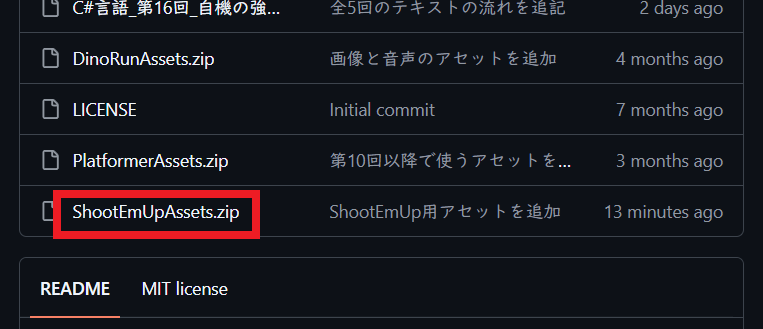<br>
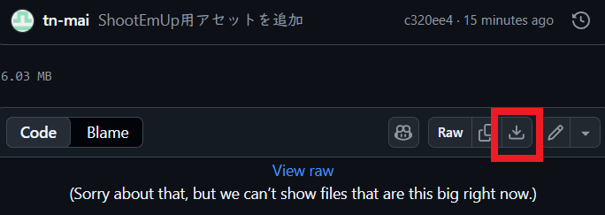</div>

ファイルをダウンロードしたら、以下の手順で`assets`フォルダのコピーを作成してください。

1. ダウンロードした`ShootEmUpAssets.zip`ファイルを開く
2. `assets`(アセッツ)というフォルダを選択
3. `Ctrl`キーを押しながら`C`キーを押して、`assets`フォルダをコピー
4. `ShootEmUp`プロジェクトのフォルダを開く
5. `Ctrl`キーを押しながら`V`キーを押して、`assets`フォルダを貼り付け

<div style="page-break-after: always"></div>

### 1.9 背景を表示する

それでは、画像ファイルを読み込みましょう。<br>
ファイル名は`bg_space.png`(ビージー・スペース・ピーエヌジー)です。<br>
このファイルは宇宙空間の画像で、大きさは1024*3584ピクセルです。

GDI+で画像を扱うには`Bitmap`(ビットマップ)クラスを使います。<br>
画像用の変数名は`bmpBackground`(ビーエムピー・バックグラウンド、「背景のビットマップ画像」という意味)とします。ゲーム状態を定義するプログラムの下に、次のプログラムを追加してください。

```diff
const int gsClear = 1; // ステージクリア状態
const int gsDead = 2;  // 死亡状態
int gameState = gsPlay; // 現在のゲーム状態
+
+// 画像用変数
+Bitmap* bmpBackground; // 背景画像

 // ゲーム状態を初期化する
 bool Init()
 {
+  // 画像を読み込む
+  Bitmap* tmp = new Bitmap(L"assets/images/bg_space.png");
+  bmpBackground =
+    tmp->Clone(0, 0, tmp->GetWidth(), tmp->GetHeight(), PixelFormat32bppPARGB);
+  delete tmp;
+
   return true;
 }

 // ゲームを終了する
 void Final()
 {
+  delete bmpBackground;
 }
```

`Bitmap`クラスは、できるだけファイルと同じ形式で画像を読み込もうとします。<br>
形式によっては、描画が遅くなる場合があります。<br>
描画速度を最大にするには、`Clone`(クローン)関数を使って、画像形式を`PixelFormat32bppPARGB`<br>
(ピクセルフォーマット・さんじゅうに・ビーピーピー、ピーエーアールジービー)形式に変換します。

> この画像形式の詳細はあまり気にしないでください。

`Clone`は元の画像は変更せず、コピーを作成します。元画像は不要なので`delete`しておきます。

<div style="page-break-after: always"></div>

次に`DrawImage`関数を使って`bmpBackground`を表示します。<br>
`PaintPlay`関数に、背景を表示するプログラムを追加してください。

```diff
 // プレイ状態を描く
 void PaintPlay(Graphics& g)
 {
+  // 背景を描く
+  g.SetCompositingMode(CompositingModeSourceCopy); // 透明度を無視する
+  g.DrawImage(bmpBackground, 0, 0,
+    bmpBackground->GetWidth(), bmpBackground->GetHeight());
+  g.SetCompositingMode(CompositingModeSourceOver); // 透明度を反映する
 }

 // クリア状態を描く
 void PaintClear(Graphics& g)
```

`CompositingMode`(コンポジティング・モード、「合成方法」という意味)には、画面と画像の合成方法を設定します。合成方法は以下の２種類から選びます。

* `SourceCopy`(ソース・コピー)&emsp;: 画面の色を無視して画像を上書き(合成しない)
* `SourceOver`(ソース・オーバー) : 画像の透明度によって画面の色と合成(合成する)

背景のように、画面全体を覆ってしまう画像を描く場合は、`SourceCopy`を指定します。<br>
すると、合成処理がスキップされて速く描けるようになります。<br>
背景を描いたら`SourceOver`に戻しておきます。

背景のサイズの指定には、`Bitmap`クラスの、`Width`(ウィス、「幅」という意味)フィールドと、`Height`(ハイト、「高さ」という意味)フィールドを使っています。<br>
これらのフィールドを使うと、画像のサイズが変わってもサイズを書き換える必要がないので便利です。

プログラムが書けたら`>ローカルWindowsデバッガー`ボタンをクリックしてアプリを実行してください。<br>
画面に宇宙が表示されていたら成功です。

<div align="center">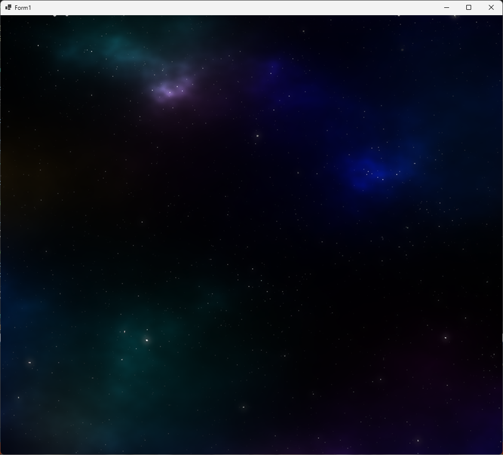</div>

### 1.10 背景を動かす(スクロールさせる)

背景の表示範囲を少しずつ変化させると、動いているように見せかけられます。

まずは表示位置をあらわす変数を宣言しましょう。<br>
変数名は`backgroundY`(バックグラウンド・ワイ、「背景のY座標」という意味)とします。<br>
「画像用変数」の宣言の下に、背景用変数の宣言を追加してください。

```diff
 // 画像用変数
 Bitmap bmpBackground; // 背景画像
+
+// 背景の変数
+float backgroundY = 0; // 背景のY座標

 // ゲーム状態を初期化する
 bool Init()
```

次に、`backgroundY`を少しずつ変化させます。`UpdatePlay`関数に、次のプログラムを追加してください。

```diff
 // プレイ状態を更新する
 //   deltaTime  状態を進める秒数
 void UpdatePlay(float deltaTime)
 {
+  // 背景を動かす
+  backgroundY += 60.0f * deltaTime; // 秒速60ドットの速度で動かす
 }
 
 // クリア状態を更新する
 //   deltaTime  状態を進める秒数
```

値を変化させる場合は、このプログラムのように、

&emsp;**1秒間の変化量 * deltaTime**

という式を使います。`deltaTime`を使うと、「秒速」のような理解しやすい単位で変化量を決められます。

最後に、背景の元画像のY座標を`backgroundY`に変更します。<br>
`PaintPlay`関数にある「背景を描く」プログラムを、次のように変更してください。

```diff
   // 背景を描く
   g.SetCompositingMode(CompositingModeSourceCopy); // 透明度を無視する
-  g.DrawImage(bmpBackground, 0, 0,
+  g.DrawImage(bmpBackground, 0, static_cast<int>(backgroundY),
     bmpBackground->GetWidth(), bmpBackground->GetHeight());
   g.SetCompositingMode(CompositingModeSourceOver); // 透明度を反映する
```

プログラムが書けたら`>ローカルWindowsデバッガー`ボタンをクリックしてアプリを実行してください。<br>
宇宙が少しずつ下に流れていったら成功です。

<div align="center">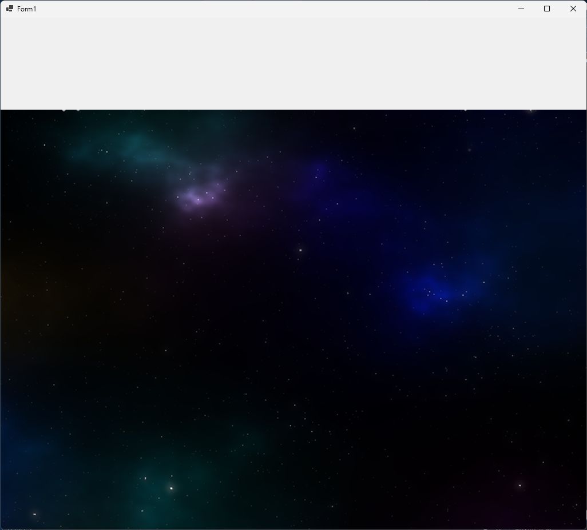</div>

### 1.11 背景の位置を設定する

宇宙の上側が白くなってしまう原因は、画像の一番上の部分を表示して、それを下に移動させたからです。<br>
下に移動させるのですから、最初は画像をウィンドウの上のほうに表示して、徐々に下げていくべきです。<br>
つまり、最初はマイナスのY座標を指定するわけです。

`bg_space.png`の高さは`3584`ピクセルで、これは4画面分に相当します。<br>
ウィンドウに対して3画面だけ上に表示すると、ちょうど4画面目がウィンドウに表示されるはずです。

そこで、画像の`Height`フィールドから1画面分の高さを引いた値を、上方向、つまりマイナス方向に設定します。<br>
`Init`関数の定義に次のプログラムを追加してください。

```diff
 // ゲーム状態を初期化する
 public void Init()
 {
   // 画像を読み込む
   bmpBackground = new Bitmap(L"assets/images/bg_space.png");
+
+  // 背景のY座標を、一番下の1画面がちょうどウィンドウ内に表示されるように設定
+  backgroundY = -static_cast<float>(bmpBackground->GetHeight() - RenderHeight);
 }

 // ゲームを終了する
 void Final()
```

プログラムが書けたら`>ローカルWindowsデバッガー`ボタンをクリックしてアプリを実行してください。<br>
宇宙が下に流れていって、しばらくの間、白い部分が表示されなければ成功です。

<div align="center"><br>[スクロールが止まっている]</div>

<pre class="tnmai_assignment">
<strong>【課題01 スクロールを止める】</strong>
背景が最後までスクロールすると、また白い部分が表示されます。
白い部分が表示されないように、背景を動かすプログラムの下に、以下の処理を行うif文を追加しなさい。

  <code>backgroundY</code>が「0以上」だったら、<code>backgroundY</code>を 0 にする

追加したif文が適切だった場合、約45秒後に背景が停止するはずです。
</pre>

<pre class="tnmai_assignment">
<strong>【課題02 コメントを追加する】</strong>
背景の停止を確認したら、追加したif文の上に、以下のコメントを追加しなさい。

  <strong>画像の上端まで来たらスクロールを止める</strong>
</pre>

<div style="page-break-after: always"></div>

## 2 敵を表示する

### 2.1 敵を表示する

背景の次は何かキャラクターを表示しましょう。まずはキャラクター用の画像を読み込みます。<br>
変数名は`bmpObjects`(ビーエムピー・オブジェクツ、「物体のビットマップ画像」という意味)とします。<br>
背景用の`bmpBackground`変数の宣言の下に、次のプログラムを追加してください。

```diff
 int gameState = gsPlay;// 現在のゲーム状態

 // 画像用変数
 Bitmap* bmpBackground; // 背景画像
+Bitmap* bmpObjects;    // キャラクター画像

 // 背景の変数
 float backgroundY = 0; // 背景のY座標
```

次に画像を読み込みます。`Init`関数に画像を読み込むプログラムを追加してください。

```diff
   bmpBackground =
     tmp->Clone(0, 0, tmp->GetWidth(), tmp->GetHeight(), PixelFormat32bppPARGB);
   delete tmp;
+
+  Bitmap* tmp = new Bitmap(L"assets/images/tile_objects.png");
+  bmpObjects =
+    tmp->Clone(0, 0, tmp->GetWidth(), tmp->GetHeight(), PixelFormat32bppPARGB);
+  delete tmp;

   // 背景のY座標を、一番下の1画面がちょうどウィンドウ内に表示されるように設定
   backgroundY = -static_cast<float>(bmpBackground->GetHeight() - RenderHeight);
```

ゲームが終わったら`Bitmap`オブジェクトを削除します。`Final`関数に次のプログラムを追加してください。

```diff
 // ゲームを終了する
 void Final()
 {
   delete bmpBackground;
+  delete bmpObjects;
 }
```

それでは画像を表示しましょう。

`tile_objects.png`(タイル・オブジェクツ・ピーエヌジー)は、複数の画像をひとつにまとめたものです。<br>
このような画像は「タイル・シート」や「スプライト・シート」と呼ばれます。<br>
`DrawImage`関数に、「描き込み先の範囲」と「元画像の描きたい範囲」の両方を指定すると、タイルシートの特定の範囲だけを画面に表示できます。

実際に試してみましょう、`PaintPlay`関数に次のプログラムを追加してください。

```diff
   g.SetCompositingMode(CompositingModeSourceCopy); // 透明度を無視する
   g.DrawImage(bmpBackground, 0, backgroundY,
     bmpBackground->GetWidth(), bmpBackground->GetHeight());
   g.SetCompositingMode(CompositingModeSourceOver); // 透明度を反映する
+
+  // 敵を描く
+  g.DrawImage(bmpObjects, // 元画像
+    Rect(0, 0, 32, 32),   // 描き込み先の範囲
+    0, 112, 32, 32,       // 元画像の描きたい範囲
+    UnitPixel);           // 範囲の数値の単位
 }

 // クリア状態を描く
 void PaintClear(Graphics& g)
```

`Rect`(レクト、「長方形」という意味)クラスのコンストラクタ・パラメータは、以下のようになっています。

&emsp;**Rect(X座標, Y座標, 幅, 高さ)**

`UnitPixel`(ユニット・ピクセル)は、関数に指定する数値の単位をあらわします。<br>
画像を画面に描く場合は`UnitPixel`を選んで、「数値 = ピクセル数」とします。<br>
印刷物を扱う場合は、`UnitInch`(ユニット・インチ)や`UnitMillimeter`(ユニット・ミリメートル)などの単位を使います。

プログラムが書けたら`>ローカルWindowsデバッガー`ボタンをクリックしてアプリを実行してください。<br>
ウィンドウの左上に「灰色の敵」が表示されていたら成功です。

<div align="center">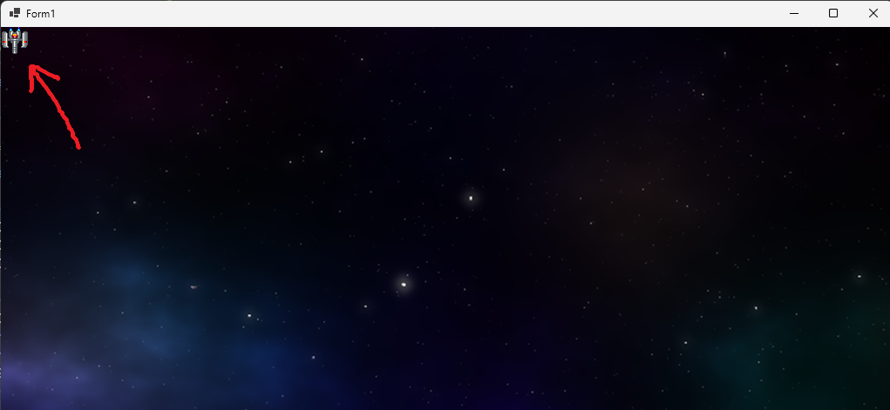</div>

<div style="page-break-after: always"></div>

### 2.2 画像の大きさを変える

少し画像が小さいので、大きく表示してみましょう。<br>
描く大きさを変えるには、書き込み先の範囲の **幅** と **高さ** を変更します。<br>
例えば、`32x32`ピクセルの絵を4倍の大きさで描くには、幅と高さに`128`を指定します。

敵を描くプログラムの「書き込み先の範囲」を、次のように変更してください。

```diff
   g.SetCompositingMode(CompositingModeSourceOver); // 透明度を反映する

   // 敵を描く
   g.DrawImage(bmpObjects, // 元画像
-    Rect(0, 0, 32, 32),   // 描き込み先の範囲
+    Rect(0, 0, 128, 128), // 描き込み先の範囲
     0, 112, 32, 32,       // 元画像の描きたい範囲
     UnitPixel);           // 範囲の数値の単位
```

プログラムが書けたら`>ローカルWindowsデバッガー`ボタンをクリックしてアプリを実行してください。<br>
ウィンドウの左上の「灰色の敵」が、大きく表示されていたら成功です。

<div align="center">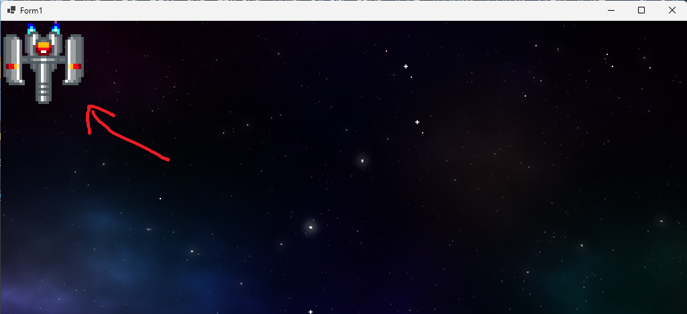</div>

<pre class="tnmai_assignment">
<strong>【課題03 敵の大きさを２倍にする】</strong>
４倍は大きすぎました。
敵の大きさが２倍になるように、<strong>書き込み先の範囲の幅と高さ</string>を<code>64</code>に変更しなさい。
</pre>

### 2.3 画像の位置を変える

ウィンドウに表示される位置を変えるには、書き込み先の範囲の **X座標**、**Y座標**を変更します。<br>
敵を描くプログラムの「書き込み先の範囲」を、次のように変更してください。

```diff
   // 敵を描く
   g.DrawImage(bmpObjects, // 元画像
-    Rect(0, 0, 64, 64),   // 描き込み先の範囲
+    Rect(128, 128, 64, 64), // 描き込み先の範囲
     0, 112, 32, 32,       // 元画像の描きたい範囲
     UnitPixel);           // 範囲の数値の単位
```

プログラムが書けたら`>ローカルWindowsデバッガー`ボタンをクリックしてアプリを実行してください。<br>
「灰色の敵」が、少し左下に移動していたら成功です。

<div align="center">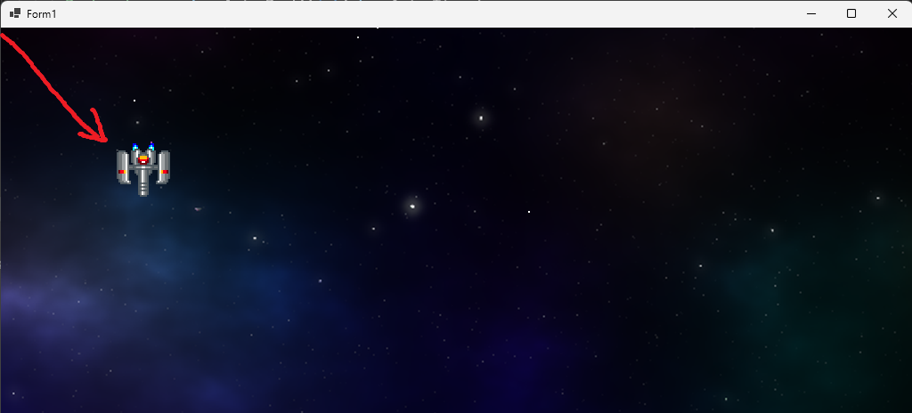</div>

<pre class="tnmai_assignment">
<strong>【課題04 敵をウィンドウ中央に表示する】</strong>
敵が中央付近に表示されるように、<strong>書き込み先の範囲のX座標とY座標</strong>を次のように変更しなさい。
  X座標=480 Y座標=320
</pre>

### 2.4 絵を変える

描く絵を変えるには、「元画像の描きたい範囲」を変更します。<br>
敵を描くプログラムを、次のように変更してください。

```diff
   // 敵を描く
   g.DrawImage(bmpObjects, // 元画像
     Rect(480, 320, 64, 64), // 描き込み先の範囲
-    0, 112, 32, 32,       // 元画像の描きたい範囲
+    192, 0, 32, 32,       // 元画像の描きたい範囲
     UnitPixel);           // 範囲の数値の単位
 }
```

プログラムが書けたら`>ローカルWindowsデバッガー`ボタンをクリックしてアプリを実行してください。<br>
「灰色の敵」が、「緑色の敵」に変わっていたら成功です。

<div align="center">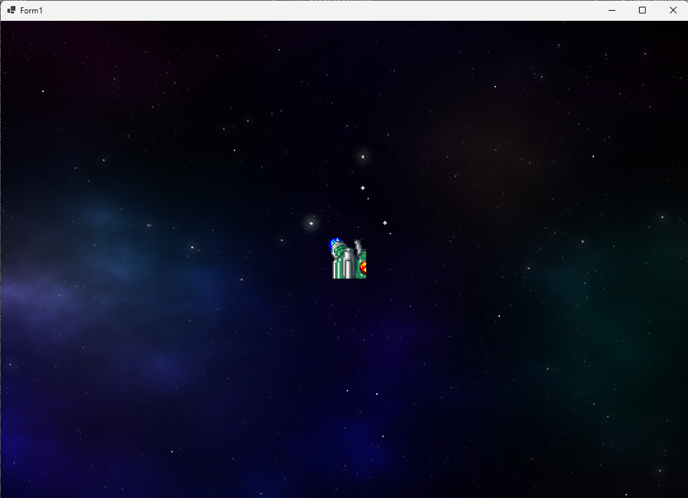</div>

絵が変わったのは分かると思いますが、絵が途中で切れているように見えます。<br>
見た目がおかしいのは、画像の幅と高さが間違っているからです。

座標`(64, 0)`にある絵の大きさは`64x64`なので、左上の`32x32`の範囲だけが表示されているのです。

意図されたとおりに画像を表示するには、「元画像の描きたい範囲」の幅と高さを適切に設定します。<br>
今回の場合はどちらも`64`です。<br>
敵を描くプログラムを、次のように変更してください。

```diff
   // 敵を描く
   g.DrawImage(bmpObjects, // 元画像
     Rect(480, 320, 64, 64), // 描き込み先の範囲
-    192, 0, 32, 32,       // 元画像の描きたい範囲
+    192, 0, 64, 64,       // 元画像の描きたい範囲
     UnitPixel);           // 範囲の数値の単位
 }
```

プログラムが書けたら`>ローカルWindowsデバッガー`ボタンをクリックしてアプリを実行してください。<br>
「緑色の敵」の全体が表示されていたら成功です。

<div align="center">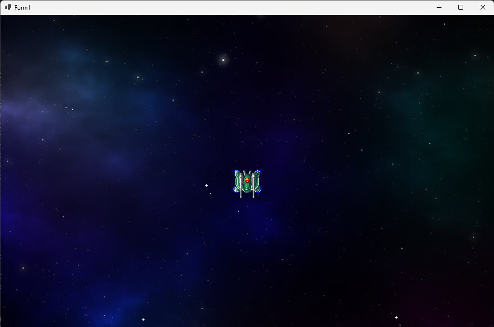</div>

さて、たしかに全体が表示されていますが。なんだか画像が小さいです。<br>
灰色の敵の大きさが`32x32`で、緑色の敵が`64x64`なら、緑色の敵は２倍の大きさで表示されてもいいはずです。<br>

意図した大きさで表示するには、「元画像の範囲の幅と高さ」に合わせて「描き込み先の範囲の幅と高さ」を変更します。<br>
敵を描くプログラムを、次のように変更してください。

```diff
   // 敵を描く
   g.DrawImage(bmpObjects, // 元画像
-    Rect(480, 320, 64, 64), // 描き込み先の範囲
+    Rect(480, 320, 128, 128), // 描き込み先の範囲
     192, 0, 64, 64,       // 元画像の描きたい範囲
     UnitPixel);           // 範囲の数値の単位
 }
```

プログラムが書けたら`>ローカルWindowsデバッガー`ボタンをクリックしてアプリを実行してください。<br>
緑色の敵が、２倍の大きさで表示されていたら成功です。

<div align="center">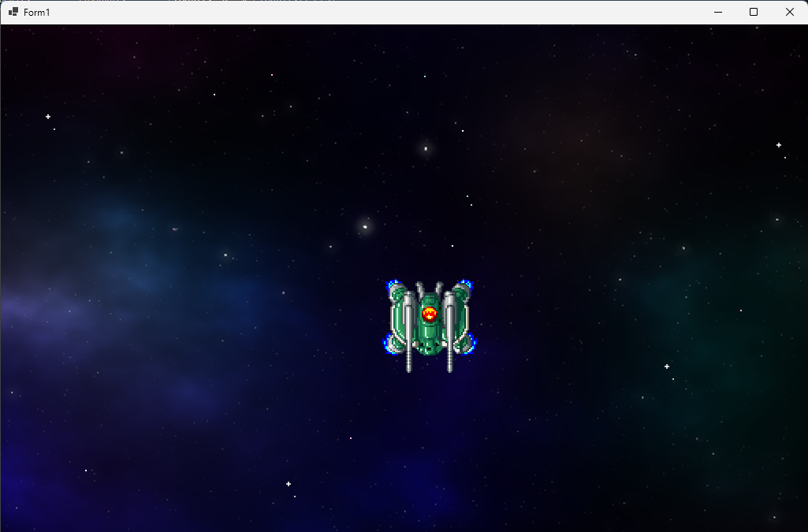</div>

<pre class="tnmai_assignment">
<strong>【課題05 敵の絵を変える】</strong>
<strong>元画像の描きたい範囲</strong>を変更して、敵の絵を「小型で緑色の敵」に変えなさい。
<strong>書き込み先の範囲</strong>の幅と高さを、元画像の範囲の幅と高さの２倍にすること。
[小型で緑色の敵の範囲]
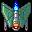
      X座標=0 Y座標=176
      幅と高さ=32x32
</pre>

<div style="page-break-after: always"></div>

## 3 キャラクタークラスを作る

### 3.1 Characterクラス用のファイルを作る

敵を移動したりアニメーションさせるには、移動やアニメーション用の変数が必要です。<br>
移動やアニメーションのプログラムは敵以外でも使いそうなので、クラスにまとめましょう。

クラス用のファイル名は、特に理由がなければ「クラス名.h」や「クラス名.cpp」とします。<br>
クラスを探すとき、ソリューションエクスプローラーで同名のファイルを探せば済むからです。

さて、今回作りたいのは移動やアニメーションをまとめたクラス、つまり「キャラクタークラス」です。<br>
そこで、クラス名は`Character`とします。

1. ソリューションエクスプローラーの「ヘッダーファイル」を右クリック
2. 「追加→新しい項目」の順でクリック
3. 中央の空欄(`FileName.cpp`となっている部分)を`Character.h`に書き換える
4. 「追加」ボタンをクリック

### 3.2 Characterクラスを作る

それでは、`Character`クラスに移動とアニメーションの機能を追加しましょう。<br>
必要なのは「変数」、「コンストラクタ」、それから「アニメーションを進める関数」、の３つです。

まずは変数を追加します。`Character.h`を開き、次のプログラムを追加してください。

```diff
 #pragma once
+
+// 移動やアニメーションの機能をまとめたクラス
+class Character
+{
+public:
+  float X; // X座標
+  float Y; // Y座標
+  std::vector<Gdiplus::Rect> AnimeRect; // アニメーション表示する範囲の配列
+  float AnimeTimestep; // 1秒間にアニメーションが切り替わる枚数
+  float AnimeTimer;    // アニメーション制御タイマー
+};
```

`AnimeRect`(アニメ・レクト)配列は、複数の「元画像の描きたい範囲」を、アニメーション順に並べて作ります。<br>
今回のシューティングゲームでは、ひとつの画像の中に全ての画像が詰め込まれています。<br>
そのため、元画像の範囲を複数用意して、範囲を切り替えることでアニメーションを行います。

変数の次は、コンストラクタを追加します。変数宣言の下に、次のコンストラクタを追加してください。

```diff
   std::vector<Gdiplus::Rect>  AnimeRect; // アニメーション表示する範囲の配列
   float AnimeTimestep; // 1秒間にアニメーションが切り替わる枚数
   float AnimeTimer;    // アニメーション制御タイマー(秒)
+
+  // コンストラクタ
+  Character(float x, float y,
+    const std::vector<Gdiplus::Rect>& animeRect, float timestep)
+  {
+    X = x;
+    Y = y;
+    AnimeRect = animeRect;
+    AnimeTimestep = timestep;
+    AnimeTimer = 0.0f;
+  }
 };
```

続いて、アニメーションを更新する関数を追加します。<br>
名前は`UpdateAnimeTimer`(アップデート・アニメ・タイマー)とします。<br>
コンストラクタの定義の下に、次のプログラムを追加してください。

```diff
     AnimeRect = animeRect;
     AnimeTimestep = timestep;
     AnimeTimer = 0.0f;
   }
+
+  // アニメーションを更新する
+  //   deltaTime  状態を進める秒数
+  void UpdateAnimeTimer(float deltaTime)
+  {
+    // タイマーを進める
+    AnimeTimer += AnimeTimestep * deltaTime;
+
+    // タイマーの数値が画像枚数以上になったら最初に戻す
+    if (AnimeTimer >= AnimeRect.size())
+    {
+      AnimeTimer -= AnimeRect.size();
+    }
+  }
 }
```

<div style="page-break-after: always"></div>

### 3.3 敵をキャラクタークラスにする

キャラクタークラスを使って敵を表示しましょう。<br>
`Game.cpp`を開き、`Character.h`をインクルードしてください。

```diff
 #include "Game.h"
+#include "Character.h"
 #include <objidl.h>
 #include <gdiplus.h>
 using namespace Gdiplus;
```

次に、「画像用変数」の宣言の下に、次のプログラムを追加してください。

```diff
 // 画像用変数
 Bitmap bmpBackground; // 背景画像
 Bitmap bmpObjects; // キャラクター画像
+
+// 敵のアニメーション範囲の配列
+std::vector<Rect> animeSmallGray = {
+  Rect(0, 112, 32, 32),  // 1枚目
+  Rect(32, 112, 32, 32), // 2枚目
+  Rect(64, 112, 32, 32), // 3枚目
+  Rect(96, 112, 32, 32), // 4枚目
+};
+
+// 敵の変数
+Character enemy(480, 320, animeSmallGray, 8);

 // 背景の変数
 float backgroundY = 0; // 背景のY座標
```

敵の変数を定義したら、敵のアニメーションタイマーを更新します。`UpdatePlay`関数に次のプログラムを追加してください。

```diff
   if (backgroundY > 0.0f)
   {
     backgroundY = 0.0f;
   }
+
+  // 敵のアニメーションを更新する
+  enemy.UpdateAnimeTimer(deltaTime);
 }

 // クリア状態を更新する
 //   deltaTime  状態を進める秒数
```

続いて、敵を描くプログラムを、次のように変更してください。

```diff
   // 背景を描く
   g.SetCompositingMode(CompositingModeSourceCopy); // 透明度を無視する
   g.DrawImage(bmpBackground, 0, backgroundY,
     bmpBackground->GetWidth(), bmpBackground->GetHeight());
   g.SetCompositingMode(CompositingModeSourceOver); // 透明度を反映する

   // 敵を描く
+  Rect rect = enemy.AnimeRect[static_cast<int>(enemy.AnimeTimer)];
   g.DrawImage(bmpObjects, // 元画像
-    Rect(480, 320, 64, 64),   // 描き込み先の範囲
-    0, 176, 32, 32,       // 元画像の描きたい範囲
+    Rect(static_cast<int>(enemy.X) - rect.Width,
+      static_cast<int>(enemy.Y) - rect.Height,
+      rect.Width * 2, rect.Height * 2),      // 描き込み先の範囲
+    rect.X, rect.Y, rect.Width, rect.Height, // 元画像の描きたい範囲
     UnitPixel);           // 範囲の数値の単位
 }
```

描き込み先の左上座標は、「X座標 - 画像の幅」、「Y座標 - 画像の高さ」としています。<br>
これは、アニメーションで範囲の大きさが変化した場合でも、 **キャラクターの座標が常に画像の中心を指す** ようにするためです。

プログラムが書けたら`>ローカルWindowsデバッガー`ボタンをクリックしてアプリを実行してください。<br>
敵がアニメーションしていたら成功です。

<div align="center">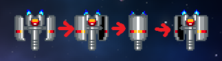</div>

### 3.4 画像を描くプログラムを関数にする

画像を描くプログラムは、２つの範囲を指定する必要があるので、ちょっと複雑です。<br>
これから、さまざまなキャラクターを描くことを考えると、毎回こんな面倒なプログラムを書きたくはないでしょう。<br>
そこで、画像を描くプログラムを関数にします。

関数名は`Draw`(ドロー、「描く」という意味)とします。<br>
まずは何もしない`Draw`関数を作ります。

<div style="page-break-after: always"></div>

`Character.h`を開き、`UpdateAnimeTimer`関数の下に、次のプログラムを追加してください。

```diff
     if (AnimeTimer >= AnimeRect.Length)
     {
       AnimeTimer -= AnimeRect.Length;
     }
   }
+
+  // キャラクターを描く
+  void Draw()
+  {
+
+  }
 };
```

次に`Game.cpp`を開き、敵の画像を描くプログラムの上に、`Draw`関数の呼び出しを追加してください。

```diff
   g.DrawImage(bmpBackground, 0, backgroundY,
     bmpBackground->GetWidth(), bmpBackground->GetHeight());
   g.SetCompositingMode(CompositingModeSourceOver); // 透明度を反映する

   // 敵を描く
+  enemy.Draw();
   const Rect& rect = enemy.AnimeRect[static_cast<int>(enemy.AnimeTimer)];
   g.DrawImage(bmpObjects, // 元画像
     Rect(static_cast<int>(enemy.X) - rect.Width,
```

今度はすぐ下の敵の画像を描くプログラムを選択し、`Ctrl+X`キーを押して切り取ってください。

```diff
   g.SetCompositingMode(CompositingModeSourceOver); // 透明度を反映する

   // 敵を描く
   enemy.Draw();
-  const Rect& rect = enemy.AnimeRect[static_cast<int>(enemy.AnimeTimer)];
-  g.DrawImage(bmpObjects, // 元画像
-    Rect(static_cast<int>(enemy.X) - rect.Width,
-      static_cast<int>(enemy.Y) - rect.Height,
-      rect.Width * 2, rect.Height * 2),      // 描き込み先の範囲
-    rect.X, rect.Y, rect.Width, rect.Height, // 元画像の描きたい範囲
-    UnitPixel);           // 範囲の数値の単位
 }

  // クリア状態を描く
  void PaintClear(Graphics& g)
```

`Character.h`を開き、`Draw`関数の`{}`の間で`Ctrl+V`キーを押して、切り取ったプログラムを貼り付けてください。

```diff
       AnimeTimer -= AnimeRect.Length;
     }
   }

   // キャラクターを描く
   void Draw()
   {
+    const Rect& rect = enemy.AnimeRect[static_cast<int>(enemy.AnimeTimer)];
+    g.DrawImage(bmpObjects, // 元画像
+      Rect(static_cast<int>(enemy.X) - rect.Width,
+        static_cast<int>(enemy.Y) - rect.Height,
+        rect.Width * 2, rect.Height * 2),      // 描き込み先の範囲
+      rect.X, rect.Y, rect.Width, rect.Height, // 元画像の描きたい範囲
+      UnitPixel);           // 範囲の数値の単位
   }
 };
```

もちろん、そのままでは動作しないので、いくつかの点を直します。まず、`enmey`変数をなくします。<br>
メンバ関数の中では変数名を書くだけで済むからです。<br>
次のように、`enemy`変数を削除してください。

```diff
   // キャラクターを描く
   void Draw()
   {
-    const Rect& rect = enemy.AnimeRect[static_cast<int>(enemy.AnimeTimer)];
+    const Rect& rect = AnimeRect[static_cast<int>(AnimeTimer)];
     g.DrawImage(bmpObjects, // 元画像
-      Rect(static_cast<int>(enemy.X) - rect.Width,
-        static_cast<int>(enemy.Y) - rect.Height,
+      Rect(static_cast<int>(X) - rect.Width,
+        static_cast<int>(Y) - rect.Height,
         rect.Width * 2, rect.Height * 2), // 描き込み先の範囲
       rect.X, rect.Y, rect.Width, rect.Height, // 元画像の描きたい範囲
       UnitPixel);           // 範囲の数値の単位
   }
```

<div style="page-break-after: always"></div>

次に、変数`g`と`bmpObjects`をパラメータにします。`Draw`関数に次のパラメータを追加してください。

```diff
       AnimeTimer -= AnimeRect.Length;
     }
   }

   // キャラクターを描く
-  void Draw()
+  void Draw(Gdiplus::Graphics& g, Gdiplus::Bitmap* bmpObjects)
   {
     const Rect& rect = AnimeRect[static_cast<int>(AnimeTimer)];
     g.DrawImage(bmpObjects, // 元画像
```

それから、`Rect`と`UnitPixel`は`Gdiplus`名前空間のメンバです。<br>
ヘッダファイルでは`namespace`を使えないので、名前空間の修飾を追加ます。

```diff
   void Draw(Gdiplus::Graphics& g, Gdiplus::Bitmap* bmpObjects)
   {
-    const Rect& rect = AnimeRect[static_cast<int>(AnimeTimer)];
+    const Gdiplus::Rect& rect = AnimeRect[static_cast<int>(AnimeTimer)];
     g.DrawImage(bmpObjects, // 元画像
-      Rect(static_cast<int>(X) - rect.Width,
+      Gdiplus::Rect(static_cast<int>(X) - rect.Width,
         static_cast<int>(Y) - rect.Height,
         rect.Width * 2, rect.Height * 2), // 描き込み先の範囲
       rect.X, rect.Y, rect.Width, rect.Height, // 元画像の描きたい範囲
-      UnitPixel);           // 範囲の数値の単位
+      Gdiplus::UnitPixel);           // 範囲の数値の単位
   }
```

これで`Draw`関数の修正は終わりです。しかし、今度は`Game.cpp`の`Draw`関数呼び出しがエラーになります。次のように、`Draw`関数の呼び出しにパラメータを付け加えて、エラーをなくしてください。

```diff
     g.DrawImage(bmpBackground, 0, backgroundY,
       bmpBackground->GetWidth(), bmpBackground->GetHeight());
     g.SetCompositingMode(CompositingModeSourceOver); // 透明度を反映する

     // 敵を描く
-    enemy.Draw();
+    enemy.Draw(g, bmpObjects);
   }

   // クリア状態を描く
   void PaintClear(Graphics& g)
```

これで、キャラクターの画像を描くプログラムを関数にすることができました。

プログラムが書けたら`>ローカルWindowsデバッガー`ボタンをクリックしてアプリを実行してください。<br>
アニメーションが、敵を描くプログラムを関数化する前と同じように再生されていたら成功です。

### 3.5 敵を増やす

敵のひとつだけだと画面がさびしいので、数を配列にして増やしましょう。<br>
`Game.cpp`にある「敵の変数」を定義するプログラムを、次のように変更してください。

```diff
   Rect(32, 176, 32, 32), // 2枚目
   Rect(64, 176, 32, 32), // 3枚目
   Rect(32, 176, 32, 32), // 4枚目
 };

 // 敵の変数
-Character enemy(480, 320, animeSmallGray, 8);
+std::vector<Character> enemyList = {
+  Character(512, 320, animeSmallGray, 8),
+  Character(384, 256, animeSmallGray, 8),
+  Character(640, 256, animeSmallGray, 8),
+};

 // 背景の変数
 float backgroundY = 0; // 背景のY座標
```

敵の変数を配列に変えたので、敵の更新と敵を描くプログラムを配列に対応させます。<br>
`UpdatePlay`関数にある「敵のアニメーションを更新する」プログラムを、次のように変更してください。

```diff
   if (backgroundY > 0.0f)
   {
     backgroundY = 0.0f;
   }

   // 敵のアニメーションを更新する
-  enemy.UpdateAnimeTimer(deltaTime);
+  for (int a = 0; a < enemyList.size(); a += 1)
+  {
+    enemyList[a].UpdateAnimeTimer(deltaTime);
+  }
 }

 // クリア状態を更新する
 //   deltaTime  状態を進める秒数
```

続いて、`PaintPlay`関数にある「敵を描く」プログラムも、次のように変更してください。

```diff
   g.DrawImage(bmpBackground, 0, backgroundY,
     bmpBackground->GetWidth(), bmpBackground->GetHeight());
   g.SetCompositingMode(CompositingModeSourceOver); // 透明度を反映する

   // 敵を描く
-  enemy.Draw(g, bmpObjects);
+  for (int a = 0; a < enemyList.size(); a += 1)
+  {
+    enemyList[a].Draw(g, bmpObjects);
+  }
 }

 // クリア状態を描く
 void PaintClear(Graphics& g)
```

プログラムが書けたら`>ローカルWindowsデバッガー`ボタンをクリックしてアプリを実行してください。<br>
３つの敵が表示されたら成功です。

<div align="center">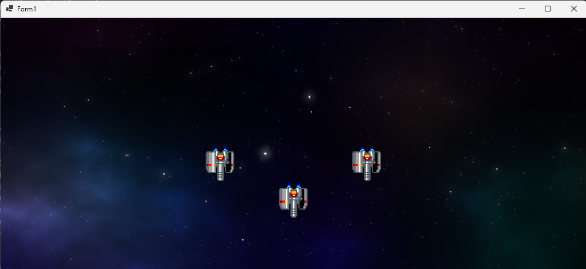</div>

<pre class="tnmai_assignment">
<strong>【課題06 敵を増やす】</strong>
以下の座標に小型で緑色の敵を追加しなさい。
  敵１: X座標=448 Y座標=128
  敵２: X座標=584 Y座標=128
</pre>

### 3.6 敵の見た目を変える

同じ見た目の敵ばかりではつまらないので、見た目の違う敵を作りましょう。<br>
といっても、やることは簡単で、「新しいアニメーション範囲を作って、敵に割り当てる」だけです。

配列の名前は、`animeMediumRed`(アニメ・ミディアム・レッド、「中型で赤色のアニメ」という意味)とします。<br>
「敵のアニメーション範囲の配列」の下に、新しいアニメーション範囲を追加してください。

<div style="page-break-after: always"></div>

```diff
   Rect(32, 176, 32, 32), // 2枚目
   Rect(64, 176, 32, 32), // 3枚目
   Rect(32, 176, 32, 32), // 4枚目
 };
+
+// 中型で赤色の敵のアニメーション範囲の配列
+std::vector<Rect> animeMediumRed = {
+  Rect(0, 0, 64, 64), Rect(64, 0, 64, 64),
+};

 // 敵の変数
 std::vector<Character> enemyList = {
   Character(512, 320, animeSmallGray, 7),
```

次に、敵の配列に新しい敵を追加してください。

```diff
 // 敵の変数
 std::vector<Character> enemyList = {
   Character(512, 320, animeSmallGray, 7),
   Character(384, 256, animeSmallGray, 7),
   Character(640, 256, animeSmallGray, 7),
   Character(448, 128, animeSmallGray, 7),
   Character(584, 128, animeSmallGray, 7),
+  Character(192, 192, animeMediumRed, 10),
 };
```

プログラムが書けたら`>ローカルWindowsデバッガー`ボタンをクリックしてアプリを実行してください。<br>
ウィンドウの右側に、中型の敵が表示されたら成功です。

<div align="center">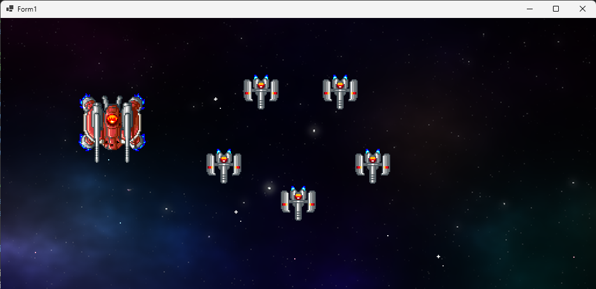</div>

<pre class="tnmai_assignment">
<strong>【課題07 中型で青色の敵を増やす】</strong>
「中型で青色の敵」を、座標<code>(832, 192)</code>に追加しなさい。
アニメーション範囲の配列名は<code>animeMediumBlue</code>(アニメ・ミディアム・ブルー)とすること。
アニメーション速度は10にすること。アニメーション範囲には以下の２つを指定すること。
  範囲１: X座標=256 Y座標=0 幅と高さ=64x64
  範囲２: X座標=320 Y座標=0 幅と高さ=64x64
</pre>
