[C++言語2026 後期 第02回]

# キャラクターを動かす

## 1 流れる星を追加する

&emsp;1回目: 背景の表示、敵の表示、敵のクラス化、敵を増やす<br>
&emsp;**今回: 流れる星の表示、敵を動かす、敵の発生を制御する、敵の行動パターンを増やす**<br>
&emsp;3回目: 自機の表示、弾丸を発射する、敵と弾丸の衝突判定、爆発を表示<br>
&emsp;4回目: 自機のパワーアップ、敵の弾丸を発射する、自機と敵の弾丸の衝突判定、ゲームオーバー、敵の調整<br>
&emsp;5回目: 得点の表示、敵出現順の制御、ボス敵の表示、ステージクリア、ステージを増やす

### 1.1 背景を流れる星クラスを作る

敵以外のキャラクターとして、背景に流れる星を表示しましょう。<br>
星は、以下のような挙動をするものとします。

* 星は、最初にランダムな位置に表示される。星の数は16個とする。
* 星は、上から下に向かって秒速120ドットで移動する。
* 星のY座標が画面外に到達したら、画面の上側のランダムな位置に戻す。

この挙動を`Game.cpp`に直接書くと、他のプログラムと区別しにくくなってしまいます。<br>
そこで、星を制御するためのクラスを作ります。

クラス名は`BackgroundStar`(バックグラウンド・スター、「背景の星」という意味)とします。<br>
クラス用のファイル名は`BackgroundStart.h`とします。

ファイルを追加するには、以下の手順で操作します。

> 1. ソリューションエクスプローラーのプロジェクト名(今回の場合は`ShootEmUp`)を右クリック
> 2. 「追加」項目にマウスカーソルを合わせる
> 3. 「新しい項目」を左クリック

上記の手順を行うと、「新しい項目の追加」というタイトルを持つ小さなウィンドウが開きます。<br>
以下の手順にしたがって、新しいクラス用のファイルを作成してください。

> 1. 中央の空欄(`FileName.cpp`となっている部分)を`BackgroundStar.h`に書き換える
> 2. 「追加」ボタンをクリック

さて、`BackgroundStar`クラスに必要なのは以下の４つです。

* 変数
* コンストラクタ
* 星の状態を更新する関数
* 星を描く関数

まずは変数と、それからコメントを追加します。<br>
`BackgroundStar.h`を開き、次のプログラムを追加してください。

```diff
 #pragma once
+#include "Character.h"
+#include "Game.h"
+#include <vector>
+#include <random>
+
+// 背景を流れる星
+class BackgroundStar
+{
+private:
+  Character starList[16];
+  std::mt19937 rand;
+};
```

`mt19937`(エムティー・いちきゅうきゅうさんなな)は、乱数を生成するクラスです。<br>
C++には乱数を作るクラスがいくつかあり、まとめて「乱数生成器(らんすうせいせいき)」と呼ばれます。

### 1.2 コンストラクタを作る

次にコンストラクタを書きます。コンストラクタでは、16個の星キャラクターを作成します。<br>
変数宣言の下に、次のプログラムを追加してください。

```diff
 // 背景を流れる星
 class BackgroundStar
 {
 private:
   Character starList[16];
   std::mt19937 rand;
+
+public:
+  // コンストラクタ
+  BackgroundStar()
+  {
+    for (int a = 0; a < std::size(starList); a++) {
+      // 画面内のランダムな位置に表示
+      float x = std::uniform_real_distribution<float>(16, RenderWidth - 16)(rand);
+      float y = std::uniform_real_distribution<float>(16, RenderHeight - 16)(rand);
+
+      // 星の画像のサイズは16x16、Y座標は286で共通。アニメーションはしない(範囲の数は１)。
+      // X座標は 128, 144, 160, 172 の４つから均等に選ぶ
+      int imageNo = a % 4;
+      std::vector<Rectangle[] anime = { Gdiplus::Rect(128 + imageNo * 16, 286, 16, 16) };
+      starList[a] = Character(x, y,anime , 0);
+    }
+  }
 };
```

`std::size`(エスティーディー・サイズ)関数は、配列の要素数を返します。

`uniform_real_distribution`(ユニフォーム・リアル・ディストリビューション、「一様な実数の分布」という意味)クラスは、乱数の生成範囲をあらわします。

&emsp;**uniform_real_distribution(最小値, 最大値);**

このクラスのオブジェクトに`(乱数生成器)`を付けると、指定した範囲からランダムに値が選ばれます。

&emsp;**uniform_real_distribution(最小値, 最大値)(乱数生成器);**

星の座標は、ウィンドウ内のランダムな位置を選びます。座標が画面端すぎると星が画面外に出てしまいます。<br>
画像のサイズは16x16ドットですが、２倍のサイズで表示するので画面上では32x32ドットです。<br>
画面における画像の中心から端までの長さは`16`ドットなので、画面端`16`ドットを除外しています。

<div align="center">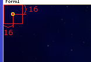</div>

星の画像は、`tile_objects.png`の`(128, 286)`から、X方向に16ドット単位で４個あります。<br>
４つの画像は個別に描かれることを想定しており、アニメーションはしません。<br>
画像の大きさは共通で、`16x16`ドットです。

<div align="center">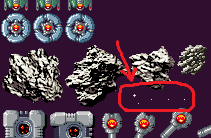</div>

すべての星の画像が均等に出現するように、「添字を４で割った余り」番目の画像を選んでいます。

### 1.3 星を更新する関数を作る

続いて、星の状態を更新する関数を書きます。<br>
名前は`Update`(アップデート、「更新する」という意味)とします。

コンストラクタブロックの下に、次のプログラムを追加してください。

```diff
     std::vector<Rectangle[] anime = { Gdiplus::Rect(128 + imageNo * 16, 286, 16, 16) };
     starList.push_back(Character(x, y,anime , 0));
     }
   }
+
+  // 星の状態を更新する
+  void Update(float deltaTime)
+  {
+    for (int a = 0; a < std::size(starList); a++) {
+      Character& star = starList[a];
+
+      // 星を下に移動
+      star.Y += 120 * deltaTime;
+
+      // 星が画面下に完全に消えたら、画面上のランダムな位置に戻す
+      if (star.Y >= RenderHeight + 16) {
+        star.X = uniform_real_distribution<float>(16, RenderWidth - 16)(rand);
+        star.Y = uniform_real_distribution<float>(-120, -16)(rand);
+      }
+    }
+  }
 };
```

このプログラムでは、星が画面下に消えた場合に画面上に戻しています。<br>
「画面の下」とは、つまり、

&emsp;**画像全体が、ウィンドウの高さ`RenderHeight`より下にある**

状態です。画像の大きさを考慮すると、「Y座標が`RenderHeight + 16`より下にある」となります。

X座標のランダム範囲は、コンストラクタで星の座標を決めたときと同じです。<br>
ただし、Y座標の範囲は違います。下に消えた星が、画面内に突然現れてほしくはないからです。<br>
そこで、上側の画面外16～120ドットの範囲でランダムに選んでいます。

Y座標のランダム範囲が広すぎると、星が見えない期間が長くなり、画面上の星の密度が下がります。<br>
逆に狭くするとランダムにする意味が弱くなり、プレイヤーに規則性を感じさせてしまいます。<br>
そこで、遅い星の移動速度に合わせて、遅くとも1秒後には画面に現れる範囲にしています。

> プログラムに現れる数値には、はっきり言葉にできないとしても、何らかの意図があります。<br>
> 意図を説明できないような数値は、バグやエラーを起こしたり、ゲームの面白さを損ねる場合があります。

### 1.4 星を描く関数を作る

最後に星を描く関数を作ります。これは、全ての星キャラクターの`Draw`関数を呼び出すだけです。<br>
関数名は`Draw`(ドロー、「描く」という意味)とします。<br>
`Update`関数ブロックの下に、`Draw`関数を追加してください。

```diff
         star.X = uniform_real_distribution<float>(16, RenderWidth - 16)(rand);
         star.Y = uniform_real_distribution<float>(-120, -16)(rand);
       }
     }
   }
+
+  // 星を描く
+  void Draw(Gdiplus::Graphics& g, Gdiplus::Bitmap* bmp)
+  {
+    for (int a = 0; a < std::size(starList); a++) {
+      starList[a].Draw(g, bmp);
+    }
+  }
 };
```

これで、４つの機能を全て作り終えました。<br>
`BackgroundStar`クラスは完成です。

### 1.5 Game.cppにBackgroundStarを追加する

完成した`BackgroundStar`クラスを`Game.cpp`に組み込みましょう。<br>
`Game.cpp`を開き、`BackgroundStar.h`をインクルードしてください。

```diff
 #include "Game.h"
 #include "Character.h"
+#include "BackgroundStar.h"
 #include <memory>
 #include <objidl.h>
 #include <gdiplus.h>
```

次に、背景の変数宣言の下に、`BackgroundStar`クラスの変数を宣言してください。

```diff
 // 背景の変数
 float backgroundY = 0; // 背景のY座標
+BackgroundStar backgroundStar; // 背景に流れる星

 // ゲーム状態を初期化する
 bool Init()
```

そして、`UpdatePlay`関数にある背景を動かすプログラムの下に、`backgroundStar`の`Update`関数呼び出しを追加してください。

```diff
   // 画像の端まで来たらスクロールを止める
   if (backgroundY > 0.0f) {
     backgroundY = 0.0f;
   }
+
+  // 背景を流れる星を動かす
+  backgroundStar.Update(deltaTime);

   // 敵を動かす
   for (int a = 0; a < enemyList.size(); a++) {
     Character enemy = enemyList[a];
```

最後に、`PaintPlay`関数にある背景を描くプログラムの下に、`backgroundStar`の`Draw`関数呼び出しを追加してください。

```diff
   g.DrawImage(bmpBackground, 0, backgroundY,
    bmpBackground->GetWidth(), bmpBackground->GetHeight());
   g.SetCompositingMode(CompositingModeSourceOver); // 透明度を反映する
+
+  // 背景に流れる星を描く
+  backgroundStar.Draw(g, bmpObjects);

   // 敵を描く
   for (int a = 0; a < enemyList.size(); a++) {
     enemyList[a].Draw(g, bmpObjects);
```

プログラムが書けたら`>ローカルWindowsデバッガー`ボタンをクリックしてアプリを実行してください。<br>
背景の上に、「流れる星」が表示されていたら成功です。

<div align="center">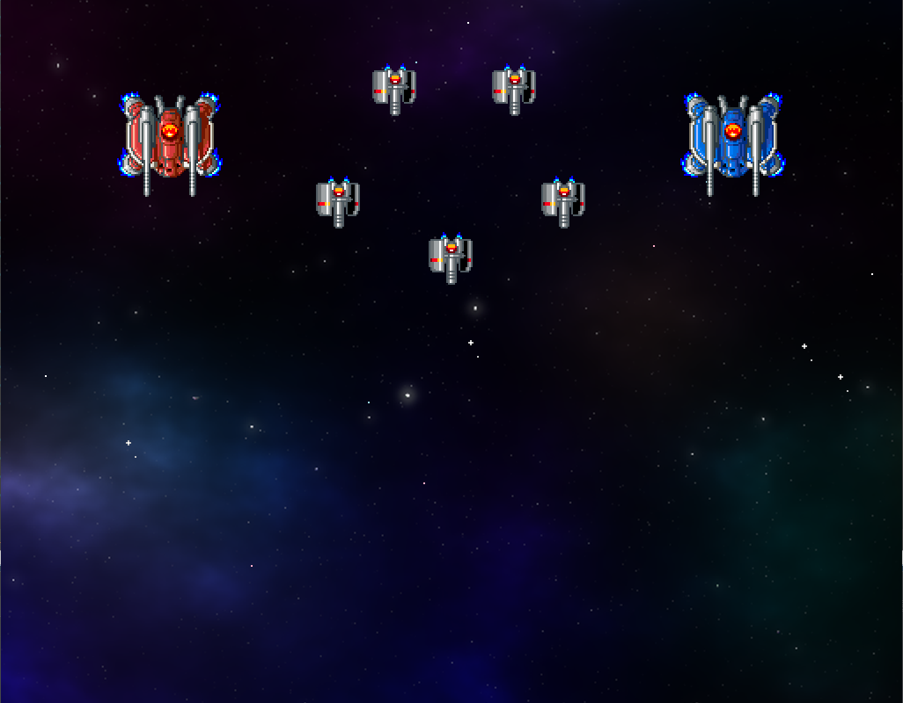</div>

### 1.6 星の動く速度を変える

星によって動く速度を変えると、空間に奥行きが加わります。<br>
星は16個あるので、最初の8個は秒速120ドット、残りの8個は秒速180ドットで動かしてみましょう。<br>

これは、添字を条件とするif文で表現できます。
とりあえず速度を120にしておいて、添字が`8`以上なら180で上書きします。<br>
`BackgroundStar.h`を開き、`Update`関数の星を下に移動するプログラムを、次のように変更してください。

```diff
     for (int a = 0; a < std::size(starList); a++) {
       Character& star = starList[a];

       // 星を下に移動
+      float speed = 120;
+      if (a >= 8) {
+        speed = 180;
+      }
-      star.Y += 120 * deltaTime;
+      star.Y += speed * deltaTime;

       // 星が画面下に完全に消えたら、画面上のランダムな位置に戻す
       if (star.Y >= RenderHeight + 16) {
         star.X = uniform_real_distribution<float>(16, RenderWidth - 16)(rand);
         star.Y = uniform_real_distribution<float>(-120, -16)(rand);
```

プログラムが書けたら`>ローカルWindowsデバッガー`ボタンをクリックしてアプリを実行してください。<br>
「流れる星」が、２種類の異なる速度で移動していたら成功です。

<div align="center">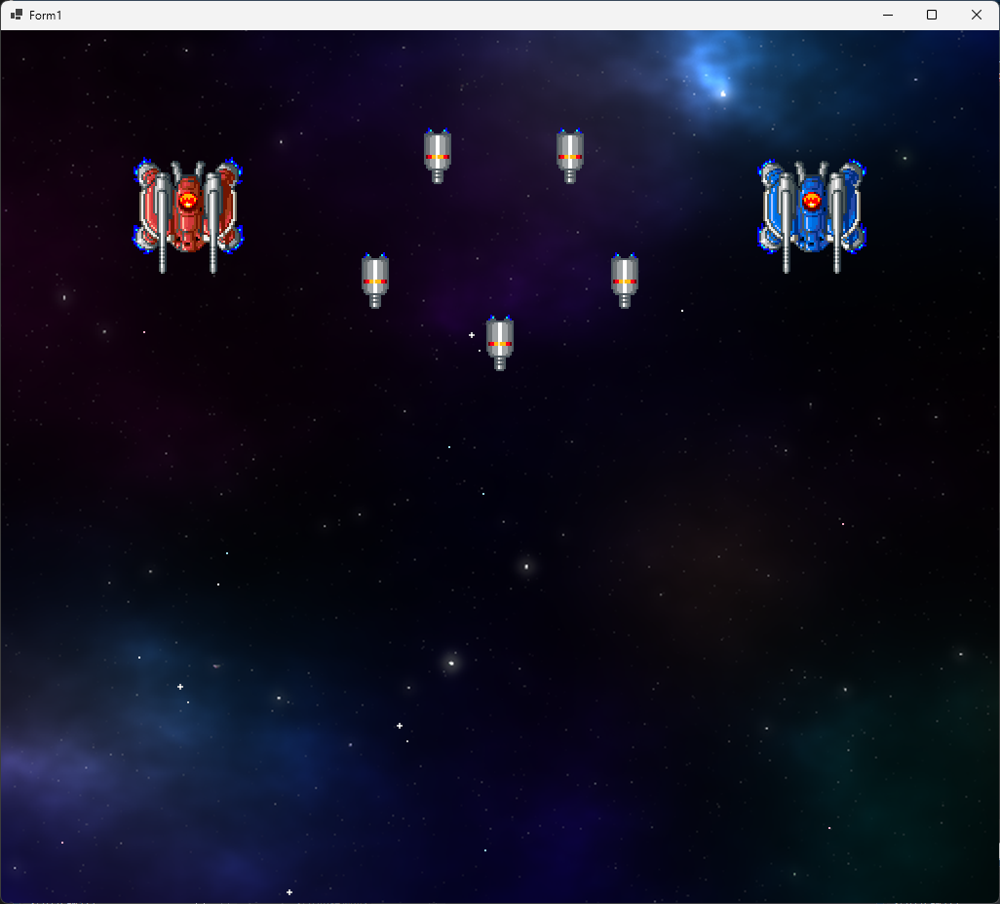</div>

> 「星を表示する」「星の速度を２段階以上に分ける」などは、プログラムとしては簡単なことです。<br>
> ですが、良いゲームはこうした「小さくて簡単な工夫」の積み重ねで出来ています。

<div style="page-break-after: always"></div>

## 2 敵を動かす

### 2.1 敵のクラスを作る

背景は一旦置いておいて、そろそろ敵にも動いてもらいましょう。<br>
敵の動きを処理するクラスを作ります。敵なので、名前は`Enemy`(エネミー、「敵」という意味)とします。<br>
「ヘッダーファイル」フィルタを右クリックして、`Enemy.h`というファイルを追加してください。

`Enemy`クラスは`Character`クラスの変数と、動きを制御する変数およびプログラムを持ちます。

* 変数
* コンストラクタ
* 状態を更新する関数
* 敵を描く関数

まずは変数を宣言しましょう。最低限必要そうな変数として、キャラクターと移動速度を宣言することにします。<br>
`Enemy.h`を開き、次のプログラムを追加してください。

```diff
 #pragma once
+#include "Character.h"
+#include "Game.h"

+// 敵クラス
+class Enemy
+{
+public:
+  Character Character;
+  float MoveSpeedX; // X方向の速度
+  float MoveSpeedY; // Y方向の速度
+
+  Enemy() = default; // デフォルトコンストラクタ
+
+  // コンストラクタ
+  Enemy(float x, float y,
+    const std::vector<Gdiplus::Rect>& animeRect, float timespan);
+
+  // 敵の状態を更新する
+  void Update(float deltaTime);
+
+  // 敵を描く
+  void Draw(Gdiplus::Graphics& g, Gdiplus::Bitmap* bmp);
+};
```

### 2.2 コンストラクタを作る

次にコンストラクタの定義を書きます。その前に、`cpp`ファイルを作りましょう。<br>
「ソースファイル」フィルタを右クリックして、`Enemy.cpp`というファイルを追加してください。

追加した`Enemy.cpp`を開き、次のプログラムを追加してください。

```diff
+#include "Enemy.h"
+using namespace Gdiplus;
+
+// コンストラクタ
+Enemy::Enemy(float x, float y,
+  const std::vector<Gdiplus::Rect>& animeRect, float timespan)
+{
+  // キャラクターを作る
+  Character = { x, y, animeRect, timespan };
+
+  // 移動速度を設定する
+  MoveSpeedX = 50.0f;
+  MoveSpeedY = 200.0f;
+}
```

移動速度の`50.0f`と`200.0f`は、動作を確認するための「仮(かり)データ」です。<br>
あとでちゃんとした値に差し替えます。

### 2.3 更新関数を作る

続いて、敵の状態を更新する関数を作ります。名前は`Update`(アップデート)とします。<br>
`Update`関数では、「アニメの更新」と「位置の更新」を行います。<br>
コンストラクタの定義の下に、`Update`関数の定義を追加してください。

```diff
   // 移動速度を設定する
   MoveSpeedX = 50.0f;
   MoveSpeedY = 200.0f;
 }
+
+// 敵の状態を更新する
+void Enemy::Update(float deltaTime)
+{
+  // アニメを更新
+  Character.UpdateAnimeTimer(deltaTime);
+
+  // 位置を更新
+  Character.X += MoveSpeedX * deltaTime;
+  Character.Y += MoveSpeedY * deltaTime;
+}
```

### 2.4 敵を描く関数を作る

敵を描く関数を追加します。名前は`Draw`(ドロー)とします。<br>
`Update`関数ブロックの下に、`Draw`関数を追加してください。

```diff
   // 位置を更新
   Character.X += MoveSpeedX * deltaTime;
   Character.Y += MoveSpeedY * deltaTime;
 }
+
+// 敵を描く
+void Enemy::Draw(Gdiplus::Graphics& g, Gdiplus::Bitmap* bmp)
+{
+  Character.Draw(g, bmp);
+}
```

この関数は`Character`クラスの`Draw`を呼び出すだけです。<br>
全ての機能が作成できたので、ひとまず`Enemy`クラスは完成です。

### 2.5 敵クラスを使う

作成した`Enemy`クラスを使って、敵を表示しましょう。<br>
`Game.cpp`を開き、`Enemy.h`をインクルードしてください。

```diff
 #include "Game.h"
 #include "Character.h"
 #include "BackgroundStar.h"
+#include "Enemy.h"
 #include <memory>
 #include <objidl.h>
 #include <gdiplus.h>
 using namespace Gdiplus;
```

<div style="page-break-after: always"></div>

次に、`enmeyList`の型を、`Character`から`Enemy`に変更してください。

```diff
 // 中型の青い敵のアニメーション範囲の配列
 std::vector<Rect> animeMediumBlue = {
   Rect(256, 0, 64, 64),
   Rect(320, 0, 64, 64),
 };

 // 敵の変数
-std::vector<Character> enemyList = {
-  Character(512, 320, animeSmallGray, 7),
-  Character(384, 256, animeSmallGray, 7),
-  Character(640, 256, animeSmallGray, 7),
-  Character(448, 128, animeSmallGray, 8),
-  Character(584, 128, animeSmallGray, 8),
-  Character(192, 192, animeMediumRed, 10),
-  Character(832, 192, animeMediumBlue, 10),
+std::vector<Enemy> enemyList = {
+  Enemy(512, 320, animeSmallGray, 7),
+  Enemy(384, 256, animeSmallGray, 7),
+  Enemy(640, 256, animeSmallGray, 7),
+  Enemy(448, 128, animeSmallGray, 8),
+  Enemy(584, 128, animeSmallGray, 8),
+  Enemy(192, 192, animeMediumRed, 10),
+  Enemy(832, 192, animeMediumBlue, 10),
 };

 // 背景の変数
 float backgroundY = 0; // 背景のY座標
```

続いて、`UpdatePlay`関数にある「敵のアニメーションを更新する」プログラムを、次のように変更してください。

```diff
     // 背景を流れる星を動かす
     backgroundStar.Update(deltaTime);

-    // 敵のアニメーションを更新する
+    // 敵の状態を更新する
     for (int a = 0; a < enemyList.size(); a++) {
-      enemyList[a].UpdateAnimeTimer(deltaTime);
+      enemyList[a].Update(deltaTime);
     }
   }

   // クリア状態を更新する
   //   deltaTime  状態を進める秒数
```

プログラムが書けたら`>ローカルWindowsデバッガー`ボタンをクリックしてアプリを実行してください。<br>
敵が右下に向かって移動していったら成功です。

<div align="center">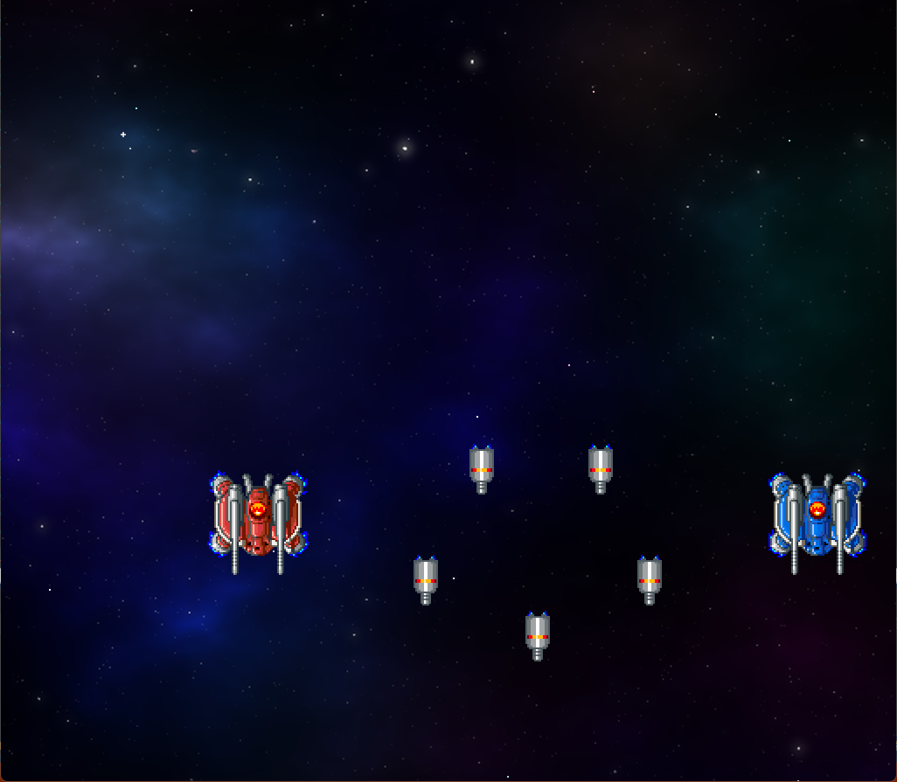</div>

### 2.6 敵の外見を敵クラスで決める

現在、敵のアニメーション範囲は`Game.cpp`に書いています。しかし、敵のことは敵が管理するべきです。<br>
そこで、アニメーション範囲を敵クラスに移動します。<br>
`Game.cpp`を開き、３つの敵のアニメーション範囲を選択し、`Ctrl+X`キーで切り取ってください。

```diff
 // 画僧用変数
 Bitmap* bmpBackground; // 背景画像
 Bitmap* bmpObjects;    // キャラクター画像
-
-// 敵アニメーション範囲の配列
-std::vector<Rect> animeSmallGray = {
-  Rect(0, 112, 32, 32),
-  Rect(32, 112, 32, 32),
-  Rect(64, 112, 32, 32),
-  Rect(96, 112, 32, 32),
-};
-
-// 中型の敵のアニメーション範囲の配列
-std::vector<Rect> animeMediumRed = {
-  Rect(0, 0, 64, 64),
-  Rect(64, 0, 64, 64),
-};
-
-// 中型で青色の敵のアニメーション範囲の配列
-std::vector<Rect> animeMediumBlue = {
-  Rect(256, 0, 64, 64),
-  Rect(320, 0, 64, 64),
-};

 // 敵の変数
 std::vector<Enemy> enemyList = {
```

次に`Enemy.cpp`を開き、`using namespace`の下に`Ctrl+V`キーで貼り付けてください。

```diff
 #include "Enemy.h"
 using namespace Gdiplus;

+  // 敵アニメーション範囲の配列
+  std::vector<Rect> animeSmallGray = {
+    new(0, 112, 32, 32),
+    new(32, 112, 32, 32),
+    new(64, 112, 32, 32),
+    new(96, 112, 32, 32),
+  };
+
+  // 中型の敵のアニメーション範囲の配列
+  std::vector<Rect> animeMediumRed = {
+    new(0, 0, 64, 64),
+    new(64, 0, 64, 64),
+  };
+
+  // 中型で青色の敵のアニメーション範囲の配列
+  std::vector<Rect> animeMediumBlue = {
+    new(256, 0, 64, 64),
+    new(320, 0, 64, 64),
+  };

 // コンストラクタ
 Enemy::Enemy(float x, float y,
```

それから、敵の種類をあらわす列挙型(名前は`EnemyType`、「敵の種類」という意味)を追加します。<br>
`Enemy.h`を開き、`EnemyType`列挙型を追加してください。

```diff
 #pragma once
 #include "Character.h"
 #include "Game.h"
+
+// 敵の種類
+enum class EnemyType
+{
+  SmallGray,  // 小型で灰色(スモール・グレー)
+  MediumRed,  // 中型で赤色(ミディアム・レッド)
+  MediumBlue, // 中型で青色(ミディアム・ブルー)
+};

 // 敵クラス
 class Enemy
```

次に、敵の種類をあらわす変数を追加します。名前は`Type`(タイプ、「種類、型」という意味)とします。<br>
`Enemy`クラスに、`Type`変数と、種類を表す以下の変数を追加してください。

```diff
 public:
   Character Character;
   float MoveSpeedX; // X方向の速度
   float MoveSpeedY; // Y方向の速度
+  EnemyType Type;   // 敵の種類

   Enemy() = default; // デフォルトコンストラクタ
```

敵の種類をコンストラクタのパラメータに追加します。そして、種類に応じてアニメーション範囲を設定します。<br>
コンストラクタの宣言を次のように変更してください。

```diff
   Enemy() = default; // デフォルトコンストラクタ

   // コンストラクタ
-  Enemy(float x, float y,
-    const std::vector<Gdiplus::Rect>& animeRect, float timespan);
+  Enemy(float x, float y, EnemyType t);

   // 敵の状態を更新する
   void Update(float deltaTime);
```

次に`Enemy.cpp`を開き、コンストラクタの定義を次のように変更してください。

```diff
   Rect(256, 0, 64, 64),
   Rect(320, 0, 64, 64),
 };

 // コンストラクタ
-Enemy::Enemy(float x, float y,
-  const std::vector<Gdiplus::Rect>& animeRect, float timespan);
+Enemy::Enemy(float x, float y, EnemyType t);
 {
+  Type = t; // 敵の種類を設定
+
   // キャラクターを作る
-  Character = { x, y, animeRect, timespan };
+  if (Type == EnemyType::SmallGray) {
+    Character = { x, y, animeSmallGray, 7 };
+  }
+  else if (Type == EnemyType::MediumRed) {
+    Character = { x, y, animeMediumRed, 10 };
+  }
+  else if (Type == EnemyType::MediumBlue) {
+    Character = { x, y, animeMediumBlue, 10 };
+  }

   // 移動速度を設定する
   MoveSpeedX = 50.0f;
```

これで敵の種類を指定すれば、自動的にアニメーション範囲が設定されるようになりました。

パラメータを変更したために、`Game.cpp`の敵の変数がエラーになります。<br>
`Game.cpp`を開き、次のようにパラメータを変更して、エラーをなくしてください。

```diff
 // 敵の変数
 std::vector<Enemy> enemyList = {
-  Enemy(512, 320, animeSmallGray, 7),
-  Enemy(384, 256, animeSmallGray, 7),
-  Enemy(640, 256, animeSmallGray, 7),
-  Enemy(448, 128, animeSmallGray, 7),
-  Enemy(584, 128, animeSmallGray, 7),
-  Enemy(192, 192, animeMediumRed, 10),
-  Enemy(832, 192, animeMediumRed, 10),
+  Enemy(512, 320, EnemyType::SmallGray),
+  Enemy(384, 256, EnemyType::SmallGray),
+  Enemy(640, 256, EnemyType::SmallGray),
+  Enemy(448, 128, EnemyType::SmallGray),
+  Enemy(584, 128, EnemyType::SmallGray),
+  Enemy(192, 192, EnemyType::MediumRed),
+  Enemy(832, 192, EnemyType::MediumRed),
 };

 // 背景の変数
 float backgroundY = 0; // 背景のY座標
```

プログラムが書けたら`>ローカルWindowsデバッガー`ボタンをクリックしてアプリを実行してください。<br>
アニメーション範囲を敵クラスに移動する前と、同じように敵が動いていたら成功です。

<div align="center"></div>

<div style="page-break-after: always"></div>

## 3 敵の発生を制御する

### 3.1 敵をランダムに出現させる

現在、画面下に消えた敵は、二度と戻ってくることはありません。<br>
ですが「下に消えた敵を上に戻す」だけでは、同じ敵しか現れず展開が単調になってしまいます。

単調さをなくすために、「適当な間隔で、敵の種類と数をランダムにして登場させる」ようにしたいです。<br>
まず、敵の配列を空っぽにします。`Game.cpp`を開き、敵の変数を次のように変更してください。

```diff
 Bitmap* bmpBackground; // 背景画像
 Bitmap* bmpObjects;    // キャラクター画像

 // 敵の変数
-std::vector<Enemy> enemyList = {
-  Enemy(512, 320, EnemyType::SmallGray),
-  Enemy(384, 256, EnemyType::SmallGray),
-  Enemy(640, 256, EnemyType::SmallGray),
-  Enemy(448, 128, EnemyType::SmallGray),
-  Enemy(584, 128, EnemyType::SmallGray),
-  Enemy(192, 192, EnemyType::MediumRed),
-  Enemy(832, 192, EnemyType::MediumBlue),
-};
+std::vector<Enemy> enemyList;

 // 背景の変数
 private float backgroundY = 0; // 背景のY座標
```

さて、多くのシューティングゲームでは、経過時間か、背景の移動量に応じて敵を発生させています。<br>
今回は「1秒おきに敵を出す」ようにしてみます。

「敵の変数」の宣言に、敵の発生間隔を制御する`enemySpawnTimer`(エネミー・スポーン・タイマー、<br>
「敵発生タイマー」という意味)と、乱数用の変数`random`(ランダム)を追加してください。

```diff
 // 敵の変数
 std::vector<Enemy> enemyList;
+float enemySpawnTimer = 0.0f; // 敵発生タイマー
+
+// 乱数
+std::mt19937 random;

 // 背景の変数
 float backgroundY = 0; // 背景のY座標
 BackgroundStar backgroundStar; // 背景に流れる星
```

`UpdatePlay`関数にある「敵の状態を更新する」プログラムの下に、次のプログラムを追加してください。

```diff
   // 敵の状態を更新する
   for (int a = 0; a < enemyList.size(); a++) {
     enemyList[a].Update(deltaTime);
   }
+
+  // 敵を発生させる
+  enemySpawnTimer += deltaTime;
+  if (enemySpawnTimer >= 1.0f) {
+    enemySpawnTimer -= 1.0f; // 敵発生タイマーの時間を戻す
+
+    // 発生位置のX座標 
+    float x = std::uniform_real_distribution<float>(32, RenderWidth - 32)(random);
+
+    // 敵の種類
+    int type = std::uniform_int_distribution<>(0, 2)(random);
+
+    enemyList.push_back(Enemy(x, -32, static_cast<EnemyType>(type)));
+  }
 }

 // クリア状態を更新する
 //   deltaTime  状態を進める秒数
```

プログラムが書けたら`>ローカルWindowsデバッガー`ボタンをクリックしてアプリを実行してください。<br>
約1秒の間隔で敵が発生し、右下に向かって移動していったら成功です。

<div align="center">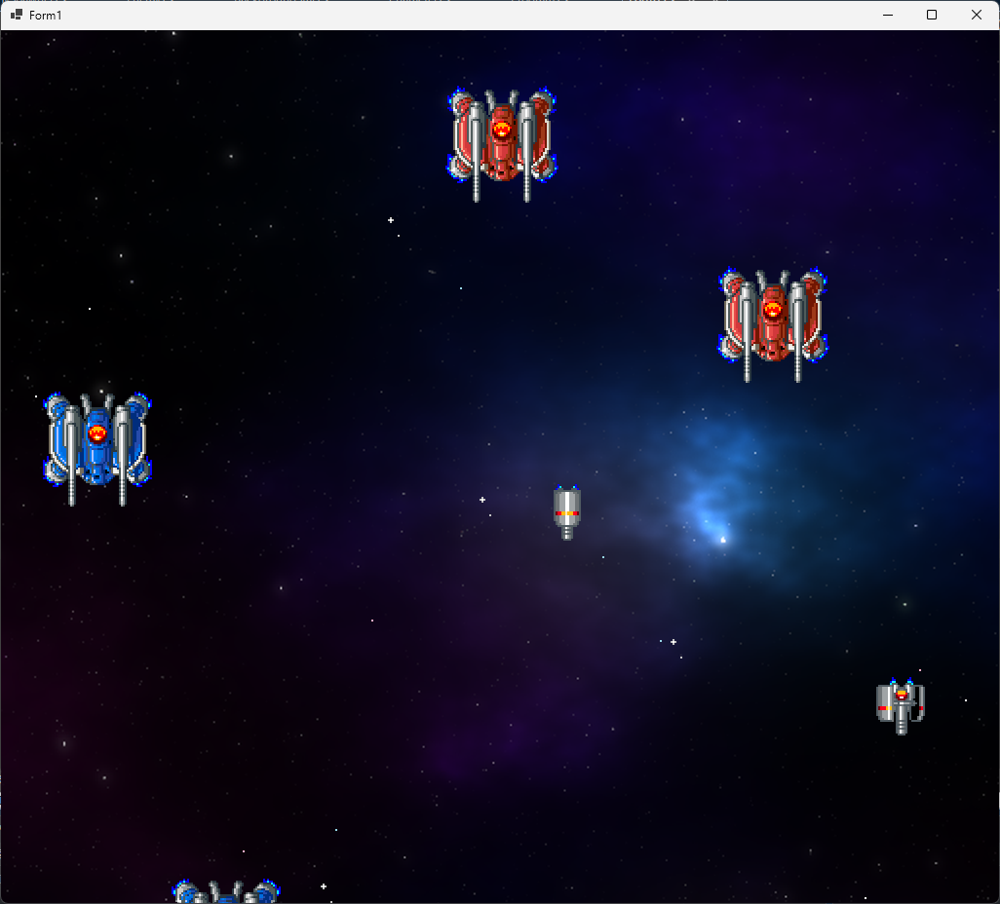</div>

<div style="page-break-after: always"></div>

### 3.2 敵を消す

敵を消していないので、敵の数はどんどん増え続けます。リストに含まれる敵の数を表示してみましょう。<br>
文字列を扱うので、`Game.cpp`に`string`ヘッダをインクルードしてください。

```diff
 #include "Character.h"
 #include "BackgroundStar.h"
 #include "Enemy.h"
+#include <string>
 #include <objidl.h>
 #include <gdiplus.h>
 using namespace Gdiplus;
```

次に、`UpdatePlay`関数にある「敵を発生させる」プログラムの下に、次のプログラムを追加してください。

```diff
     // 敵の種類
     int type = std::uniform_int_distribution<>(0, 2)(random);

     enemyList.Add(new(x, -32, type));
   }
+  extern HWND hWnd;
+  std::string text = "敵の数=" + std::to_string(enemyList.size());
+  SetWindowTextA(hWnd, text.c_str());
 }

 // クリア状態を更新する
 //   deltaTime  状態を進める秒数
```

`extern`(エクスターン)キーワードは、他のファイルで宣言した変数を参照する指示です。<br>
このプログラムでは、`ShootEmUp.cpp`で宣言した`hWnd`を参照しています。

`SetWindowTextA`(セット・ウィンドウ・テキスト・エー、「ウィンドウのテキストをASCII文字で設定する」という意味)は、ウィンドウ上部のタイトルバーに表示する文章を設定します。

&emsp;**SetWindowTextA(ウィンドウハンドル, 表示するテキスト);**

設定するテキストは、`enemyList.size()`の値(整数)を、`to_string`(トゥ・ストリング)関数で文字列に変換して作っています。

&emsp;**to_string(文字列に変換したい数値);**

プログラムが書けたら`>ローカルWindowsデバッガー`ボタンをクリックしてアプリを実行してください。<br>
ウィンドウ上部のタイトルバーに、敵の数が表示されるはずです。

<div align="center">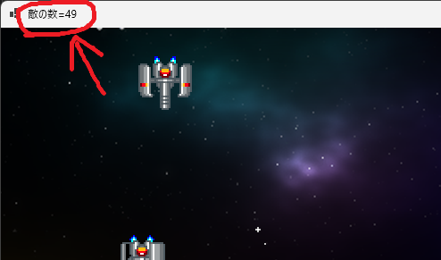</div>

上の画像では、敵の数は49個となっています。しかし、実際に画面に映っているのはわずか数個にすぎません。<br>
残りの敵は、画面外に向かって永遠に飛び続けます。

二度と画面に映らなくても、その敵のために更新プログラムは実行されます。これは無駄でしかありません。<br>
そこで、画面に戻ってこない、つまり **行動を終えた敵** を、リストから削除しましょう。

まずは敵クラスに、行動を終えたこと判定する変数を追加します。<br>
変数は`bool`型で、名前は`IsFinished`(イズ・フィニッシュド、「終わった？」という意味)とします。<br>
`Enemy.h`を開き、`IsFinished`変数を追加してください。

```diff
   Character Character;
   float MoveSpeedX; // X方向の速度
   float MoveSpeedY; // Y方向の速度
+  bool IsFinished;  // true=行動終了 false=行動中
   EnemyType Type;   // 敵の種類
```

次に`Enemy.cpp`を開き、コンストラクタで`IsFinished`変数を初期化してください。

```diff
 // コンストラクタ
 Enemy::Enemy(float x, float y, int t)
 {
+  IsFinished = false; // 「行動中」にする
   type = t; // 敵の種類を設定
```

そして、行動終了を判定します。今回は、「敵が画面下に消えたら」行動終了とします。<br>
`Update`関数に、次のプログラムを追加してください。

```diff
   // 位置を更新
   Character.X += MoveSpeedX * deltaTime;
   Character.Y += MoveSpeedY * deltaTime;
+
+  // 敵が画面の下に消えたら行動終了
+  if (Character.Y >= RenderHeight + 64) {
+    IsFinished = true;
+  }
 }

 // 敵を描く
 void Enemy::Draw(Gdiplus::Graphics& g, Gdiplus::Bitmap* bmp)
```

これで、敵の行動終了を判定できるようになりました。<br>
追加した`IsFinished`変数を使って、敵を消すプログラムを追加しましょう。

`vector`からデータを削除するには、`erase`(イレース)メンバ関数と`remove_if`(リムーブ・イフ)関数を使います。`remove_if`関数を使うには`algorithm`(アルゴリズム)ヘッダをインクルードします。<br>
`Game.cpp`を開き、`algorithm`ヘッダをインクルードしてください。

```diff
 #include "Character.h"
 #include "BackgroundStar.h"
 #include "Enemy.h"
 #include <string>
+#include <algorithm>
 #include <objidl.h>
 #include <gdiplus.h>
 using namespace Gdiplus;
```

次に、`UpdatePlay`関数にある「敵の状態を更新する」プログラムの下に、敵を削除するプログラムを追加してください。

```diff
   // 敵の状態を更新する
   for (int a = 0; a < enemyList.size(); a++) {
     enemyList[a].Update(deltaTime);
   }
+
+  // 行動の終わった敵を削除する
+  enemyList.erase(std::remove_if(enemyList.begin(), enemyList.end(),
+    [](const Enemy& e){ return e.IsFinished; }), enemyList.end());

  // 敵を発生させる
  enemySpawnTimer += deltaTime;
```

`remove_if`(リムーブ・イフ)関数のパラメータは次のようになっています。

&emsp;**remove_if(範囲の先頭, 範囲の終端, 条件);**

`remove_if`は、「範囲の先頭」から「範囲の終端」の範囲から、「条件」に **一致しない要素を前方にまとめる** という動作をします。

「条件」の書きかたは関数とほぼ同じで、次のように書きます。この記法を「ラムダ式」といいます。<br>
関数との主な違いは、「関数名の代わりに記号`[]`を書く」ことです。

&emsp;**\[\](パラメータ) => { プログラム }**

`remove_if`は、範囲内のすべての要素に対して、この「条件」を実行します。<br>
各要素は「パラメータ」に代入され、「プログラム」が実行されます。<br>
プログラムの結果が`false`になった要素を範囲の前側に、`true`になった要素を後ろ側に移動します。<br>
`remove_if`の戻り値は、`false`になった要素の終端位置です。

> `reove_if`は分類するだけで、削除は行わない点に注意してください。

次に`erase`(イレース)メンバ関数ですが、この関数は「指定した範囲の要素を実際に削除」します。

&emsp;**erase(範囲の先頭, 範囲の終端);**

プログラムが書けたら`>ローカルWindowsデバッガー`ボタンをクリックしてアプリを実行してください。<br>
画面外に出た敵が消されて、敵の数が増え続けなくなっていたら成功です。

<div align="center">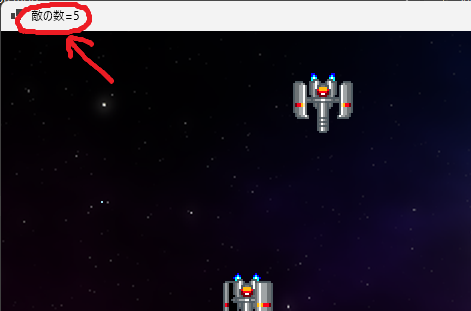</div>

### 3.3 敵発生装置クラスを作る

敵が1個ずつしか発生しないのは少なすぎます。<br>
発生間隔を短くすれば数を増やせますが、ランダムすぎて画面がごちゃついてしまいます。<br>
そこで、複数の敵の発生を制御するクラスを作ります。

クラス名は`EnemySpawner`(エネミー・スポナー、「敵発生装置」という意味)とします。<br>
「ヘッダーファイル」フィルタを右クリックして、<code>EnemySpawner.h</code>というファイルを追加してください。

`EnemySpawner`クラスは、敵の発生位置と発生間隔を制御する変数および関数を持ちます。

* 変数
* コンストラクタ
* 状態を更新する関数

必要な変数は、敵の種類や発生させる数などです。<br>

<div style="page-break-after: always"></div>

それでは、`EnemySpawner`クラスの定義に、以下の変数を追加してください。

```diff
 #pragama once
+#include "Enemy.h"
+#include <vector>
+
+// 敵を発生させるクラス
+class EnemySpawner
+{
+public:
+  float SpawnX;    // 敵発生位置のX座標
+  float SpawnY;    // 敵発生位置のY座標
+  int Pattern;     // 発生パターン
+  int Count;       // 発生させる数
+  float Timer;     // 発生タイマー
+  bool IsFinished; // true=発生終了 false=発生中
+
+  EnemySpawner() = default; // デフォルトコンストラクタ
+
+  // コンストラクタ
+  //  x, y= 発生位置 pattern=発生パターン
+  EnemySpawner(float x, float y, int pattern);
+
+  // 敵を発生させる
+  void Update(float deltaTime, std::vector<Enemy>& enemyList);
+};
```

### 3.4 コンストラクタを作る

続いて、メンバ関数を定義しましょう。<br>
「ソースファイル」フィルタを右クリックして、`Game.cpp`というファイルを追加してください。<br>
`Game.cpp`を開き、次のプログラムを追加してください。

```diff
+#include "EnemySpawner.h"
+#include "Game.h"
+
+// コンストラクタ
+//  x, y= 発生位置 pattern=発生パターン
+EnemySpawner::EnemySpawner(float x, float y, int pattern)
+{
+  SpawnX = x;
+  SpawnY = y;
+  Pattern = pattern;
+  Count = 4;
+  Timer = 0.0f;
+  IsFinished = false;
+}
```

敵の発生数は、とりあえず一律で４つとしておきます。

### 3.5 敵を発生させる関数を作る

次に、`EnemySpawner`の状態を更新し、敵を発生させる関数を作ります。<br>
関数名は`Update`(アップデート、「更新する」という意味)とします。<br>
コンストラクタブロックの下に、次の`Update`関数を追加してください。

```diff
   Count = 4;
   Timer = 0.0f;
   IsFinished = false;
 }
+
+// 敵を発生させる
+void EnemySpawner::Update(float deltaTime, std::vector<Enemy>& enemyList)
+{
+  // すべての敵が発生済みなら何もしない
+  if (IsFinished) {
+    return;
+  }
+
+  Timer -= deltaTime; // 発生タイマーを減らす
+
+  // 時間が残っていたら何もしない
+  if (Timer > 0) {
+    return;
+  }
+
+  // 時間になったので敵を発生させる
+  enemyList.push_back(Enemy(SpawnX, SpawnY, static_cast<EnemyType>(Pattern)));
+
+  Timer += 0.5f; // 次の発生までの時間を設定
+  Count -= 1; // 発生数を1減らす
+
+  // 発生数が 0 になったら発生終了にする
+  if (Count <= 0) {
+    IsFinished = true;
+  }
+}
```

これでひとまず、`EnemySpawer`クラスは完成です。

<div style="page-break-after: always"></div>

### 3.6 敵発生装置を使う

敵発生装置を使ってみましょう。まず、敵発生装置のリストを用意します。<br>
変数名は`enemySpawnerList`(エネミー・スポナー・リスト、「敵発生装置のリスト」という意味)とします。<br>
`Game.cpp`を開き、`EnemySpawner.h`をインクルードしてください。

```diff
 #include "Character.h"
 #include "BackgroundStar.h"
 #include "Enemy.h"
+#include "EnemySpawner.h"
 #include <string>
 #include <algorithm>
 #include <objidl.h>
```

次に、「敵の変数」に`enemySpawnerList`変数を追加してください。

```diff
 Bitmap* bmpObjects;    // キャラクター画像

 // 敵の変数
 std::vector<Enemy> enemyList;
+std::vector<EnemySpawner> enemySpawnerList; // 敵発生装置のリスト
 float enemySpawnTimer = 0.0f; // 敵発生タイマー
```

続いて、`UpdatePlay`関数にある「敵を発生させるプログラム」を、次のように変更してください。

```diff
   // 行動が終わった敵を削除する
   enemyList.erase(std::remove_if(enemyList.begin(), enemyList.end(),
     [](const Enemy& e){ return e.IsFinished; }), enemyList.end());

-  // 敵を発生させる
+  // 敵発生装置を作る
   enemySpawnTimer += deltaTime;
   if (enemySpawnTimer >= 1.0f) {
     enemySpawnTimer -= 1.0f; // 敵発生タイマーの時間を戻す

     // 発生位置のX座標 
     float x = std::uniform_real_distribution<float>(32, RenderWidth - 32)(random);

-    // 敵の種類
-    int type = std::uniform_int_distribution<>(0, 2)(random);
+    // 敵発生パターン
+    int pattern = std::uniform_int_distribution<>(0, 2)(random);
 
-    enemyList.push_back(Enemy(x, -32, static_cast<EnemyType>(type)));
+    enemySpawnerList.push_back(EnemySpawner(x, -32, pattern));
   }
+
+  // 敵発生装置を更新する
+  for (int a = 0; a < enemySpawnerList.size(); a++) {
+    enemySpawnerList[a].Update(deltaTime, enemyList);
+  }
+  enemySpawnerList.erase(std::remove_if(enemySpawnerList.begin(), enemySpawnerList.end(),
+    [](const EnemySpawner& e){ return e.IsFinished; }), enemySpawnerList.end());
+
  extern HWND hWnd;
  std::string text = "敵の数=" + std::to_string(enemyList.size());
  SetWindowTextA(hWnd, text.c_str());
```

プログラムが書けたら`>ローカルWindowsデバッガー`ボタンをクリックしてアプリを実行してください。<br>
敵が4個ずつ連続して発生していたら成功です。

<div align="center">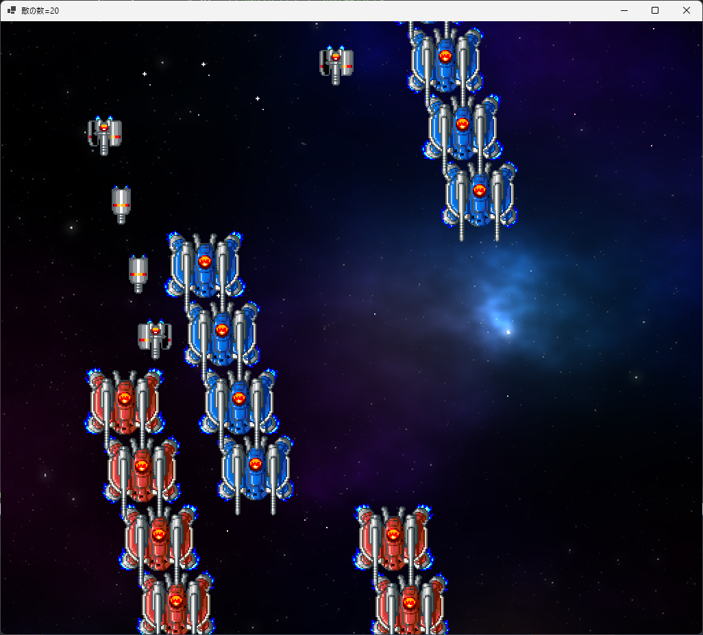</div>

### 3.7 敵発生パターンを増やす

同じ位置に敵を発生させるパターン以外に、他の発生パターンも作りましょう。<br>
現在の、敵が縦に発生するものをパターン0として、以下の4つのパターンを作ります。

&emsp;パターン0 : 小型で灰色の敵を、縦方向に発生<br>
&emsp;パターン1 : 小型で灰色の敵を、横方向に発生<br>
&emsp;パターン2 : 中型で赤色の敵を、間隔を開けて左右に発生<br>
&emsp;パターン3 : 中型で青色の敵を、間隔を開けて左右に発生

`EnemySpawner.cpp`を開き、`Update`関数を次のように変更してください。

```diff
       // 時間が残っていたら何もしない
       if (Timer > 0) {
         return;
       }

       // 時間になったので敵を発生させる
-      enemyList.push_back(Enemy(SpawnX, SpawnY, static_cast<EnemyType>(Pattern)));
+      if (Pattern == 0) {
+        // 小型で灰色の敵を、縦方向に発生
+        enemyList.push_back(Enemy(SpawnX, SpawnY, EnemyType::SmallGray));
+        Timer += 0.5f; // 次の発生までの時間を設定
+      }
+      else if (Pattern == 1) {
+        // 小型で灰色の敵を、横方向に発生
+        enemyList.push_back(Enemy(SpawnX, SpawnY, EnemyType::SmallGray));
+        SpawnX += 128; // 発生位置を右にずらす
+      }
+      else if (Pattern == 2) {
+        // 中型で赤色の敵を、間隔を開けて左右に発生
+        enemyList.push_back(Enemy(SpawnX, SpawnY, EnemyType::MediumRed));
+        SpawnX = RenderWidth - SpawnX; // 発生位置の左右を逆転
+        Timer += 3.5f; // 次の発生までの時間を設定
+      }
+      else if (Pattern == 3) {
+        // 中型で青色の敵を、間隔を開けて左右に発生
+        enemyList.push_back(Enemy(SpawnX, SpawnY, EnemyType::MediumBlue));
+        SpawnX = RenderWidth - SpawnX; // 発生位置の左右を逆転
+        Timer += 3.5f; // 次の発生までの時間を設定
+      }

-      Timer += 0.5f; // 次の発生までの時間を設定
       Count -= 1; // 発生数を1減らす

       // 発生数が 0 になったら発生終了にする
       if (Count <= 0) {
```

次に、`Game.cpp`を開き、`UpdatePlay`関数にあるパターン数を増やしてください。

```diff
   if (enemySpawnTimer >= 1.0f) {
     enemySpawnTimer -= 1.0f; // 敵発生タイマーの時間を戻す

     // 発生位置のX座標 
     float x = std::uniform_real_distribution<float>(32, RenderWidth - 32)(random);

     // 敵発生パターン
-    int pattern = std::uniform_int_distribution<>(0, 2)(random);
+    int pattern = std::uniform_int_distribution<>(0, 3)(random);
 
     enemySpawnerList.push_back(EnemySpawner(x, -32, pattern));
   }
```

プログラムが書けたら`>ローカルWindowsデバッガー`ボタンをクリックしてアプリを実行してください。<br>
敵が、4種類の異なるパターンで発生していたら成功です。

<div align="center">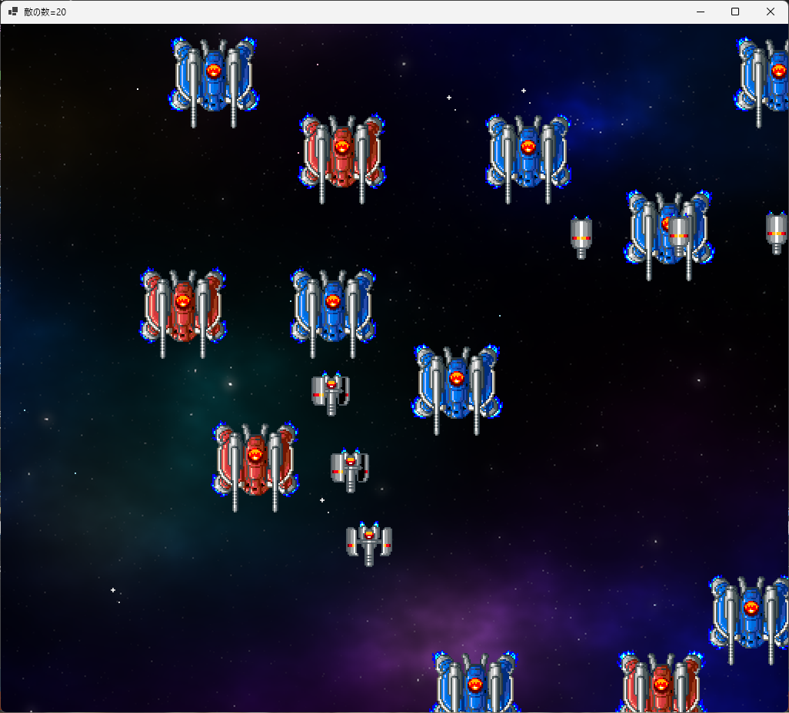</div>

### 3.8 敵の移動パターンを増やす

敵が同時に複数発生することで、画面がにぎやかになってきました。<br>
ですが、まだ少し単調な気がします。それは、敵が全部同じ動きをしているからです。<br>
そこで、以下の3種類の動きを作りましょう。

* 直進: 下に向かって進む
* U字ターン: 下に向かって画面中央まで進み、上に戻っていく
* S字カーブ: 左右に波のように揺れながら下に向かって進む

これらの敵の行動を制御するために、以下の変数を追加します。

* 発生からの経過時間
* 発生時のX座標とY座標

変数名は`timer`(タイマー)、`startX`(スタート・エックス)、`startY`(スタート・ワイ)とします。<br>
`Enemy.h`を開き、`Enemy`クラスにこれらの変数を追加してください。

```diff
   float MoveSpeedX; // X方向の速度
   float MoveSpeedY; // Y方向の速度
   bool IsFinished;  // true=行動終了 false=行動中
   EnemyType Type;   // 敵の種類
+  float Timer;      // 発生からの経過時間(秒)
+  float StartX;     // 発生時のX座標
+  float StartY;     // 発生時のY座標

   Enemy() = default; // デフォルトコンストラクタ

   // コンストラクタ
   Enemy(float x, float y, EnemyType t);
```

次に`Enemy.cpp`を開き、コンストラクタを次のように変更してください。

```diff
 // コンストラクタ
 Enemy::Enemy(float x, float y, int t)
 {
+  MoveSpeedX = 0.0f;
+  MoveSpeedY = 0.0f;
   IsFinished = false; // 「行動中」にする
   Type = t; // 敵の種類を設定
+  Timer = 0.0f; // 経過時間を0にする
+  StartX = x;   // 発生時のX座標を記録
+  StartY = y;   // 発生時のY座標を記録

   // キャラクターを作る
   if (Type == EnemyType::SmallGray) {
     Character = new Character(x, y, animeSmallGray, 7);
+    MoveSpeedY = 200.0f;
   }
   else if (Type == EnemyType::MediumRed) {
     Character = new Character(x, y, animeMediumRed, 10);
+
+    // 画面中央より左に発生したら右へ、右に発生したら左へ移動させる
+    MoveSpeedX = 50.0f;
+    if (x >= RenderWidth * 0.5f) {
+      MoveSpeedX = -50.0f;
+    }
   }
   else if (Type == EnemyType::MediumBlue) {
     Character = new Character(x, y, animeMediumBlue, 10);
+    MoveSpeedY = 100.0f;
   }
 
-  // 移動速度を設定する
-  MoveSpeedX = 50.0f;
-  MoveSpeedY = 200.0f;
 }
```

これで、３種類の敵ごとに、初期の移動速度が設定できました。

<div style="page-break-after: always"></div>

敵の初期状態を設定したので、次は敵の移動プログラムを書きます。<br>
まず、「小型で灰色の敵」の移動パターンを書きましょう。`Update`関数に、次のプログラムを追加してください。

```diff
 // 敵の状態を更新する
 void Update(float deltaTime)
 {
   // アニメを更新
   Character.UpdateAnimeTimer(deltaTime);
+
+  // 経過時間を更新
+  Timer += deltaTime;
 
   // 位置を更新
+  if (Type == EnemyType::SmallGray) {
+    // 下に向かって移動
     Character.X += MoveSpeedX * deltaTime;
     Character.Y += MoveSpeedY * deltaTime;

     // 敵が画面の下に消えたら行動終了
     if (Character.Y >= RenderHeight + 64) {
       IsFinished = true;
     }
+  }
 }

 // 敵を描く
 void Draw(Gdiplus::Graphics& g, Gdiplus::Bitmap* bmp)
```

次に、「U字ターン」の移動パターンを作ります。<br>
今回は、２次関数 $ y = 1 - x^2 $ の曲線を使うことにします。

<div align="center">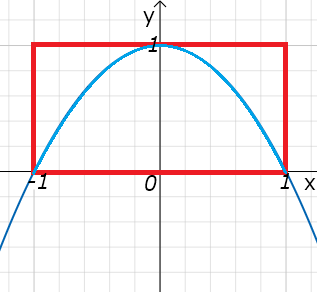</div>

このグラフの「`y`が`0`より上の範囲(赤枠)」の部分を、U字ターンとして使います。

<div style="page-break-after: always"></div>

それでは、`Update`関数に、次のプログラムを追加してください。

```diff
         // 敵が画面の下に消えたら行動終了
         if (Character.Y >= RenderHeight + 64) {
           IsFinished = true;
         }
       }
+      else if (Type == EnemyType::MediumRed) {
+        // U字ターン
+        Character.X += MoveSpeedX * deltaTime;
+
+        float targetY = 384.0f - StartY; // U字の頂点のY座標
+        float t = Timer * 0.5f - 1.0f;
+        Character.Y = (1 - t * t) * targetY + StartY;
+
+        // 敵が画面の上に消えたら行動終了
+        if (Character.Y < -64) {
+          IsFinished = true;
+        }
+      }
     }

     // 敵を描く
     public void Draw(Gdiplus::Graphics& g, Gdiplus::Bitmap* bmp)
```

式`Timer * 0.5f - 1.0f`によって、`timer`の値を`t`の範囲`-1～1`に変換します。<br>
`Timer`が`4`のとき、`t`は`1`になります(`4 * 0.5f - 1.0f = 1`)。<br>
このときグラフの`(1, 0)`の位置にいて、このあとは画面外に出るので「行動終了」となります。

> 動作速度を調整するには`Timer * 0.5f - 1.0f`の`0.5f`の部分を変更します。<br>
> 例えば`0.25f`にすると、グラフの`(1, 0)`に到達するまで8秒かかります。

最後に、「S字カーブ」の移動パターンを作ります。<br>
S字カーブは、`sin`(サイン)関数の式 $ y = sin(x) $ を元にして作ります。

<div align="center">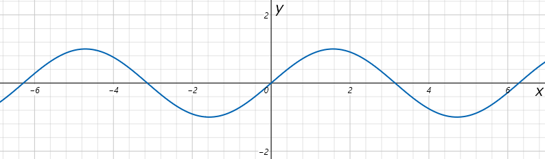</div>

C++では、角度を`0～2π`の「弧度法(こどほう)」で表します(`0～360`の「度数法」ではありません)。<br>
`π`の数値を毎回書くのは大変なので、定数を作りましょう。

<div style="page-break-after: always"></div>

`Game.h`を開き、次のプログラムを追加してください。

```diff
 constexpr int RenderWidth = 1024; // 横のピクセル数
 constexpr int RenderHeight = 896; // 縦のピクセル数
+
+constexpr float Pi = 3.1415926535f; // 円周率

 // ゲーム状態を初期化する
 bool Init();
```

それでは、S字カーブのプログラムに戻りましょう。<br>
U字ターンのプログラムの下に、次の「S字カーブ」のプログラムを追加してください。

```diff
         // 敵が画面の上に消えたら行動終了
         if (Character.Y < -64) {
           IsFinished = true;
         }
       }
+      else if (Type == MediumBlue) {
+        // S字カーブ
+        float a = 5.0f;   // 周波数(振動1回にかかる秒数)
+        float b = 128.0f; // 振幅(ドット数)
+        Character.X = StartX + sinf(Pi * 2.0f * Timer / a) * b;
+
+        Character.Y += MoveSpeedY * deltaTime;
+
+        // 敵が画面の下に消えたら行動終了
+        if (Character.Y >= RenderHeight + 64) {
+          IsFinished = true;
+        }
+      }
     }

     // 敵を描く
     public void Draw(Gdiplus::Graphics& g, Gdiplus::Bitmap* bmp)
```

プログラムが書けたら`>ローカルWindowsデバッガー`ボタンをクリックしてアプリを実行してください。<br>
敵の種類によって、異なるパターンで移動していたら成功です。

<div align="center">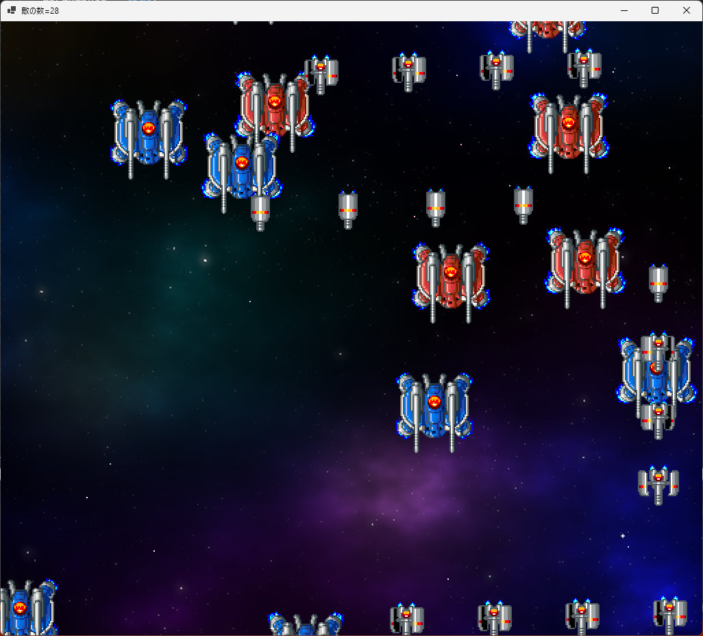</div>

<pre class="tnmai_assignment">
<strong>【課題03 小型で緑色の敵を増やす】</strong>
「小型で緑色の敵」を追加し、以下の移動パターンと発生パターンで発生させなさい。
  アニメーション範囲:
    (0, 176, 32, 32), (32, 176, 32, 32), (64, 176, 32, 32)

  秒間アニメーション枚数:
    8

  移動パターン:
    S字カーブ、X方向の速度=150、周波数=3、振幅=256ドット

  発生パターン:
    縦一列、発生位置=変更しない、次の発生までの時間=0.25秒
</pre>
