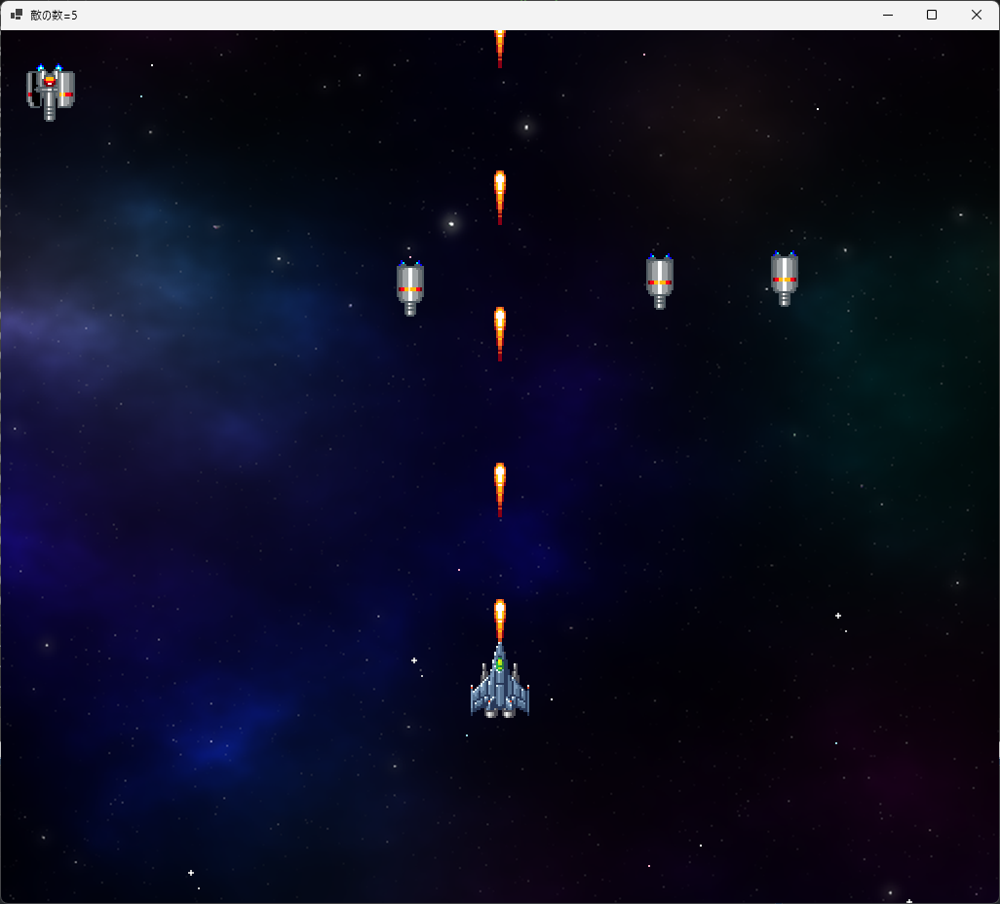
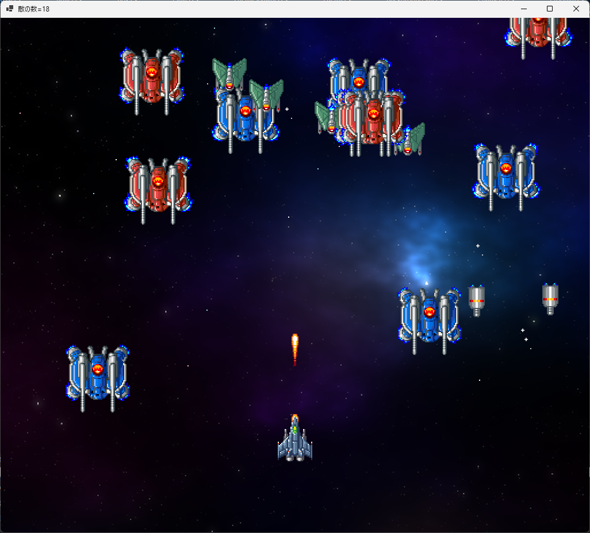

[C++言語2026 後期 第03回]

# プレイヤーを動かす

## 1 プレイヤー(自機)を動かす

&emsp;1回目: 背景の表示、敵の表示、敵のクラス化、敵を増やす<br>
&emsp;2回目: 流れる星の表示、敵を動かす、敵の発生を制御する、敵の行動パターンを増やす<br>
&emsp;**今回: 自機の表示、弾丸を発射する、敵と弾丸の衝突判定、爆発を表示**<br>
&emsp;4回目: 自機のパワーアップ、敵の弾丸を発射する、自機と敵の弾丸の衝突判定、ゲームオーバー、敵の調整<br>
&emsp;5回目: 得点の表示、敵出現順の制御、ボス敵の表示、レベルクリア、レベルを増やす

### 1.1 プレイヤークラスを作る

敵ばかり増えてしまったので、そろそろプレイヤーを登場させましょう。<br>
まず、プレイヤーが操作する機体(=自機)のためのクラスを追加します。

クラス名は`Player`(プレイヤー)とします。<br>
ソリューションエクスプローラーの「ヘッダーファイル」を右クリックして、`Player.h`を追加してください。

`Player`クラスに必要なのは以下の４つです。

* 変数
* コンストラクタ
* 自機の状態を更新する関数
* 自機を描く関数

`Player`クラスを定義して、変数を追加します。`Player.h`に次のプログラムを追加してください。

```diff
 #pragma once
+#include "Character.h"
+
+// 自機クラス
+class Player
+{
+public:
+  Character Character;
+  float MoveSpeed; // 移動速度
+
+  Player() = default; // デフォルトコンストラクタ
+
+  // コンストラクタ
+  Player(float x, float y);
+
+  // 自機の状態を更新する
+  void Update(float deltaTime);
+
+  // 自機を描く
+  void Draw(Gdiplus::Graphics& g, Gdiplus::Bitmap* bmp);
+};
```

### 1.2 コンストラクタを作る

次にコンストラクタを書きます。その前にcppファイルを追加しましょう。<br>
ソリューションエクスプローラーの「ソースファイル」フィルタを右クリックして、`Player.cpp`を追加してください。<br>
`Player.cpp`を開き、次のプログラムを追加してください。

```diff
+#include "Player.h"
+#include "Game.h"
+using namespace Gdiplus;
+    
+// コンストラクタ
+Player::Player(float x, float y)
+{
+  // キャラクターの座標とアニメーションを設定
+  std::vector<Rect> animePlayer = { Rect(0, 464, 32, 48) };
+  Character = { x, y, animePlayer, 0 };
+
+  // 移動速度を設定
+  MoveSpeed = 500.0f;
+}
```

移動速度は秒速500ドットにしておきます。<br>
ウィンドウの幅が`1024`ドットなので、約2秒で端から端へ移動できます。

### 1.3 自機を更新する関数を作る

続いて、自機の状態を更新する関数を書きます。名前は`Update`(アップデート、「更新する」という意味)<br>
とします。`Update`関数では、キー入力によって自機を移動させます。

なお、今回は移動に矢印キーではなく、`W`, `A`, `S`, `D`キーを使います。<br>
一部のキーボードで、矢印キーとスペースバーの同時押しが効かない場合があるからです。<br>
`GetAsyncKeyState`関数で英数字キーの入力を調べるには、<br>
`'A'`のように **大文字** を記号`'`(シングルクォーテーション、`Shift+7`キー)で囲みます。

それでは、コンストラクタの定義の下に、次のプログラムを追加してください。

```diff
   // キャラクターの座標とアニメーションを設定
   Character = { x, y, animePlayer, 0 };

   // 移動速度を設定
   MoveSpeed = 500.0f;
 }
+
+// 自機の状態を更新する
+void Player::Update(float deltaTime)
+{
+  // アニメを更新
+  Character.UpdateAnimeTimer(deltaTime);
+
+  // キー入力に応じて自機を左右に動かす
+  if (GetAsyncKeyState('A') < 0) {
+    Character.X -= MoveSpeed * deltaTime;
+  }
+  else if (GetAsyncKeyState('D') < 0) {
+    Character.X += MoveSpeed * deltaTime;
+  }
+
+  // キー入力に応じて自機を上下に動かす
+  if (GetAsyncKeyState('W') < 0) {
+    Character.Y -= MoveSpeed * deltaTime;
+  }
+  else if (GetAsyncKeyState('S') < 0) {
+    Character.Y += MoveSpeed * deltaTime;
+  }
+}
```

### 1.4 自機を描く関数を作る

続いて、自機を描く関数を作ります。関数名は`Draw`(ドロー、「描く」という意味)とします。<br>
`Update`関数ブロックの下に、`Draw`関数を追加してください。

```diff
   else if (GetAsyncKeyState('S') < 0) {
     Character.Y += MoveSpeed * deltaTime;
   }
 }
+
+// 自機を描く
+void Player::Draw(Gdiplus::Graphics& g, Gdiplus::Bitmap* bmp)
+{
+  Character.Draw(g, bmp);
+}
```

これで、とりあえず使える`Player`クラスが完成しました。

### 1.5 Game.cppにPlayerを追加する

完成した`Player`クラスを`Game.cpp`に組み込みましょう。<br>
`Game.cpp`を開き、`Player.h`をインクルードしてください。

```diff
 #include "BackgroundStar.h"
 #include "Enemy.h"
 #include "EnemySpawner.h"
+#include "Player.h"
 #include <string>
 #include <algorithm>
 #include <objidl.h>
```

次に、敵の変数の宣言の下に、`Player`クラスの変数を宣言してください。

```diff
 // 敵の変数
 std::vector<Enemy> enemyList;
 std::vector<EnemySpawner> enemySpawnerList; // 敵発生装置のリスト
 float enemySpawnTimer = 0.0f; // 敵出現タイマー
+
+// 自機の変数
+Player player(RenderWidth * 0.5f, RenderHeight * 0.75f);

 // 乱数
 std::mt19937 random;
```

自機の座標は、「画面中央より少し下」にしてみました。

次に、`UpdatePlay`関数にある「星を動かす」プログラムの下に、<br>
`Player`クラスの`Update`関数呼び出しを追加してください。

```diff
   if (backgroundY > 0.0f) {
     backgroundY = 0.0f;
   }

   // 背景を流れる星を動かす
   backgroundStar.Update(deltaTime);
+
+  // 自機の状態を更新する
+  player.Update(deltaTime);

   // 敵の状態を更新する
   for (int a = 0; a < enemyList.size(); a++) {
```

続いて、`PaintPlay`関数にある「敵を描く」プログラムの下に、<br>
`Player`クラスの`Draw`関数呼び出しを追加してください。

```diff
   // 敵を描く
   for (int a = 0; a < enemyList.size(); a++) {
     enemyList[a].Draw(g, bmpObjects);
   }
+
+  // 自機を描く
+  player.Draw(g, bmpObjects);
 }

 // クリア状態を描く
 void PaintClear(Graphics& g)
```

プログラムが書けたら`>ローカルWindowsデバッガー`ボタンをクリックしてアプリを実行してください。<br>
敵に混ざって「自機」が表示され、自機を`W`, `A`, `S`, `D`キーで移動できたら成功です。

<div align="center"></div>

### 1.6 自機が画面外に出ないようにする

現在、自機は画面の外側にも移動できます。<br>
自機が見えないと操作が難しいので、画面外に出ないようにしましょう。

例えば、自機の座標が画面の左側に行き過ぎていたら、座標を左端に設定します。<br>
この処理を、上下左右の４方向で行います。<br>
移動可能な範囲は、自機の画像が画面端で見きれないように、画像の横幅を考慮して決めています。

<div style="page-break-after: always"></div>

まずは、横方向の制限を追加しましょう。<br>
`Player.cpp`を開き、自機を動かすプログラムの下に、次のプログラムを追加してください。

```diff
     Character.Y -= MoveSpeed * deltaTime;
   }
   else if (GetAsyncKeyState('S') < 0) {
     Character.Y += MoveSpeed * deltaTime;
   }
+
+  // 画面の横方向の移動範囲を制限する
+  float w = static_cast<float>(Character.AnimeRect[0].Width); // 画像の横幅
+  float minX = w; // X座標の最小値
+  float maxX = RenderWidth - w; // X座標の最大値
+  if (Character.X < minX) {
+    Character.X = minX;
+  }
+  else if (Character.X > maxX) {
+    Character.X = maxX;
+  }
 }

 // 自機を描く
 void Player::Draw(Gdiplus::Graphics& g, Gdiplus::Bitmap* bmp)
```

<pre class="tnmai_assignment">
<strong>【課題01 縦方向の移動範囲を制限する】</strong>
横(X)方向の移動範囲を制限するプログラムの下に、「縦(X)方向」の移動範囲を制限するプログラムを追加しなさい。
プログラムのコメント、必要な変数の名前と値は、以下のようにすること。

  プログラム先頭のコメント: 画面の縦方向の移動範囲を制限する

  画像の高さ:
    変数名 = <code>h</code>
    変数の値 = <code>Character.AnimeRect[0].Height</code>

  Y座標の最小値:
    変数名 = <code>minY</code>(ミン・ワイ)
    変数の値 = <code>h</code>

  Y座標の最大値:
    変数名: <code>maxY</code>(マックス・ワイ)
    変数の値 = <code>RenderHeight - h</code>
</pre>

プログラムが書けたら`>ローカルWindowsデバッガー`ボタンをクリックしてアプリを実行してください。<br>
自機を移動させたとき、画面外に出られなくなっていたら成功です。

<div style="page-break-after: always"></div>

## 2 弾丸を発射する

### 2.1 弾丸クラスを作る

シューティングゲームなので弾丸を発射しましょう。<br>
まずは、弾丸をあらわす`Bullet`(バレット、「弾丸」という意味)クラスを作ります。<br>
ソリューションエクスプローラーの「ヘッダーファイル」フィルタを右クリックし、`Bullet.h`を追加してください。

弾丸にはキャラクター型のメンバ変数と、移動速度メンバ変数を持たせます。<br>
`Bullet.h`を開き、以下の`Bullet`クラスの定義を追加してください。

```diff
 #pragma once
+#include "Character.h"
+
+// 弾丸クラス
+class Bullet
+{
+public:
+  Character Character;
+  float MoveSpeedX; // X方向の移動速度
+  float MoveSpeedY; // Y方向の移動速度
+  bool IsFinished;  // true=行動終了 false=行動中
+
+  Bullet() = default; // デフォルトコンストラクタ
+
+  // コンストラクタ
+  //  x,y=発生位置 sx,sy=移動速度
+  Bullet(float x, float y, float sx, float sy);
+
+  // 弾丸の状態を更新する
+  void Update(float deltaTime);
+
+  // 弾丸を描く
+  void Draw(Gdiplus::Graphics& g, Gdiplus::Bitmap* bmp);
+};
```

変数の構成は、`Enemy`クラスとちょっと似ています。<br>
どちらも移動と終了判定が必要なので、同じような変数が必要なのです。<br>
`IsFinished`(イズ・フィニッシュド)変数は、あとで弾丸をリストから削除するために使います。

<div style="page-break-after: always"></div>

### 2.2 弾丸のコンストラクタを作る

次に、コンストラクタを作ります。ソリューションエクスプローラーを開き、「ソースファイル」フィルタに`Bullet.cpp`を追加してください。`Bullet.cpp`を開き、次のプログラムを追加してください。

```diff
+#include "Bullet.h"
+#include "Game.h"
+using namespace Gdiplus;
+
+// 弾丸のアニメーション範囲
+std::vector<Rect> animePlayerBullet = { Rect(48, 432, 16, 32) };
+
+// コンストラクタ
+//  x,y=発生位置 sx,sy=移動速度
+Bullet::Bullet(float x, float y, float sx, float sy)
+{
+  // キャラクターの座標とアニメーションを設定
+  Character = { x, y, animePlayerBullet, 0 };
+
+  // 移動速度を設定
+  MoveSpeedX = sx;
+  MoveSpeedY = sy;
+
+  // 行動中にする
+  IsFinished = false;
+}
```

### 2.3 弾丸を更新する関数を作る

続いて、弾丸の状態を更新する関数を書きます。名前は`Update`(アップデート)とします。<br>
`Update`関数では、移動速度に合わせて弾丸を移動させます。<br>
コンストラクタブロックの下に、`Update`関数を追加してください。

```diff
   // 移動速度を設定
   MoveSpeedX = sx;
   MoveSpeedY = sy;
 
   // 行動中にする
   IsFinished = false;
 }
+
+// 弾丸の状態を更新する
+void Bullet::Update(float deltaTime)
+{
+  // 動作終了していたら何もしない
+  if (IsFinished) {
+    return;
+  }
+
+  // アニメーションを更新する
+  Character.UpdateAnimeTimer(deltaTime);
+
+  // 弾丸の位置を更新する
+  Character.X += MoveSpeedX * deltaTime;
+  Character.Y += MoveSpeedY * deltaTime;
+}
```

それから、弾丸が画面外に出たら、「行動終了」にします。<br>
`Player`クラスの場合、キャラクターが **ちょっとでも画面外に出ないように** していましたが、<br>
今回は **完全に画面外に出たら** 行動終了にします。

弾丸の位置を更新するプログラムの下に、次のプログラムを追加してください。

> 記号`|`を出すには、`Shift`キーを押しながら、キーボード右上の`￥`キーを押します。

```diff
   // 弾丸の位置を更新する
   Character.X += MoveSpeedX * deltaTime;
   Character.Y += MoveSpeedY * deltaTime;
+
+  // 弾丸のX座標が画面外に出たら行動終了にする
+  float w = static_cast<float>(Character.AnimeRect[0].Width); // 画像の幅
+  float minX = -w; // 画面内と判定されるX座標の最小値
+  float maxX = RenderWidth + w; // 画面内と判定されるX座標の最大値
+  if (Character.X < minX || Character.X > maxX) {
+    IsFinished = true;
+  }
+
+  // 弾丸のY座標が画面外に出たら行動終了にする
+  float h = static_cast<float>(Character.AnimeRect[0].Height); // 画像の高さ
+  float minY = -h; // 画面内と判定されるY座標の最小値
+  float maxY = RenderHeight + h; // 画面内と判定されるY座標の最大値
+  if (Character.Y < minY || Character.Y > maxY) {
+    IsFinished = true;
+  }
 }
```

弾丸の場合、どの端から画面外に出た場合でも`IsFinished`を`true`にします。<br>
そのため、`||`によって条件をまとめられます。

<div style="page-break-after: always"></div>

### 2.4 弾丸を描く関数を作る

続いて、弾丸を描く関数を作ります。関数名は`Draw`(ドロー、「描く」という意味)とします。<br>
`Update`関数ブロックの下に、`Draw`関数を追加してください。

```diff
   if (Character.Y < minY || Character.Y >= maxY) {
     IsFinished = true;
   }
 }
+
+// 弾丸を描く
+void Bullet::Draw(Gdiplus::Graphics& g, Gdiplus::Bitmap* bmp)
+{
+  Character.Draw(g, bmp);
+}
```

これで、弾丸に必要な機能は完成です。

### 2.5 Game.cppにBulletを追加する

完成した`Bullet`クラスを`Game.cpp`クラスに組み込みましょう。<br>
`Game.cpp`を開き、`Bullet.h`をインクルードしてください。

```diff
 #include "BackgroundStar.h"
 #include "Enemy.h"
 #include "EnemySpawner.h"
 #include "Player.h"
+#include "Bullet.h"
 #include <string>
 #include <algorithm>
 #include <objidl.h>
```

次に、自機の変数に`Bullet`クラスの配列を宣言してください。<br>
弾丸の配列の名前は`playerBulletList`(プレイヤー・バレット・リスト)とします。

```diff
 std::vector<EnemySpawner> enemySpawnerList; // 敵発生装置のリスト
 float enemySpawnTimer = 0.0f; // 敵出現タイマー

 // 自機の変数
 Player player(RenderWidth * 0.5f, RenderHeight * 0.75f);
+std::vector<Bullet> playerBulletList; // 自機の弾丸のリスト

 // 乱数
 std::mt19937 random;
```

次に、`UpdatePlay`関数にある「自機の状態を更新する」プログラムの下に、弾丸リストを更新するfor文を追加してください。

```diff
   // 背景を流れる星を動かす
   backgroundStar.Update(deltaTime);

   // 自機の状態を更新する
   player.Update(deltaTime);
+
+  // 自機の弾丸の状態を更新する
+  for (int a = 0; a < playerBulletList.size(); a++) {
+    playerBulletList[a].Update(deltaTime);
+  }
+  playerBulletList.erase(std::remove_if(
+    playerBulletList.begin(), playerBulletList.end(),
+    [](const Bullet& e) { return e.IsFinished; }), playerBulletList.end());

   // 敵の状態を更新する
   for (int a = 0; a < enemyList.size(); a++) {
```

続いて、`PaintPlay`関数にある「敵を描く」プログラムの下に、弾丸リストを描くfor文を追加してください。

```diff
   // 敵を描く
   for (int a = 0; a < enemyList.size(); a++) {
     enemyList[a].Draw(g, bmpObjects);
   }
+
+  // 自機の弾丸を描く
+  for (int a = 0; a < playerBulletList.size(); a++) {
+    playerBulletList[a].Draw(g, bmpObjects);
+  }

   // 自機を描く
   player.Draw(g, bmpObjects);
 }
```

これで、弾丸の移動と表示は完成です。あとは発射するだけです。

<div style="page-break-after: always"></div>

### 2.6 Playerクラスに弾丸発射機能を追加する

`Player`クラスに「弾丸を発射する機能」を追加しましょう。<br>
`Player.h`を開き、`Bullet.h`をインクルードしてください。<br>

```diff
 #pragma once
 #include "Character.h"
+#include "Bullet.h"
 
 // 自機クラス
 class Player
```

次に、`Update`関数のパラメータに弾丸リストを追加してください。

```diff
   // コンストラクタ
   Player(float x, float y);

  // 自機の状態を更新する
- void Update(float deltaTime);
+ void Update(float deltaTime, std::vector<Bullet>& bulletList);

   // 自機を描く
   void Draw(Gdiplus::Graphics& g, Gdiplus::Bitmap* bmp);
 };
```

`Player.cpp`を開き、`Update`関数の定義にもパラメータを追加してください。

```diff
   // 移動速度を設定
   MoveSpeed = 500.0f;
 }

 // 自機の状態を更新する
-void Player::Update(float deltaTime)
+void Player::Update(float deltaTime, std::vector<Bullet>& bulletList)
 {
   // アニメを更新
   Character.UpdateAnimeTimer(deltaTime);
```

<div style="page-break-after: always"></div>

それでは弾丸を発射しましょう。「スペースバー」が押されたら弾丸を発射します。`Update`関数にある<br>
「自機の移動範囲を制限する」プログラムの下に、弾丸を発射するプログラムを追加してください。

```diff
   else if (Character.Y >= maxY) {
     Character.Y = maxY;
   }
+
+  // 弾丸を発射する
+  if (GetAsyncKeyState(VK_SPACE) < 0) {
+    float bulletSpeed = -1200;
+    bulletList.push_back(Bullet(Character.X, Character.Y, 0, bulletSpeed));
+  }
 }

 // 自機を描く
 void Player::Draw(Gdiplus::Graphics& g, Gdiplus::Bitmap* bmp)
```

`Update`関数のパラメータを追加したので、`Game.cpp`にエラーが出てています。`Game.cpp`を開き、<br>
`UpdatePlay`関数にある「自機の状態を更新する」プログラムを、次のように変更してください。

```diff
   // 背景を流れる星を動かす
   backgroundStar.Update(deltaTime);
 
   // 自機の状態を更新する
-  player.Update(deltaTime);
+  player.Update(deltaTime, playerBulletList);
 
   // 自機の弾丸の状態を更新する
   for (int a = 0; a < playerBulletList.size(); a++) {
```

プログラムが書けたら`>ローカルWindowsデバッガー`ボタンをクリックしてアプリを実行してください。<br>
スペースバーを押しているとき、弾丸が発射されたら成功です。

<div align="center"></div>

### 2.7 弾丸の発射間隔を制御する

スペースバーが押されていたら弾丸を発射する設計では、弾丸が棒のようにつながってしまいます。<br>
弾丸に見えないので、次の弾丸を発射するまでの待ち時間を作りましょう。

待ち時間をあらわす変数の名前は、`ShotTimer`(ショット・タイマー、「発射タイマー」という意味)とします。<br>
`Player.h`を開き、次のプログラムを追加してください。

```diff
 {
 public:
   Character Character;
   float MoveSpeed; // 移動速度
+  float ShotTimer; // 弾丸の発射間隔タイマー

   Player() = default; // デフォルトコンストラクタ

   // コンストラクタ
   Player(float x, float y);
```

次に`Player.cpp`を開き、コンストラクタで`ShotTimer`を初期化してください。

```diff
   // キャラクターの座標とアニメーションを設定
   std::vector<Rect> animePlayer = { Rect(0, 464, 32, 48) };
   Character = { x, y, animePlayer, 0 };

   // 移動速度を設定
   MoveSpeed = 500.0f;
+
+  // 弾丸の発射間隔タイマーを初期化
+  ShotTimer = 0.0f;
 }

 // 自機の状態を更新する
 void Player::Update(float deltaTime, std::vector<Bullet>& bulletList)
```

<div style="page-break-after: always"></div>

それでは、発射間隔タイマーを減らして、タイマーが0以下になったら弾丸を発射させましょう。<br>
`Update`関数にある「弾丸を発射する」プログラムを、次のように変更してください。

```diff
   // 弾丸を発射する
   if (GetAsyncKeyState(VK_SPACE) < 0) {
+    // 発射間隔タイマーが 0 以下になったら弾丸を発射
+    ShotTimer -= deltaTime;
+    if (ShotTimer <= 0) {
+      ShotTimer += 0.125f; // 次の発射までの時間を設定
       float bulletSpeed = -1200;
       bulletList.Add(new(Character.X, Character.Y, 0, bulletSpeed));
+    }
   }
+  else {
+    // 発射キーが離されたら発射間隔タイマーを0に戻す
+    ShotTimer = 0.0f;
+  }
 }

 // 自機を描く
 void Player::Draw(Gdiplus::Graphics& g, Gdiplus::Bitmap* bmp)
```

発射キーが離された場合はタイマーを0に戻します。<br>
この初期化がないと、次に発射キーを押したとき、弾丸が出るまで少し時間がかかってしまいます。

プログラムが書けたら`>ローカルWindowsデバッガー`ボタンをクリックしてアプリを実行してください。<br>
スペースバーを押しているとき、弾丸が一定間隔で発射されたら成功です。

<div align="center"></div>

<div style="page-break-after: always"></div>

## 3 衝突判定

### 3.1 長方形クラスを作る

弾丸を撃つのは、敵を倒すためです。弾丸が敵に当たるようにしましょう。<br>
敵と弾丸に「衝突範囲をあらわす長方形」を定めて、２つの長方形の交差状態を調べます。

そのために、衝突判定を行う`Box`(ボックス)クラスを作ります。<br>
ソリューションエクスプローラーの「ヘッダーファイル」フィルタを右クリックし、`Box.h`を追加してください。<br>

さて、長方形の定義は、衝突判定が書きやすい「長方形の４つの辺の座標」形式で作ります。<br>
衝突判定を行うメンバ関数名は、「交差する」の英語`Intersect`(インターセクト)とします。<br>
`Box.h`を開き、`Box`クラスの定義を追加してください。

```diff
 #pragma once
+#include "Character.h"
+
+// 長方形クラス
+class Box
+{
+public:
+  float Left;   // 長方形の左辺のX座標
+  float Right;  // 長方形の右辺のX座標
+  float Top;    // 長方形の上辺のY座標
+  float Bottom; // 長方形の下辺のY座標
+
+  Box() = default; // デフォルトコンストラクタ
+
+  // コンストラクタ
+  Box(float l, float r, float t, float b);
+
+  // ボックス同士の衝突判定
+  // 戻り値: true  衝突している
+  //         false 衝突していない
+  bool Intersect(const Box& other);
+};
```

<div style="page-break-after: always"></div>

### 3.2 長方形のコンストラクタを作る

次は、コンストラクタの定義を書きます。<br>
ソリューションエクスプローラーの「ソースファイル」フィルタを右クリックし、`Box.cpp`を追加してください。<br>
`Box.cpp`を開き、次のプログラムを追加してください。

```diff
+#include "Box.h"
+
+// コンストラクタ
+Box::Box(float l, float r, float t, float b)
+{
+  Left = l;
+  Right = r;
+  Top = t;
+  Bottom = b;
+}
```

コンストラクタでは、４つの辺の座標を設定します。

### 3.3 衝突判定関数を作る

続いて、衝突判定を行う`Intersect`メンバ関数を作ります。<br>
衝突とは「２つ以上の物体が交差している状態」のことです。<br>
この状態を判定するには、長方形`A`と長方形`B`について、以下の４つのif文によって衝突の有無を判定します。

> 1. `A`が`B`より左側にある → 衝突していない
> 2. `A`が`B`の右側にある&emsp;→ 衝突していない
> 3. `A`が`B`より上側にある → 衝突していない
> 4. `A`が`B`の下側にある&emsp;→ 衝突していない
> 5. 上記のどれでもない&emsp;&emsp;&ensp;→ **衝突している！**

<div align="center"></div>

<div style="page-break-after: always"></div>

1と2の左右の判定から作成しましょう。
コンストラクタブロックの下に、`Intersect`関数を追加してください。

```diff
   Left = l;
   Right = r;
   Top = t;
   Bottom = b;
 }
+
+// ボックス同士の衝突判定
+// 戻り値: true  衝突している
+//         false 衝突していない
+bool Box::Intersect(const Box& other)
+{
+  // 1. ボックスがotherより右にあるなら、衝突していない
+  if (Left > other.Right) {
+    return false;
+  }
+
+  // 2. ボックスがotherの左にあるなら、衝突していない
+  if (Right <= other.Left) {
+    return false;
+  }
+
+  // 5. 上記のどれにも当てはまらないなら、衝突している
+  return true;
+}
```

<pre class="tnmai_assignment">
<strong>【課題02 Intersect関数に3と4のif文を追加する】</strong>
<code>Intersect</code>関数に、以下の２つの判定を行うif文を追加しなさい。

  - 3. ボックスがotherより下にあるなら、衝突していない
  - 4. ボックスがotherの上にあるなら、衝突していない
</pre>

### 3.4 敵に衝突判定を追加する

<div align="center"><br>[赤枠が衝突判定]</div>

シューティングゲームでは、多数の敵と弾丸が同時に表示されます。<br>
100体の敵と100発の弾丸が表示されたとすると、それらの衝突判定の回数は100x100で **1万回** になります。

これほど回数が多いと、判定のたびに長方形を作っていては効率が悪いです。<br>
そこで、敵と弾丸の両方に、`Box`クラスの変数を追加します。<br>
これらの作成済み変数を使って衝突判定を行うことで、`Box`作成にかかる時間をなくします。

それでは、弾丸と敵に衝突判定を追加しましょう。<br>
`Enemy.h`を開き、`Box.h`をインクルードしてください。

```diff
 #pragma once
 #include "Character.h"
+#include "Box.h"
 #include "Game.h"

 // 敵の種類
 enum class EnemyType
```

次に、`Enemy`クラスに衝突判定用の変数を追加してください。

```diff
   bool IsFinished;  // true=行動終了 false=行動中
   EnemyType Type;   // 敵の種類
   float Timer;      // 発生からの経過時間(秒)
   float StartX;     // 発生時のX座標
   float StartY;     // 発生時のY座標
+  Box Hitbox;       // 画面左上を原点とする衝突判定
+  Box HitboxLocal;  // キャラ中心を原点とする衝突判定

   Enemy() = default; // デフォルトコンストラクタ

   // コンストラクタ
   Enemy(float x, float y, EnemyType t);
```

`Hitbox`(ヒットボックス)は、実際に使う衝突判定です。<br>
`HitboxLocal`(ヒットボックス・ローカル、「局所的なヒットボックス」という意味)は、<br>
**敵の中心座標を原点(0, 0)とする衝突判定** です。

`Hitbox`は、敵が移動するたびに計算し直す必要があります。<br>
そこで、まずコンストラクタで`HitboxLocal`に「キャラ中心の衝突判定」を設定しておきます。<br>
そして、`Update`関数で`HitboxLocal`と現在の敵の座標を加算して、`Hitbox`に代入します。<br>
この仕組みによって、`Hitbox`変数は常に「画面左上を原点とする現在の衝突判定」になります。

<div style="page-break-after: always"></div>

衝突判定の大きさは、敵の見た目や大きさによって変わってきます。<br>
`Enemy.cpp`を開き、コンストラクタの「キャラクターを作る」部分に、次のプログラムを追加してください。

```diff
   // キャラクターを作る
   if (Type == EnemyType::SmallGray) {
     Character = { x, y, animeSmallGray, 7 };
+    HitboxLocal = { -28, 28, -28, 28 }; // キャラ中心の衝突判定
     MoveSpeedY = 200.0f;
   }
   else if (Type == EnemyType::MediumRed) {
     Character = { x, y, animeMediumRed, 10 };
+    HitboxLocal = { -56, 56, -56, 38 }; // キャラ中心の衝突判定

     // 画面中央より左に発生したら右へ、右に発生したら左へ移動させる
     MoveSpeedX = 50;
     if (x >= RenderWidth * 0.5f) {
```

敵の衝突判定は「見た目より少し小さく」しています。<br>
これは、あとで自機と敵の衝突判定を作るとき、自機と衝突しにくくするためです。

<pre class="tnmai_assignment">
<strong>【課題03 残りの敵の衝突判定を作る】</strong>
以下の２種類の敵に、キャラ中心の衝突判定を作るプログラムを追加しなさい。
    「中型で青色の敵」の衝突判定: (-56, 56, -56, 38)
    「小型で緑色の敵」の衝突判定: (-28, 28, -28, 28)
</pre>

### 3.5 敵の衝突判定を計算する

コンストラクタの最後で、実際の衝突判定を計算します。<br>
コンストラクタに次のプログラムを追加してください。

```diff
   else if (Type == EnemyType::SmallGreen) {
     Character = { x, y, animeSmallGreen, 8 };
     HitboxLocal = { -28, 28, -28, 28 }; // キャラ中心の衝突判定
     MoveSpeedX = 150.0f;
   }
+
+  // 実際の衝突判定を計算
+  Hitbox = {
+    HitboxLocal.Left + Character.X, HitboxLocal.Right + Character.X,
+    HitboxLocal.Top + Character.Y, HitboxLocal.Bottom + Character.Y };
 }

 // 敵の状態を更新する
 void Enemy::Update(float deltaTime)
```

同様に、`Update`関数の最後でも衝突判定を計算します。<br>
`Update`関数にある敵の移動プログラムの下に、次のプログラムを追加してください。

```diff
   else if (Type == EnemyType::SmallGreen) {
     float a = 3.0f; // 周波数(振動1回にかかる秒数)
     float b = 256.0f; // 振幅
     Character.X = SpawnX + MathF.Sin(MathF.PI * 2.0f / a * Timer) * b;
     Character.Y += MoveSpeedY * deltaTime;
 
     // 敵が画面の下に消えたら行動終了
     if (Character.Y >= RenderHeight + 64) {
       IsFinished = true;
     }
   }
+
+  // 実際の衝突判定を更新
+  Hitbox = {
+    HitboxLocal.Left + Character.X, HitboxLocal.Right + Character.X,
+    HitboxLocal.Top + Character.Y, HitboxLocal.Bottom + Character.Y };
 }

 // 敵を描く
 void Enemy::Draw(Gdiplus::Graphics& g, Gdiplus::Bitmap* bmp)
```

これで、敵に衝突判定が付きました。

### 3.6 弾丸の衝突判定を作る

<div align="center"><br>[自機の弾丸の判定は大きくする]</div>

敵の次は、弾丸にも衝突判定を追加します。`Bullet.h`を開き、`Box.h`をインクルードしてください。

```diff
 #pragma once
 #include "Character.h"
+#include "Box.h"

 // 弾丸クラス
 class Bullet
```

`Bullet`クラスに、衝突判定用の変数を追加してください。

```diff
   Character Character;
   float MoveSpeedX; // X方向の移動速度
   float MoveSpeedY; // Y方向の移動速度
   bool IsFinished;  // true=行動終了 false=行動中
+  Box Hitbox;       // 画面左上を原点とする衝突判定
+  Box HitboxLocal;  // キャラ中心を原点とする衝突判定

   Bullet() = default; // デフォルトコンストラクタ

   // コンストラクタ
   //  x,y=発生位置 sx,sy=移動速度
```

次に`Bullet.cpp`を開き、コンストラクタに、キャラ中心の衝突判定を設定するプログラムを追加してください。

```diff
 // コンストラクタ
 //  x,y=発生位置 sx,sy=移動速度
 Bullet::Bullet(float x, float y, float sx, float sy)
 {
   // キャラクターの座標とアニメーションを設定
   Character = { x, y, animePlayerBullet, 0 };
+
+  // キャラ中心の衝突判定を設定
+  HitboxLocal = { -16, 16, -32, 32 };

   // 移動速度を設定
   MoveSpeedX = sx;
   MoveSpeedY = sy;

   // 行動中にする
   IsFinished = false;
+
+  // 実際の衝突判定を計算
+  Hitbox = {
+    HitboxLocal.Left + Character.X, HitboxLocal.Right + Character.X,
+    HitboxLocal.Top + Character.Y, HitboxLocal.Bottom + Character.Y };
 }

 // 弾丸の状態を更新する
 void Bullet::Update(float deltaTime)
```

<div style="page-break-after: always"></div>

続いて、`Update`関数にも、実際の衝突判定を計算するプログラムを追加してください。

```diff
   // 弾丸の位置を更新する
   Character.X += MoveSpeedX * deltaTime;
   Character.Y += MoveSpeedY * deltaTime;
+
+  // 実際の衝突判定を更新
+  Hitbox = {
+    HitboxLocal.Left + Character.X, HitboxLocal.Right + Character.X,
+    HitboxLocal.Top + Character.Y, HitboxLocal.Bottom + Character.Y };

   // 弾丸のX座標が画面外に出たら行動終了にする
   float w = Character.AnimeRect[0].Width; // 画像の幅
   float minX = -w; // 画面内と判定されるX座標の最小値
```

これで、弾丸に衝突判定が付きました。

### 3.7 二重for文による敵と弾丸の衝突判定

敵と弾丸の「画面左上を原点とする衝突判定」を使って、衝突判定を行いましょう。

ひとつの敵ごとに、for文を使ってすべての弾丸との衝突判定を行います。<br>
これを、すべての敵について行います。つまり、 **敵のfor文と弾丸のfor文の二重for文** になります。<br>
`Game.cpp`を開き、`Update`関数の末尾に、敵と弾丸の二重for文を追加してください。

```diff
   extern HWND hWnd;
   std::string text = "敵の数=" + std::to_string(enemyList.size());
   SetWindowTextA(hWnd, text.c_str());
+
+  // 敵と自機の弾丸の衝突判定
+  for (int a = 0; a < enemyList.size(); a++) {
+    Enemy& enemy = enemyList[a];
+
+    // 敵1体ごとに、すべての弾丸との衝突判定を行う
+    for (int b = 0; b < playerBulletList.size(); b++) {
+      Bullet& bullet = playerBulletList[b];
+    } // for playerBulletList
+  } // for enemyList
 }

 // クリア状態を更新する
 //   deltaTime  状態を進める秒数
 void UpdateClear(float deltaTime)
```

衝突判定は、弾丸のfor文の中で行います。弾丸のfor文の中に、次のプログラムを追加してください。

```diff
   // 敵と自機の弾丸の衝突判定
   for (int a = 0; a < enemyList.size(); a++) {
     Enemy& enemy = enemyList[a];
 
     // 敵1体ごとに、すべての弾丸との衝突判定を行う
     for (int b = 0; b < playerBulletList.size(); b++) {
       Bullet& bullet = playerBulletList[b];
+
+      // 敵と弾丸が衝突していたら、両者を終了状態にする
+      if (bullet.Hitbox.Intersect(enemy.Hitbox)) {
+        bullet.IsFinished = true;
+        enemy.IsFinished = true;
+        break; // 弾丸のループを終了する
+      }
     } // for playerBulletList
   } // for enemyList
 }
```

これで、弾丸が的に命中したら、弾丸と敵の両方がいなくなります。

プログラムが書けたら`>ローカルWindowsデバッガー`ボタンをクリックしてアプリを実行してください。<br>
弾丸と敵が衝突したあと、その弾丸も敵も画面から消えたら成功です。

<div align="center"></div>

<div style="page-break-after: always"></div>

### 3.8 敵に耐久値を付ける

どんな大きさの敵も1発で破壊できるのでは、敵の種類を分ける意味が弱くなります。<br>
そこで、敵ごとに異なる耐久値を設定し、弾丸が当たるたびに減らすようにしましょう。

耐久値の変数名は`Hp`(エイチピー、「ヒットポイント、耐久値」という意味)とします。<br>
`Enemy.h`を開き、`Enemy`クラスに`Hp`変数を追加してください。

```diff
   float StartX;     // 発生時のX座標
   float StartY;     // 発生時のY座標
   Box Hitbox;       // 画面左上を原点とする衝突判定
   Box HitboxLocal;  // キャラ中心を原点とする衝突判定
+  int Hp;           // 耐久値

   Enemy() = default; // デフォルトコンストラクタ

   // コンストラクタ
   Enemy(float x, float y, EnemyType t);
```

次に、耐久値を設定します。`Enemy.cpp`を開き、コンストラクタに次のプログラムを追加してください。

```diff
   Type = t; // 敵の種類を設定
   Timer = 0.0f; // 経過時間を0にする
   StartX = x;   // 発生時のX座標を記録
   StartY = y;   // 発生時のY座標を記録
+  Hp = 1;       // 基本の耐久値を設定

   // キャラクターを作る
   if (Type == EnemyType::SmallGray) {
```

敵の種類に関わらず、とりあえず`1`の耐久値を設定しておきます。これは、小型の敵の耐久値になります。

中型以上の敵には、個別に耐久値を設定します。<br>
コンストラクタにある「中型で赤色の敵」を作るプログラムに、耐久値を設定するプログラムを追加してください。

```diff
   else if (Type == EnemyType::MediumRed) {
     Character = { x, y, animeMediumRed, 10 };
     HitboxLocal = { -56, 56, -56, 56 }; // キャラ中心の衝突判定
+    Hp = 8;
+
     // 画面中央より左に発生したら右へ、右に発生したら左へ移動させる
     MoveSpeedX = 50;
     if (x >= RenderWidth * 0.5f) {
```

<pre class="tnmai_assignment">
<strong>【課題04 中型で青色の敵の耐久値を設定する】</strong>
中型で青色の敵について、耐久値を<code>10</code>に設定するプログラムを追加しなさい。
</pre>

耐久値を作ったので、衝突判定を耐久値に対応させます。<br>
`Game.cpp`を開き、`UpdatePlay`関数にある「敵と弾丸の衝突判定」プログラムに、<br>
次のプログラムを追加してください。

```diff
       // 敵と弾丸が衝突していたら、両者を終了状態にする
       if (bullet.Hitbox.Intersect(enemy.Hitbox)) {
         bullet.IsFinished = true;
+        enemy.Hp -= 1; // 敵のHPを減らす
+
+        // HPが0以下になった敵を破壊する
+        if (enemy.Hp <= 0) {
           enemy.IsFinished = true;
           break; // 弾丸のループを終了する
+        }
       }
     } // for playerBulletList
   } // for enemyList
```

プログラムが書けたら`>ローカルWindowsデバッガー`ボタンをクリックしてアプリを実行してください。<br>
中型の敵が１発では消えなくなっていたら成功です。

<div align="center"></div>

<div style="page-break-after: always"></div>

### 3.9 爆発を表示する

敵を倒したとき、ただ消えてしまうのは味気ないです。<br>
そこで、敵を消すのと同時に、爆発アニメーションを表示しましょう。

まず、爆発を管理するためのリストを作ります。<br>
変数名は`effectList`(エフェクト・リスト、「演出効果リスト」という意味)とします。<br>
`Game.cpp`を開き、自機の変数の宣言の下に、次の変数宣言を追加してください。

```diff
 // 自機の変数
 Player player(RenderWidth * 0.5f, RenderHeight * 0.75f);
 std::vector<Bullet> playerBulletList;
+
+// 爆発などのエフェクトのリスト
+std::vector<Character> effectList;
+
+// 小さな爆発のアニメーション範囲
+std::vector<Rect> animeSmallBlast = {
+  Rect(848, 384, 16, 16), Rect(864, 368, 32, 32), Rect(896, 368, 32, 32),
+  Rect(928, 368, 32, 32), Rect(960, 368, 32, 32), Rect(992, 368, 32, 32),
+};

 // 乱数
 std::mt19937 random;
```

次に、エフェクトの状態を更新するプログラムを書きます。<br>
`UpdatePlay`関数にある「敵発生装置を更新する」プログラムの下に、次のプログラムを追加してください。

```diff
   extern HWND hWnd;
   std::string text = "敵の数=" + std::to_string(enemyList.size());
   SetWindowTextA(hWnd, text.c_str());
+
+  // エフェクトを更新する
+  for (int a = 0; a < effectList.size(); a++) {
+    effectList[a].UpdateAnimeTimer(deltaTime);
+  }

   // 敵と自機の弾丸の衝突判定
   for (int a = 0; a < enemyList.size(); a++) {
     Enemy& enemy = enemyList[a];
```

<div style="page-break-after: always"></div>

続いて、エフェクトを描きます。<br>
`PaintPlay`関数にある「敵を描く」プログラムの下に、エフェクトを描くプログラムを追加してください。

```diff
   // 敵を描く
   for (int a = 0; a < enemyList.size(); a++) {
     enemyList[a].Draw(g, bmpObjects);
   }
+
+  // エフェクトを描く
+  for (int a = 0; a < effectList.size(); a++) {
+    effectList[a].Draw(g, bmpObjects);
+  }

   // 自機の弾丸を描く
   for (int a = 0; a < playerBulletList.size(); a++) {
```

最後に、敵を破壊したときに爆発エフェクトを表示します。<br>
`UpdatePlay`関数にある「敵と弾丸の衝突判定」プログラムに、次のプログラムを追加してください。

```diff
         // HPが0以下になった敵を破壊する
         if (enemy.Hp <= 0) {
           enemy.IsFinished = true;
+
+          // 爆発エフェクトを追加する
+          Character c = { enemy.Character.X, enemy.Character.Y, animeSmallBlast, 15 };
+          effectList.push_back(c);
+
           break; // 弾丸のループを終了する
         }
       }
```

プログラムが書けたら`>ローカルWindowsデバッガー`ボタンをクリックしてアプリを実行してください。<br>
敵を破壊したとき爆発アニメーションが表示されたら成功です。

<div align="center"></div>

### 3.10 アニメーションを停止する

現在、爆発アニメーションが繰り返し再生されて、ずっと画面に残り続けています。<br>
邪魔で仕方ないので、一度のアニメーションで終わるようにします。<br>
そのために、キャラクタークラスに、アニメーションの繰り返しを制御する機能を追加します。

繰り返しを制御するために、以下の２つの変数を追加します。

* **AnimeIsLoop**(アニメ・イズ・ループ、「アニメは繰り返すか？」という意味)<br>
  `true`だと「繰り返し再生」、`false`だと「一度だけ再生」になる
* **AnimeIsEnd**(アニメ・イズ・エンド、「アニメは終わったか？」という意味)<br>
  `AnimeIsLoop`が`false`の場合、再生が終わったら`true`を設定する<br>
  `AnimeIsLoop`が`true`の場合はずっと`false`のまま

`Character.h`を開き、`Character`クラスに次の変数を追加してください。

```diff
   float Y; // Y座標
   std::vector<Rect> AnimeRect; // アニメーション表示する範囲の配列
   float AnimeTimestep;   // 1秒間にアニメーションが切り替わる枚数
   float AnimeTimer;      // アニメーション制御タイマー(秒)
+  bool AnimeIsLoop;      // true=アニメを繰り返し再生 false=アニメを1回だけ再生
+  bool AnimeIsEnd;       // true=アニメ終了 false=アニメ実行中

   Character() = default; // デフォルトコンストラクタ

   // コンストラクタ
     const std::vector<Rect>& animeRect, float timestep)
   {
     X = x;
     Y = y;
     AnimeRect = animeRect;
     AnimeTimestep = timestep;
     AnimeTimer = 0.0f;
+    AnimeIsLoop = true;
+    AnimeIsEnd = false;
   }

   // アニメーションを更新する
   //   deltaTime  状態を進める秒数
   void UpdateAnimeTimer(float deltaTime)
```

<div style="page-break-after: always"></div>

それでは、追加した変数を使って繰り返しを制御しましょう。<br>
`UpdateAnimeTimer`関数に、次のプログラムを追加してください。

```diff
   // アニメーションを更新する
   //   deltaTime  状態を進める秒数
   void UpdateAnimeTimer(float deltaTime)
   {
+    // アニメが終了していたら何もしない
+    if (AnimeIsEnd) {
+      return;
+    }
+
     // タイマーを進める
     AnimeTimer += AnimeTimestep * deltaTime;
 
     // タイマーの数値が画像枚数以上になったら最初に戻す
     if (AnimeTimer >= AnimeRect.Length) {
+      if (AnimeIsLoop) {
         AnimeTimer -= AnimeRect.Length;
+      }
+      else {
+        AnimeIsEnd = true; // 再生終了
+        AnimeTimer = static_cast<float>(AnimeRect.size()) - 1; // タイマーを「最後のコマ」に設定
+      }
     }
   }
```

アニメーションを止められるようになったので、爆発を「一度だけ再生」するようにしましょう。<br>
`Game.cpp`を開き、`UpdatePlay`関数にある「爆発エフェクトを追加する」プログラムに、<br>
次のプログラムを追加してください。

```diff
         if (enemy.Hp <= 0) {
           enemy.IsFinished = true;

           // 爆発エフェクトを追加する
           Character c = { enemy.Character.X, enemy.Character.Y, animeSmallBlast, 15);
+          c.AnimeIsLoop = false; // 一度だけ再生する
           effectList.push_back(c);

           break; // 弾丸のループを終了する
         }
```

<div style="page-break-after: always"></div>

最後に、再生が終わった爆発エフェクトを削除します。
`UpdatePlay`関数にある「エフェクトを更新する」プログラムの下に、次のプログラムを追加してください。

```diff
   // エフェクトを更新する
   for (int a = 0; a < effectList.size(); a++) {
     effectList[a].UpdateAnimeTimer(deltaTime);
   }
+  effectList.erase(std::remove_if(effectList.begin(), effectList.end(),
+    [](const Character& e) { return e.AnimeIsEnd; }), effectList.end());

   // 敵と自機の弾丸の衝突判定
   for (int a = 0; a < enemyList.size(); a++) {
```

プログラムが書けたら`>ローカルWindowsデバッガー`ボタンをクリックしてアプリを実行してください。<br>
爆発アニメーションが一度だけ再生され、画面から消えたら成功です。

<div align="center"></div>

<pre class="tnmai_assignment">
<strong>【課題05 中くらいの爆発アニメーションを作る】</strong>
<code>Game.cpp</code>に中くらいの爆発のアニメーション範囲の変数を追加しなさい。

  アニメーション範囲の変数名: <code>animeMediumBlast</code>
  アニメーション範囲:
    (832, 384, 16, 16), (800, 368, 32, 32), (752, 368, 48, 48),
    (704, 368, 48, 48), (656, 368, 48, 48),
  秒間アニメーション枚数: 10
</pre>

<pre class="tnmai_assignment">
<strong>【課題06 中型の敵を倒したとき、中くらいの爆発を表示する】</strong>
<code>Game.cpp</code>にある「爆発エフェクトを追加する」プログラムについて、
if文を使って、「敵の種類に応じて爆発の種類を変える」プログラムを追加しなさい。

  <code>enemy.Type</code>が⋯
    <code>MediumRed</code>または<code>MediumBlue</code>の場合: <code>animeMediumBlast</code>を表示
    上記以外の場合: <code>animeSmallBlast</code>を表示
</pre>
