[C++言語2026 後期 第04回]

# 自機の強化と敵の攻撃

## 1 自機のパワーアップ

&emsp;1回目: 背景の表示、敵の表示、敵のクラス化、敵を増やす<br>
&emsp;2回目: 流れる星の表示、敵を動かす、敵の発生を制御する、敵の行動パターンを増やす<br>
&emsp;3回目: 自機の表示、弾丸を発射する、敵と弾丸の衝突判定、爆発を表示<br>
&emsp;**今回: 自機のパワーアップ、敵の弾丸を発射する、自機と敵の弾丸の衝突判定、ゲームオーバー、敵の調整**<br>
&emsp;5回目: 得点の表示、敵出現順の制御、ボス敵の表示、レベルクリア、レベルを増やす

### 1.1 自機にパワーアップ機能を追加する

発生する敵の数が多くなると、敵を撃ちきれない状況になりがちです。<br>
そこで、パワーアップアイテムを出して、自機の攻撃力を上げましょう。<br>
パワーアップのためには、`Player`クラスに以下の変数を追加する必要があります。

* 「攻撃の段階」をあらわす変数
* 衝突判定

「攻撃の段階」をあらわす変数の名前は`ShotLevel`(ショット・レベル、「発射の段階」という意味)とします。
衝突判定は、「パワーアップアイテムとの衝突」を判定するために使います。<br>
また、後で作る「自機と敵の弾丸との衝突判定」にも使う予定です。<br>
それでは、`Player.h`を開き、次の変数を追加してください。

```diff
   Character Character;
   float MoveSpeed; // 移動速度
   float ShotTimer; // 弾丸の発射間隔タイマー
+  int ShotLevel;   // 弾丸の発射レベル
+  Box Hitbox;      // 画面左上を原点とする衝突判定
+  Box HitboxLocal; // キャラ中心を原点とする衝突判定

   Player() = default; // デフォルトコンストラクタ

   // コンストラクタ
   Player(float x, float y);
```

次に`Player.cpp`を開き、コンストラクタに、発射レベルと衝突判定を計算するプログラムを追加してください。

```diff
   // 移動速度を設定
   MoveSpeed = 500;

   // 弾丸の発射間隔タイマーを初期化
   ShotTimer = 0.0f;
+
+  // 発射レベルを初期化
+  ShotLevel = 0;
+
+  // 実際の衝突判定を計算
+  HitboxLocal = { -8, 8, 12, 12 }; // キャラ中心の衝突判定
+  Hitbox = {
+    HitboxLocal.Left + Character.X, HitboxLocal.Right + Character.X,
+    HitboxLocal.Top + Character.Y, HitboxLocal.Bottom + Character.Y };
 }

 // プレイヤーを更新する
 void Player::Update(float deltaTime, std::vector<Bullet>& bulletList)
```

自機の衝突判定は小さめにしています。<br>
これは、後で敵や敵弾との衝突判定を行うとき、衝突しにくくするためです。

<div align="center">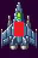<br>[自機の判定は小さくする]</div>

続いて、`Update`関数の最後に、衝突判定を更新するプログラムを追加してください。

```diff
   else if (Character.Y > maxY) {
     Character.Y = maxY;
   }
+
+  // 実際の衝突判定を更新
+  Hitbox = {
+    HitboxLocal.Left + Character.X, HitboxLocal.Right + Character.X,
+    HitboxLocal.Top + Character.Y, HitboxLocal.Bottom + Character.Y };

   // 弾丸を発射する
   if (GetAsyncKeyState(VK_SPACE) < 0) {
     // 発射間隔タイマーが 0 以下になったら弾丸を発射
```

それから、レベルに応じて発射する弾丸を増やすように、弾丸を発射するプログラムを変更します。<br>
`Update`関数にある弾丸を発射するプログラムを、次のように変更してください。

```diff
     ShotTimer -= deltaTime;
     if (ShotTimer <= 0.0f) {
       ShotTimer += 0.125f; // 次の発射までの時間を設定
       float bulletSpeed = -1200;
+
+      // レベルに合わせて発射数を増やす
+      for (int a = 0; a <= ShotLevel; a++) {
+        // 発射位置を計算
+        const float x = static_cast<float>(a * 32 - ShotLevel * 16);
-        bulletList.push_back(Bullet(Character.X, Character.Y, 0, bulletSpeed));
+        bulletList.push_back(Bullet(Character.X + x, Character.Y, 0, bulletSpeed));
+      }
     }
```

レベルが0のときは1発、レベルが1のときは2発というように、発射レベルごとに発射数が1発ずつ増やしています。<br>
また、同じ位置から複数の弾丸を発射しても、パワーアップしたようには見えません。<br>
そこで、レベルに合わせて、弾丸の発射位置を少しずつずらしています。

### 1.2 パワーアップアイテムを追加する

<div align="center"></div>

続いて、パワーアップ用のアイテムをあらわすクラスを作ります。クラス名は`Item`(アイテム)とします。<br>
ソリューションエクスプローラーの「ヘッダーファイル」フィルタを右クリックし、`Item.h`を追加してください。

`Item.h`を開き、次の`Item`クラスの定義を追加してください。

```diff
 #pragma once
+#include "Character.h"
+#include "Box.h"
+
+// アイテムクラス
+class Item
+{
+public:
+  Character Character;
+  bool IsFinished; // true=行動終了 false=行動中
+  Box Hitbox;      // 画面左上を原点とする衝突判定
+  Box HitboxLocal; // キャラ中心を原点とする衝突判定
+
+  Item() = default; // デフォルトコンストラクタ
+
+  // コンストラクタ
+  Item(float x, float y);
+
+  // アイテムの状態を更新する
+  void Update(float deltaTime);
+
+  // アイテムを描く
+  void Draw(Gdiplus::Graphics& g, Gdiplus::Bitmap* bmp);
+};
```

### 1.3 アイテムのコンストラクタを作る

メンバ関数を作成するために、CPPファイルを追加します。<br>
ソリューションエクスプローラーの「ソースファイル」フィルタを右クリックし、`Item.cpp`を追加してください。<br>
追加したファイルを開き、コンストラクタの定義を追加してください。

```diff
+#include "Item.h"
+#include "Game.h"
+using namespace Gdiplus;
+
+// アイテムのアニメーション範囲
+const std::vector<Rect> animeItem = { Rect(320, 480, 32, 32) };
+
+// コンストラクタ
+Item::Item(float x, float y)
+{
+  Character = { x, y, animeItem, 0 };
+  IsFinished = false;
+
+  // 実際の衝突判定を計算
+  HitboxLocal = { -40, 48, -48, 40 }; // キャラ中心の衝突判定
+  Hitbox = {
+    HitboxLocal.Left + Character.X, HitboxLocal.Right + Character.X,
+    HitboxLocal.Top + Character.Y, HitboxLocal.Bottom + Character.Y };
+}
```

アイテムの衝突判定の大きさは、画像サイズより大きくしています。<br>
プレイヤーの衝突判定が小さめなので、アイテム側は少し大きくしないと衝突が難しくなるからです。

<div align="center"></div>

<div style="page-break-after: always"></div>

### 1.4 アイテムを動かす関数を作る

アイテムは、画面の上から下に向かってゆっくりと移動させ、画面下に消えたら行動終了とします。<br>
この動きを行う`Update`(アップデート)関数を定義しましょう。<br>
コンストラクタの定義の下に、`Update`関数の定義を追加してください。

```diff
   // 実際の衝突判定を計算
   HitboxLocal = { -40, 48, -48, 40 }; // キャラ中心の衝突判定
   Hitbox = {
     HitboxLocal.Left + Character.X, HitboxLocal.Right + Character.X,
     HitboxLocal.Top + Character.Y, HitboxLocal.Bottom + Character.Y };
 }
+
+// アイテムの状態を更新する
+void Item::Update(float deltaTime)
+{
+  // 動作終了していたら何もしない
+  if (IsFinished) {
+    return;
+  }
+
+  // アニメを更新
+  Character.UpdateAnimeTimer(deltaTime);
+
+  // アイテムを毎秒100ドットの速度で下に移動
+  Character.Y += 100 * deltaTime;
+
+  // アイテムが画面下に消えたら動作終了
+  if (Character.Y >= RenderHeight + Character.AnimeRect[0].Height) {
+    IsFinished = true;
+  }
+
+  // 実際の衝突判定を更新
+  Hitbox = {
+    HitboxLocal.Left + Character.X, HitboxLocal.Right + Character.X,
+    HitboxLocal.Top + Character.Y, HitboxLocal.Bottom + Character.Y };
+}
```

<div style="page-break-after: always"></div>

### 1.5 アイテムを描く関数を作る

続いて、アイテムを描く関数を追加します。関数名は`Draw`(ドロー、「描く」という意味)とします。<br>
`Update`関数ブロックの下に、`Draw`関数を追加してください。

```diff
   Hitbox = {
     HitboxLocal.Left + Character.X, HitboxLocal.Right + Character.X,
     HitboxLocal.Top + Character.Y, HitboxLocal.Bottom + Character.Y };
 }
+
+// アイテムを描く
+void Item::Draw(Gdiplus::Graphics& g, Gdiplus::Bitmap* bmp)
+{
+  Character.Draw(g, bmp);
+}
```

これで、アイテムクラスは完成です。

### 1.6 Game.cppにアイテムを追加する

完成した`Item`クラスをゲームに組み込みましょう。アイテムは複数発生する可能性があるので配列にします。

変数名は`itemList`(アイテム・リスト、「アイテムのリスト」という意味)とします。<br>
`Game.cpp`を開き、`Item.h`をインクルードしてください。

```diff
 #include "EnemySpawner.h"
 #include "Player.h"
 #include "Bullet.h"
+#include "Item.h"
 #include <string>
 #include <algorithm>
```

それでは変数を宣言しましょう。自機の変数を宣言するプログラムに、`Item`の配列を追加してください。<br>

```diff
 // 自機の変数
 Player player(RenderWidth * 0.5f, RenderHeight * 0.75f);
 std::vector<Bullet> playerBulletList; // 自機の弾丸のリスト
+std::vector<Item> itemList; // アイテムのリスト

 // 爆発などのエフェクトのリスト
 std::vector<Character> effectList;
```

次に、追加したアイテムリストの状態を更新るプログラムを書きます。<br>
`UpdatePlay`関数にある「自機の弾丸の状態を更新する」プログラムの下に、<br>
アイテムリストを更新するfor文を追加してください。

```diff
   playerBulletList.erase(std::remove_if(
     playerBulletList.begin(), playerBulletList.end(),
     [](const Bullet& e) { return e.IsFinished; }), playerBulletList.end());
+
+  // アイテムの状態を更新する
+  for (int a = 0; a < itemList.size(); a++) {
+    itemList[a].Update(deltaTime);
+  }
+  itemList.erase(std::remove_if(
+    itemList.begin(), itemList.end(),
+    [](const Item& e) { return e.IsFinished; }), itemList.end());

   // 敵の状態を更新する
   for (int a = 0; a < enemyList.size(); a++) {
```

続いて、`PaintPlay`関数にある「敵を描く」プログラムの下に、アイテムリストを描くfor文を追加してください。

```diff
   // 敵を描く
   for (int a = 0; a < enemyList.size(); a++) {
     enemyList[a].Draw(g, bmpObjects);
   }
+
+  // アイテムを描く
+  for (int a = 0; a < itemList.size(); a++) {
+    itemList[a].Draw(g, bmpObjects);
+  }

   // エフェクトを描く
   for (int a = 0; a < effectList.size(); a++) {
     effectList[a].Draw(g, bmpObjects);
```

### 1.7 アイテムを出現させる

準備ができたので、アイテムを出現させましょう。<br>
2Dシューティングゲームの「アイテムを出現させる条件」には、以下のようなものがあります。

* 一定時間、あるいは一定距離進むごとに出現
* あらかじめマップの特定の場所に配置されている
* 特定の種類の敵を倒す、または敵編隊を全滅させると出現
* 一定のスコアを得るごとに出現

今回は作るのが簡単な「一定距離進むごとに出現」させるルールを使います。<br>
進んだ距離は`backgroundY`を調べれば分かります。<br>
そこで、`backgroundY`を`500`で割ったあまりが`-100`になったら、アイテムを出現させます。<br>

>「割られる数」がマイナスの場合、「あまり」もマイナスになります。

なお、`500`や`-100`という数値は、レベル全体で６個のアイテムが出現する数値として、<br>
背景画像の移動量である`2688`(3画面分の高さ)ドットから逆算しました。

それでは、`UpdatePlay`関数にある、アイテムの状態を更新するプログラムの下に、<br>
アイテムを出すプログラムを追加してください。

```diff
   itemList.erase(std::remove_if(
     itemList.begin(), itemList.end(),
     [](const Item& e) { return e.IsFinished; }), itemList.end());
+
+  // アイテムを出現させる
+  if (static_cast<int>(backgroundY) % 500 == -100) {
+    float x = std::uniform_real_distribution<float>(128, RenderWidth - 128)(random);
+    float y = std::uniform_real_distribution<float>(-RenderHeight, -16)(random);
+    itemList.push_back(Item(x, y));
+  }

   // 敵の状態を更新する
   for (int a = 0; a < enemyList.size(); a++) {
```

アイテムの発生範囲のX座標は、左右端128ドットを除外した範囲としました。<br>
128ドットを除外したのは、 **アイテムが画面端に出ると取りづらい** からです。<br>
Y座標は、ほぼ「画面の高さ」の範囲です。これは、 **画面に現れるタイミングをずらす** ためです。

プログラムが書けたら`>ローカルWindowsデバッガー`ボタンをクリックしてアプリを実行してください。<br>
ゲーム開始後しばらくして、画面上からアイテムが出現したら成功です。

### 1.8 アイテムを取る

プレイヤーとアイテムの衝突判定を書いて、パワーアップを完成させましょう。<br>
プレイヤーはひとつだけなので、単純なfor文で判定できます。<br>
アイテムを出現させるプログラムの下に、アイテムとプレイヤーの衝突判定を追加してください。

```diff
   if (static_cast<int>(backgroundY) % 500 == -100) {
     float x = std::uniform_real_distribution<float>(128, RenderWidth - 128)(random);
     float y = std::uniform_real_distribution<float>(-RenderHeight, -16)(random);
     itemList.push_back(Item(x, y));
   }
+
+  // アイテムとプレイヤーの衝突判定
+  for (int a = 0; a < itemList.size(); a++) {
+    Item& item = itemList[a];
+    if (item.Hitbox.Intersect(player.Hitbox)) {
+      // 衝突したらアイテムを消して、弾丸レベルを上げる
+      item.IsFinished = true;
+      const int maxShotLevel = 4; // 最大レベル
+      if (player.ShotLevel < maxShotLevel) {
+        player.ShotLevel++;
+      }
+    }
+  } // for itemList

   // 敵の状態を更新する
   for (int a = 0; a < enemyList.size(); a++) {
```

プログラムが書けたら`>ローカルWindowsデバッガー`ボタンをクリックしてアプリを実行してください。<br>
アイテムを取得するたびに、弾丸の同時発射数が増えたら成功です。

<div align="center">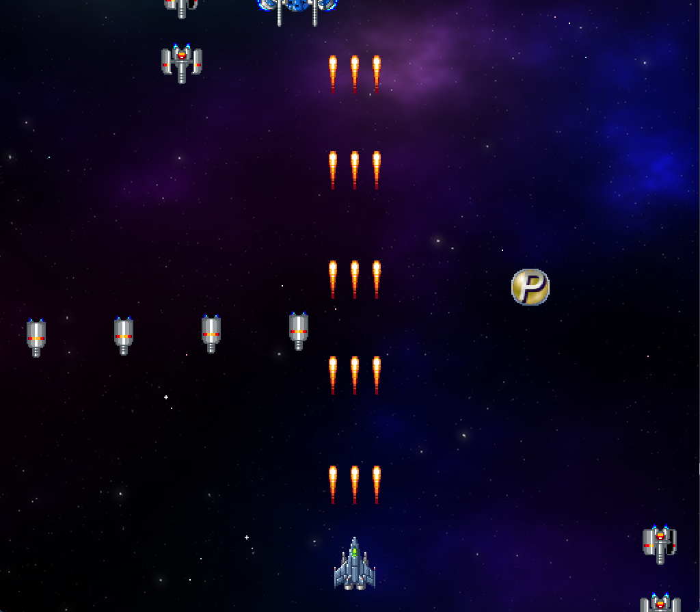</div>

<pre class="tnmai_assignment">
<strong>【課題01 アイテムの出現数を減らす】</strong>
現在、レベルには６個ものアイテムが出現するので、すぐに最大レベルになってしまいます。
アイテムが４個だけ出現するように、出現間隔を調整しなさい。
出現間隔を変更するには、余りを求める式の数値<code>500</code>を変更します。
数値を小さくすると間隔が短くなり、数値を大きくすると間隔が長くなります。
</pre>

<pre class="tnmai_assignment">
<strong>【課題02 敵の耐久値を増やす】</strong>
パワーアップすると、中型の敵を簡単に倒せてしまいます。
これは、敵の耐久値が「自機のパワーアップ」を考慮していないためです。
中型で赤色の敵の耐久値を<code>20</code>に、中型で青色の敵の耐久値を<code>30</code>に変更しなさい。
</pre>

<div style="page-break-after: always"></div>

## 2 敵の弾丸

### 2.1 弾丸を発射する砲塔クラスを作る

ゲームを面白くするために、敵の攻撃を追加して、「弾丸を避ける遊び方」ができるようにしましょう。<br>
まず弾丸を発射するクラスを作ります。クラス名は`Turret`(ターレット、「砲塔(ほうとう)」という意味)とします。<br>
ソリューションエクスプローラーの「ヘッダーファイル」フィルタを右クリックし、`Turret.h`を追加してください。

今回作成する砲塔は、指定された時間間隔で、真下に1発の弾丸を発射します。<br>
まずはクラスを定義し、変数とメンバ関数宣言を追加します。発射間隔は`Interval`(インターバル、<br>
「間隔」という意味)、弾丸の速度は`BulletSpeed`(バレット・スピード、「弾丸の速度」という意味)とします。

`Turret.h`を開き、次のプログラムを追加してください。

```diff
 #pargma once
+#include "Bullet.h"
+
+// 砲塔クラス
+class Turret
+{
+public:
+  float Interval;    // 発射間隔(秒)
+  float BulletSpeed; // 弾丸の速度
+  float Timer;       // 発射タイマー
+
+  Turret() = default; // デフォルトコンストラクタ
+
+  // コンストラクタ
+  Turret(float interval, float speed);
+
+  // 砲塔の状態を更新する
+  void Update(float deltaTime,
+    const Character& character, std::vector<Bullet>& bulletList);
+};
```

<div style="page-break-after: always"></div>

### 2.2 砲塔のコンストラクタを作る

次にコンストラクタを書きます。ソリューションエクスプローラーの「ソースファイル」フィルタを右クリックし、<br>
`Turret.cpp`を追加してください。追加した`Turret.cpp`を開き、次のプログラムを追加してください。

```diff
+#include "Turret.h"
+
+// コンストラクタ
+Turret::Turret(float interval, float speed)
+{
+  Interval = interval;
+  BulletSpeed = speed;
+  Timer = 0.0f;
+}
```

### 2.3 砲塔の状態を更新する関数を作る

続いて、砲塔の状態を更新する`Update`(アップデート)関数を作ります。<br>
`Update`関数では、タイマーを進めて、発射時間になったら弾丸リストに弾丸を追加します。<br>
コンストラクタの定義の下に、次の`Update`関数を追加してください。

```diff
   Interval = interval;
   BulletSpeed = speed;
   Timer = 0.0f;
 }
+
+// 砲塔の状態を更新する
+void Turret::Update(float deltaTime,
+  const Character& character, std::vector<Bullet>& bulletList)
+{
+  // 発射までの時間が残っていたら何もしない
+  Timer -= deltaTime;
+  if (Timer > 0.0f) {
+    return;
+  }
+
+  // 発射タイマーの時間を戻す
+  Timer += Interval;
+
+  // 弾丸を発射
+  bulletList.push_back(Bullet(character.X, character.Y, 0, BulletSpeed));
+}
```

これで、`Turret`クラスは完成です。

### 2.4 Enemyクラスに砲塔を追加する

完成した`Turret`クラスを敵に追加しましょう。
`Enemy.h`を開き、`Turret.h`をインクルードしてください。

```diff
 #pragma once
 #include "Character.h"
 #include "Box.h"
 #include "Game.h"
+#include "Turret.h"

 // 敵の種類
 enum class EnemyType
```

次に、砲塔のリストを追加します。<br>
変数名は`TurretList`(ターレット・リスト、「砲塔のリスト」という意味)とします。<br>
`Turret`クラスの変数宣言に、砲塔リストの変数宣言を追加してください。

```diff
   float StartX;     // 発生時のX座標
   float StartY;     // 発生時のY座標
   Box Hitbox;       // 画面左上を原点とする衝突判定
   Box HitboxLocal;  // キャラ中心を原点とする衝突判定
   int Hp;           // 耐久値
+  std::vector<Turret> TurretList; // 砲塔のリスト

   Enemy() = default; // デフォルトコンストラクタ

   // コンストラクタ
   Enemy(float x, float y, EnemyType t);
```

次に、砲塔を作成します。`Enemy.cpp`を開き、コンストラクタに、砲塔を作るプログラムを追加してください。

```diff
   Type = t; // 敵の種類を設定
   Timer = 0.0f; // 経過時間を0にする
   StartX = x;   // 発生時のX座標を記録
   StartY = y;   // 発生時のY座標を記録
   Hp = 1;       // 基本の耐久値を設定
+
+  // 砲塔を追加する
+  TurretList.push_back(Turret(2.0f, 300.0f));

   // キャラクターを作る
   if (Type == EnemyType::SmallGray) {
```

続いて、砲塔を更新するプログラムを追加します。ただし、砲塔を更新するには「弾丸のリスト」が必要です。<br>
そこで、`Enemy`クラスの`Update`関数のパラメータに、「弾丸のリスト」を追加します。<br>
`Enemy.h`を開き、`Update`関数のパラメータを次のように変更してください。

```diff
   // コンストラクタ
   Enemy(float x, float y, EnemyType t);

   // 敵の状態を更新する
-  void Update(float deltaTime);
+  void Update(float deltaTime, std::vector<Bullet>& bulletList);

   // 敵を描く
   void Draw(Gdiplus::Graphics& g, Gdiplus::Bitmap* bmp);
```

同様に、`Update`関数の定義も変更します。<br>
`Enemy.cpp`を開き、`Update`関数のパラメータを次のように変更してください。

```diff
     HitboxLocal.Left + Character.X, HitboxLocal.Right + Character.X,
     HitboxLocal.Top + Character.Y, HitboxLocal.Bottom + Character.Y };
 }

 // 敵の状態を更新する
-void Enemy::Update(float deltaTime)
+void Enemy::Update(float deltaTime, std::vector<Bullet> bulletList)
 {
   // 行動終了していたら何もしない
   if (IsFinished) {
```

追加したパラメータを使って、敵の砲塔を更新しましょう。<br>
`Update`関数にある「位置を更新するif文」の下に、砲塔の状態を更新するプログラムを追加してください。

```diff
         if (Character.Y >= RenderHeight + 64) {
           IsFinished = true;
         }
       }
+
+      // 砲塔の状態を更新
+      for (int a = 0; a < TurretList.size(); a++) {
+        TurretList[a].Update(deltaTime, Character, bulletList);
+      }

       // 実際の衝突判定を更新
       Hitbox = {
         HitboxLocal.Left + Character.X, HitboxLocal.Right + Character.X,
```

### 2.5 Game.cppに敵の弾丸リストを追加する

`Enemy`クラスの`Update`関数のパラメータを変更したので、`Game.cpp`にある敵の更新プログラムを<br>
変更に対応させなくてはなりません。まず、パラメータとして必要な「敵の弾丸のリスト」を追加します。<br>
`Game.cpp`を開き、敵の変数を宣言するプログラムに、敵の弾丸のリストを追加してください。

```diff
 // 敵の変数
 std::vector<Enemy> enemyList;
+std::vector<Bullet> enemyBulletList; // 敵の弾丸のリスト
 std::vector<EnemySpawner> enemySpawnerList; // 敵発生装置のリスト
 float enemySpawnTimer = 0.0f; // 敵発生タイマー
```

これで、`Enemy`クラスの`Update`関数呼び出しで起きているエラーを直せます。`UpdatePlay`関数にある<br>
「敵の状態を更新する」プログラムのパラメータに、敵の弾丸のリストを追加してください。

```diff
   // 敵の状態を更新する
   for (int a = 0; a < enemyList.size(); a++) {
-    enemyList[a].Update(deltaTime);
+    enemyList[a].Update(deltaTime, enemyBulletList);
   }

   // 行動が終わった敵を削除する
   enemyList.erase(std::remove_if(enemyList.begin(), enemyList.end(),
```

「敵の弾丸」は、まだ移動もしないし画面にも映りません。<br>
弾丸を移動させるには、「弾丸の`Update`関数の呼び出し」を追加する必要があります。<br>
「行動が終わった敵を削除する」プログラムの下に、敵の弾丸の状態を更新するプログラムを追加してください。

```diff
   // 行動が終わった敵を削除する
   enemyList.erase(std::remove_if(enemyList.begin(), enemyList.end(),
     [](const Enemy& e) { return e.IsFinished; }), enemyList.end());
+
+  // 敵の弾丸の状態を更新する
+  for (int a = 0; a < enemyBulletList.size(); a++) {
+    enemyBulletList[a].Update(deltaTime);
+  }
+  enemyBulletList.erase(std::remove_if(
+    enemyBulletList.begin(), enemyBulletList.end(),
+    [](const Bullet& e) { return e.IsFinished; }), enemyBulletList.end());

   // 敵発生装置を作る
   enemySpawnTimer += deltaTime;
   if (enemySpawnTimer >= 1.0f) {
```

最後に、敵の弾丸を画面に表示します。<br>
`PaintPlay`関数にある「自機を描く」プログラムの下に、敵の弾丸を描くプログラムを追加してください。

```diff
     playerBulletList[a].Draw(g, bmpObjects);
   }

   // 自機を描く
   player.Draw(g, bmpObjects);
+
+  // 敵の弾丸を描く
+  for (int a = 0; a < enemyBulletList.size(); a++) {
+    enemyBulletList[a].Draw(g, bmpObjects);
+  }
 }

 // クリア状態を描く
 void PaintClear(Graphics& g)
```

プログラムが書けたら`>ローカルWindowsデバッガー`ボタンをクリックしてアプリを実行してください。<br>
敵から真下に向かって弾丸が発射されたら成功です。

<div align="center">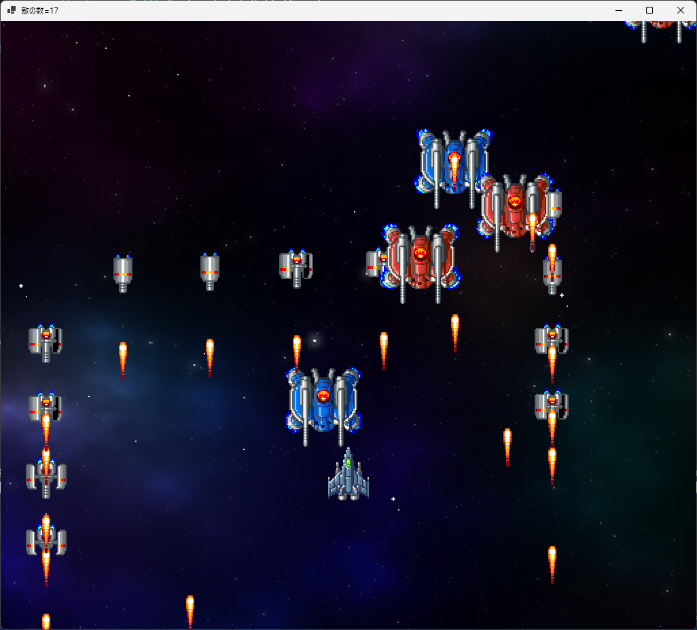</div>

<div style="page-break-after: always"></div>

### 2.6 弾丸の見た目を変える

自機の弾丸と敵の弾丸の見た目が同じだと分かりにくいです。敵の弾丸の画像を変えましょう。<br>
弾丸の管理は`Bullet`クラスの仕事なので、弾丸の画像変更も`Bullet`クラスで行うのがよいでしょう。<br>
`Bullet.cpp`を開き、`Bullet`クラスに次の変数を追加してください。

```diff
 #include "Bullet.h"
 #include "Game.h"
 using namespace Gdiplus;

 // 弾丸のアニメーション範囲
 std::vector<Rect> animePlayerBullet = { Rect(48, 432, 16, 32) };
+std::vector<Rect> animeEnemyBullet = { Rect(320, 464, 16, 16) };

 // コンストラクタ
 //  x,y=発生位置 sx,sy=移動速度
 Bullet::Bullet(float x, float y, float sx, float sy)
```

弾丸を描くときに画像を変えるには、弾丸の種類を覚えておく必要があります。<br>
弾丸の種類を管理する変数を追加しましょう。名前は`Type`(タイプ、「種類」という意味)とします。

それから、弾丸の種類をあらわす定数も追加します。<br>
自機の弾丸の種類名は`PlayerBullet`(プレイヤー・バレット、「自機の弾丸」という意味)とします。<br>
敵の弾丸の種類名は`EnemyBullet`(エネミー・バレット、「敵の弾丸」という意味)とします。

`Bullet.h`を開き、弾丸の種類をあらわす列挙型を追加してください。

```diff
 #pragma once
 #include "Character.h"
 #include "Box.h"
+
+// 弾丸の種類
+enum class BulletType
+{
+  PlayerBullet = 0, // 自機の弾丸
+  EnemyBullet = 1,  // 敵の弾丸
+};

 // 弾丸クラス
 class Bullet
```

<div style="page-break-after: always"></div>

`Bullet`クラスの定義に、弾丸の種類をあらわす変数を追加してください。<br>
変数名は`Type`(タイプ、「種類」という意味)とします。

```diff
   bool IsFinished;  // true=行動終了 false=行動中
   Box Hitbox;       // 画面左上を原点とする衝突判定
   Box HitboxLocal;  // キャラ中心を原点とする衝突判定
+  BulletType Type;  // 弾丸の種類

   Bullet() = default; // デフォルトコンストラクタ

   // コンストラクタ
   //  x,y=発生位置 sx,sy=移動速度
-  Bullet(float x, float y, float sx, float sy);
+  Bullet(float x, float y, float sx, float sy, BulletType type);

  // 弾丸の状態を更新する
  void Update(float deltaTime);
```

次に、`Bullet.cpp`を開き、コンストラクタの定義を次のように変更してください。

```diff
 // コンストラクタ
 //  x,y=発生位置 sx,sy=移動速度
-Bullet::Bullet(float x, float y, float sx, float sy);
+Bullet::Bullet(float x, float y, float sx, float sy, BulletType type)
 {
+  // 弾丸の種類を設定
+  Type = type;
+
+  // 種類によって弾丸を作り分ける
+  if (Type == BulletType::PlayerBullet) {
+    // プレイヤーの弾丸を作る
     // キャラクターの座標とアニメーションを設定
     Character = { x, y, animePlayerBullet, 0 };

     // キャラ中心の衝突判定を設定
     HitboxLocal = { -16, 16, -8, 56 };
+  }
+  else if (Type == BulletType::EnemyBullet) {
+    // 敵の弾丸を作る
+    Character = { x, y, animeEnemyBullet, 0 };
+    HitboxLocal = { -8, 8, -8, 8 }; // キャラ中心の衝突判定
+  }

   // 移動速度を設定
   MoveSpeedX = sx;
```

敵の弾丸の画像はは丸い形で小さめです。そのため、衝突判定も小さめにしています。<br>
これで、弾丸の種類ごとに画像と衝突判定が変わります。

さて、コンストラクタ引数が増えたことで、弾丸を発射する関数にエラーが出ています。これを直しましょう。<br>
弾丸を発射する関数は`Player`クラスの`Update`関数と、`Turret`クラスの`Update`関数です。

まずは`Player`クラスを修正します。<br>
`Player.cpp`を開き、`Update`関数にある弾丸を発射するプログラムを、次のように変更してください。

```diff
     for (int a = 0; a <= ShotLevel; a++)
     {
       // 発射位置を計算
       float x = a * 32 - ShotLevel * 16;
-      bulletList.push_back(Bullet(Character.X + x, Character.Y, 0, bulletSpeed));
+      bulletList.push_back(Bullet(Character.X + x, Character.Y, 0, bulletSpeed,
+        BulletType::PlayerBullet));
     }
   }
   else {
     // 発射キーが離されたら発射間隔タイマーを0に戻す
```

続いて、`Turret`クラスを修正します。<br>
`Turret.cpp`を開き、`Update`関数にある弾丸を発射するプログラムを、次のように変更してください。

```diff
   // 発射タイマーの時間を戻す
   Timer += Interval;

   // 弾丸を発射
-  bulletList.push_back(Bullet(character.X, character.Y, 0, BulletSpeed));
+  bulletList.push_back(Bullet(character.X, character.Y, 0, BulletSpeed,
+    Bullet.EnemyBullet));
 }
```

プログラムが書けたら`>ローカルWindowsデバッガー`ボタンをクリックしてアプリを実行してください。<br>
敵の発射する弾丸が、丸い形の画像に変わっていたら成功です。

<div align="center">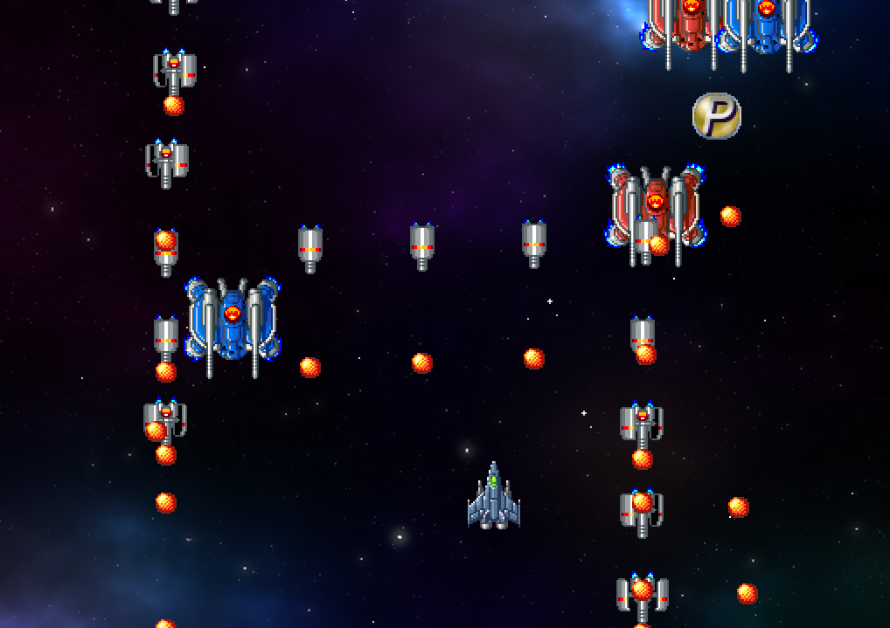</div>

### 2.7 敵の弾丸と自機の衝突判定を作る

自機が敵の弾丸と衝突したら、ゲームオーバーになるようにしましょう。`Game.cpp`を開き、`UpdatePlay`<br>
関数にある「敵と自機の弾丸の衝突判定」の下に、「自機と敵の弾丸の衝突判定」を追加してください。

```diff
       }
     } // for playerBulletList
   } // for enemyList
+
+  // 自機と敵の弾丸の衝突判定
+  for (int a = 0; a < enemyBulletList.size(); a++) {
+    Bullet& bullet = enemyBulletList[a];
+    if (bullet.Hitbox.Intersect(player.Hitbox)) {
+      gameState = gsDead; // 死亡状態にする
+      break;
+    }
+  } // for enemyBulletList
 }

 // クリア状態を更新する
 //   deltaTime  状態を進める秒数
```

それと、死亡状態の画面を描いておきます。`PaintDead`関数に、次のプログラムを追加してください。

```diff
 // 死亡状態を描く
 private void PaintDead(Graphics& g)
 {
+  PaintPlay(g);
 }

 // ゲーム状態を更新する
 void Tick(float deltaTime)
```

プログラムが書けたら`>ローカルWindowsデバッガー`ボタンをクリックしてアプリを実行してください。<br>
自機が敵の弾丸と衝突したとき、ゲームが停止したら成功です。

<div align="center">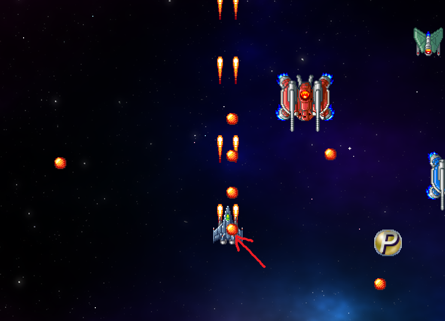</div>

<pre class="tnmai_assignment">
<strong>【課題03 自機と敵の衝突判定を作る】</strong>
自機と敵の弾丸の衝突判定の下に、自機と敵の衝突判定を行うプログラムを追加しなさい。
衝突したら「死亡状態」にすること。
</pre>

### 2.8 ゲームオーバーの文字を表示する

ゲームオーバーになったことが分かるように、文字を表示しましょう。<br>
文字を表示するには「フォント」が必要です。フォント変数を追加しましょう。<br>
フォント変数の名前は`fontHeading`(フォント・ヘッディング、「見出しフォント」という意味)とします。

`Game.cpp`にある「ゲーム状態」変数の宣言の下に、次のプログラムを追加してください。

```diff
 // ゲーム状態
 const int gsPlay = 0;   // プレイ状態
 const int gsClear = 1;  // ステージクリア状態
 const int gsDead = 2;   // 死亡状態
 int gameState = gsPlay; // 現在のゲーム状態
+
+// フォント変数
+Font* fontHeading; // 見出し用フォント

 // 画像用変数
 Bitmap* bmpBackground; // 背景画像
 Bitmap* bmpObjects;    // キャラクター画像
```

次に、`Init`関数でフォントを読み込みます。<br>
`Init`関数に次のプログラムを追加してください。

```diff
 // ゲーム状態を初期化する
 void Init()
 {
+  // フォントを作成
+  extern HWND hWnd;
+  const float deviceDpi = static_cast<float>(GetDpiForWindow(hWnd));
+  const float dpiScale = USER_DEFAULT_SCREEN_DPI / deviceDpi;
+  fontHeading = new Font(L"Impact", 64 * dpiScale);
+
   // 画像を読み込む
   Bitmap* tmp = new Bitmap(L"assets/images/bg_space.png");
   bmpBackground = tmp->Clone(0, 0, tmp->GetWidth(), tmp->GetHeight(),
     PixelFormat32bppPARGB);
```

<div style="page-break-after: always"></div>

フォントの準備ができたので、文字を表示しましょう。`PaintDead`関数に次のプログラムを表示してください。

```diff
 void PaintDead(Graphics& g)
 {
   PaintPlay(g);
+
+  // 文字を描く
+  SolidBrush sbRed(Color::Red);
+  g.DrawString(L"GAME OVER", -1, fontHeading, PointF(300, 400), &sbRed);
 }
```

プログラムが書けたら`>ローカルWindowsデバッガー`ボタンをクリックしてアプリを実行してください。<br>
自機が敵の弾丸と衝突したとき、`GAME OVER`の文字が表示されたら成功です。

<div align="center">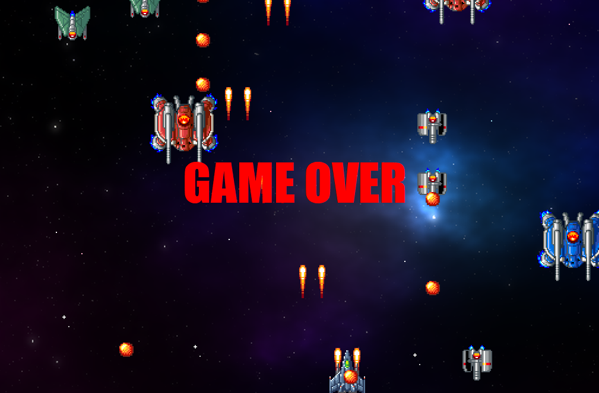</div>

### 2.9 ゲームを再開できるようにする

ゲームオーバーから復帰して、ゲームを再開できるようにしましょう。<br>
`UpdateDead`関数に、「`Enter`キーが押されたら`gsPlay`状態にする」プログラムを追加してください。

```diff
 // 死亡状態を更新する
 //   deltaTime  状態を進める秒数
 void UpdateDead(float deltaTime)
 {
+  if (GetAsyncKeyState(VK_RETURN) < 0) {
+    gameState = gsPlay; // ゲームを開始する
+  }
 }

 // プレイ状態を描く
 void PaintPlay(Graphics& g)
```

プログラムが書けたら`>ローカルWindowsデバッガー`ボタンをクリックしてアプリを実行してください。<br>
ゲームオーバーになったとき、`Enter`キーでゲームが再開できたら成功です。

### 2.10 変数を最初の状態に戻す

ゲームを再開すると、ゲームオーバーになった時の状態から始まります。ゲームを始めからやり直すには、<br>
敵のリストや弾丸のリストからデータを消去したり、背景の表示位置を戻したりする必要があります。

`vector`からデータを消去するには、`clear`(クリア、「片付ける」という意味)関数を使います。<br>
`UpdateDead`関数に、データを初期化するプログラムを追加してください。

```diff
 private void UpdateDead(float deltaTime)
 {
   if (GetAsyncKeyState(VK_RETURN) < 0) {
+    // 敵のデータを初期化する
+    enemyList.clear();
+    enemySpawnerList.clear(); +    enemyBulletList.clear();
+    enemySpawnTimer = 0.0f;
+
+    // 自機のデータを初期化する
+    player.Character.X = RenderWidth * 0.5f;
+    player.Character.Y = RenderHeight * 0.75f;
+    player.ShotLevel = 0;
+    playerBulletList.clear();
+
+    // その他のデータを初期化する
+    itemList.clear();
+    effectList.clear();
+
+    // 背景のY座標を、一番下の1画面がちょうどウィンドウ内に表示されるように設定
+    backgroundY =
+      -(static_cast<float>(bmpBackground->GetHeight()) - RenderHeight);
+
     gameState = gsPlay; // ゲームを開始する
   }
 }
```

プログラムが書けたら`>ローカルWindowsデバッガー`ボタンをクリックしてアプリを実行してください。<br>
ゲームオーバーになって`Enter`キーでゲームを再開したとき、敵や弾丸が消えていたら成功です。

<div align="center">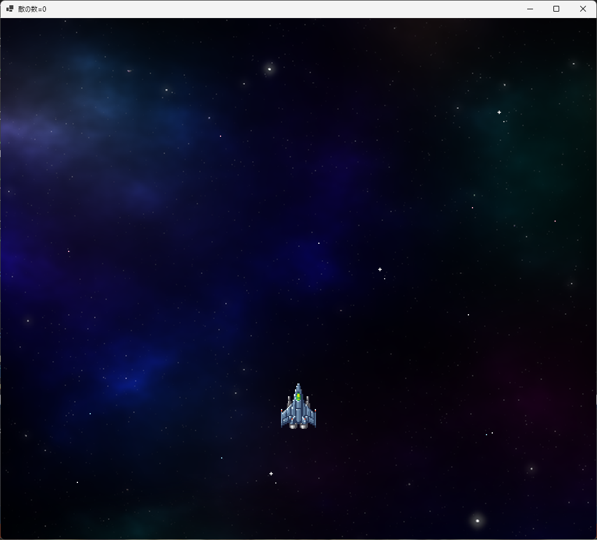</div>

<div style="page-break-after: always"></div>

## 3 自機を狙って撃つ

### 3.1 自機を狙う機能を追加する

真下に撃たれる弾丸を避けるのは、それほど難しいことではありません。<br>
ゲームを少し難しくするために、砲塔が自機を狙って撃ってくるようにしましょう。<br>
そのために、砲塔に「攻撃目標を指定する機能」を追加します。

まずは、攻撃目標をあらわす変数を追加します。変数名は`Target`(ターゲット、「目標」という意味)とします。<br>
`Turret.h`を開き、`Turret`クラスに次のプログラムを追加してください。

```diff
 public:
   float Interval;    // 発射間隔(秒)
   float BulletSpeed; // 弾丸の速度
   float Timer;       // 発射タイマー
+  const Character* Target; // 攻撃目標

   Turret() = default; // デフォルトコンストラクタ

   // コンストラクタ
-  Turret(float interval, float speed)
+  Turret(float interval, float speed, const Character* target);

   // 砲塔の状態を更新する
   void Update(float deltaTime,
     const Character& character, std::vector<Bullet>& bulletList);
```

次に`Turret.cpp`を開き、`Game.h`をインクルードします。<br>
それから、コンストラクタの定義を次のように変更してください。

```diff
 #include "Turret.h"
+#include "Game.h"

 // コンストラクタ
-Turret::Turret(float interval, float speed)
+Turret::Turret(float interval, float speed, const Character* target)
 {
   Interval = interval;
   BulletSpeed = speed;
   Timer = 0.0f;
+  Target = target;
 }
```

続いて、敵から攻撃目標(自機)に向かって弾丸を発射しましょう。<br>
向きを求めるには、`math.h`(マス・ヘッダ)にある`atan2f`(エータン・ツー・エフ)関数を使います。<br>
`atan2f`関数のパラメータに「Y軸方向の距離」と「X軸方向の距離」を指定すると、角度が得られます。<br>

&emsp;`float atan2f(float Y軸方向の距離, float X軸方向の距離)`

> 関数名の末尾の`f`は「`float`型用の関数」を意味します。<br>
> `atan2`という`f`の付かない関数もあり、こちらは`double`型用です。

そして、`atan2f`で求めた方向から、さらに「X軸方向の速度」と「Y軸方向の速度」を求めます。<br>
これには`cosf`(コサイン・エフ)関数と`sinf`(サイン・エフ)関数を使います。<br>
`Update`関数のプログラムを、次のように変更してください。

```diff
   if (Timer > 0.0f) {
     return;
   }

   // 発射タイマーの時間を戻す
   Timer += Interval;
+
+  // 発射角度を計算
+  float angle = 0.5f * Pi; // 攻撃目標がない場合、下向きに撃つ
+  if (Target != nullptr) {
+    // 攻撃目標がある場合、攻撃目標に向かう角度を計算
+    float dx = Target->X - character.X; // 敵から攻撃目標までの距離(X軸方向)
+    float dy = Target->Y - character.Y; // 敵から攻撃目標までの距離(Y軸方向)
+    angle = atan2f(dy, dx);
+  }
+
+  // 弾丸の速度を計算
+  float sx = cosf(angle) * BulletSpeed;
+  float sy = sinf(angle) * BulletSpeed;

   // 弾丸を発射
-  bulletList.push_back(Bullet(character.X, character.Y, 0, BulletSpeed,
+  bulletList.push_back(Bullet(character.X, character.Y, sx, sy,
     Bullet.EnemyBullet));
 }
```

C++では、一周の角度を`360`度ではなく、`2π`で表現します。<br>
この`π`を使った角度表現のことを、 **弧度法(こどほう)** または **ラジアン** といいます。

ゲーム内の角度は、右が`0`、下が`0.5π`、左が`π`、上が`1.5π`になります。<br>
例えば、下を狙う場合の角度は`0.5π`になります。

これで、自機を狙って弾丸が発射されるようになります。

### 3.2 砲塔、敵、敵発生装置に攻撃目標パラメータを追加する

砲塔に自機を狙わせるために、`Enemy`クラスのコンストラクタに「攻撃目標」のパラメータを追加します。<br>
`Enemy.h`を開き、コンストラクタを次のように変更してください。

```diff
   Enemy() = default; // デフォルトコンストラクタ

   // コンストラクタ
-  Enemy(float x, float y, int t);
+  Enemy(float x, float y, int t, const Character* target);

   // 敵の状態を更新する
   void Update(float deltaTime, std::vector<Bullet>& bulletList);
```

次に`Enemy.cpp`を開き、コンストラクタの定義を次のように変更してください。

```diff
 // コンストラクタ
-Enemy::Enemy(float x, float y, int t)
+Enemy::Enemy(float x, float y, int t, const ::Character* target)
 {
   MoveSpeedX = 0.0f;
   MoveSpeedY = 0.0f;
   IsFinished = false; // 「行動中」にする
   Type = t; // 敵の種類を設定
   Timer = 0.0f;   // 経過時間を0にする
   StartX = x; // 発生時のX座標を記録
   StartY = y; // 発生時のY座標を記録
   Hp = 1;     // 基本の耐久値を設定

   // 砲塔を追加する
-  TurretList.push_back(Turret(2.0f, 300.0f));
+  TurretList.push_back(Turret(2.0f, 300.0f, target));

   // キャラクターを作る
```

`Enemy`コンストラクタに引数を追加したので、コンストラクタを呼び出しているプログラムも変更します。<br>
`EnemySpawner.h`を開き、`Update`関数に攻撃目標パラメータを追加してください。

```diff
   // コンストラクタ
   EnemySpawner(float x, float y, int pattern);

   // 敵を発生させる
-  void Update(float deltaTime, std::vector<Enemy>& enemyList);
+  void Update(float deltaTime, std::vector<Enemy>& enemyList, const Character* target);
 };
```

次に、`EnemySpawner.cpp`を開き、`Update`関数の定義を次のように変更してください。

```diff
   IsFinished = false;
 }

 // 敵を発生させる
-void EnemySpawner::Update(float deltaTime, std::vector<Enemy>& enemyList)
+void EnemySpawner::Update(float deltaTime, std::vector<Enemy>& enemyList,
+  const Character* target)
 {
   // すべての敵が発生済みなら何もしない
   if (IsFinished) {
```

そして、追加したパラメータを、`Enemy`クラスのコンストラクタに指定します。<br>
ただ、全ての敵から狙い撃ちされると、ゲームが難しくなりすぎます。<br>
そこで、中型で赤色の敵だけは、自機を狙ってこないようにします。

それでは、`Update`関数にある敵を発生させるプログラムを、次のように変更してください。

```diff
       // 時間になったので敵を発生させる
       if (Pattern == 0) {
         // 小型で灰色の敵を、縦方向に発生
-        enemyList.push_back(Enemy(SpawnX, SpawnY, EnemyType::SmallGray));
+        enemyList.push_back(Enemy(SpawnX, SpawnY, EnemyType::SmallGray, target));
         Timer += 0.5f; // 次の発生までの時間を設定
       }
       else if (Pattern == 1) {
         // 小型で灰色の敵を、横方向に発生
-        enemyList.push_back(Enemy(SpawnX, SpawnY, EnemyType::SmallGray));
+        enemyList.push_back(Enemy(SpawnX, SpawnY, EnemyType::SmallGray, target));
         SpawnX += 128; // 発生位置を右にずらす
       }
       else if (Pattern == 2) {
         // 中型で赤色の敵を、間隔を開けて左右に発生
-        enemyList.push_back(Enemy(SpawnX, SpawnY, EnemyType::MediumRed));
+        enemyList.push_back(Enemy(SpawnX, SpawnY, EnemyType::MediumRed, nullptr));
         SpawnX = RenderWidth - SpawnX;
         Timer += 3.5f; // 次の発生までの時間を設定
```

<pre class="tnmai_assignment">
<strong>【課題04 残りの敵が自機を狙うようにする】</strong>
中型で青色の敵と、小型で緑色の敵を発生させるパターン3と4について、
敵を発生させて<code>enemyList</code>に追加するとき、<code>target</code>パラメータを追加しなさい。
</pre>

最後に、`Game.cpp`にある`EnemySpawner`の`Update`関数呼び出しを修正します。<br>
`Game.cpp`を開き、`UpdatePlayer`関数にある「敵発生装置を更新する」プログラムを、<br>
次のように変更してください。

```diff
   // 敵発生装置を更新する
   for (int a = 0; a < enemySpawnerList.size(); a++) {
-    enemySpawnerList[a].Update(deltaTime, enemyList);
+    enemySpawnerList[a].Update(deltaTime, enemyList, &player.Character);
   }
   enemySpawnerList.erase(std::remove_if(enemySpawnerList.begin(), enemySpawnerList.end(),
     [](const EnemySpawner& e) { return e.IsFinished; }), enemySpawnerList.end());
```

プログラムが書けたら`>ローカルWindowsデバッガー`ボタンをクリックしてアプリを実行してください。<br>
敵から、自機を狙って弾丸が発射されたら成功です。

<div align="center">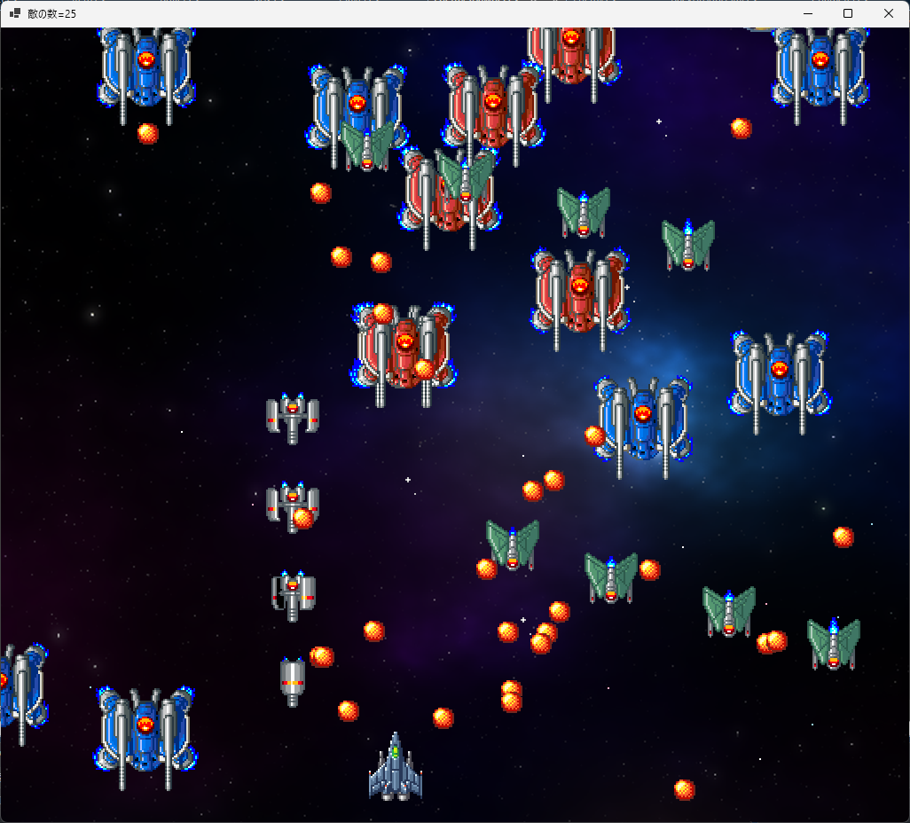</div>

### 3.3 敵の発生数を減らす

敵の数が多くなると、敵の弾丸を避けにくくなります。<br>
弾丸を避けやすくするために、中型の敵の数を少し減らしましょう。`EnemySpawer.cpp`を開き、<br>
コンストラクタにある`Count`変数を初期化するプログラムを、次のように変更してください。

```diff
   SpawnX = x;
   SpawnY = y;
   Pattern = pattern;
-  Count = 4;
+  Count = 4; // 基本の発生数は4つ
+  if (Pattern == 2 || Pattern == 3) {
+    // 中型の敵は発生数を2つにする
+    Count = 2;
+  }
   Timer = 0.0f;
   IsFinished = false;
 }
```

プログラムが書けたら`>ローカルWindowsデバッガー`ボタンをクリックしてアプリを実行してください。<br>
中型の敵の数が減って、少しだけ戦いやすくなっていたら成功です。

<div align="center">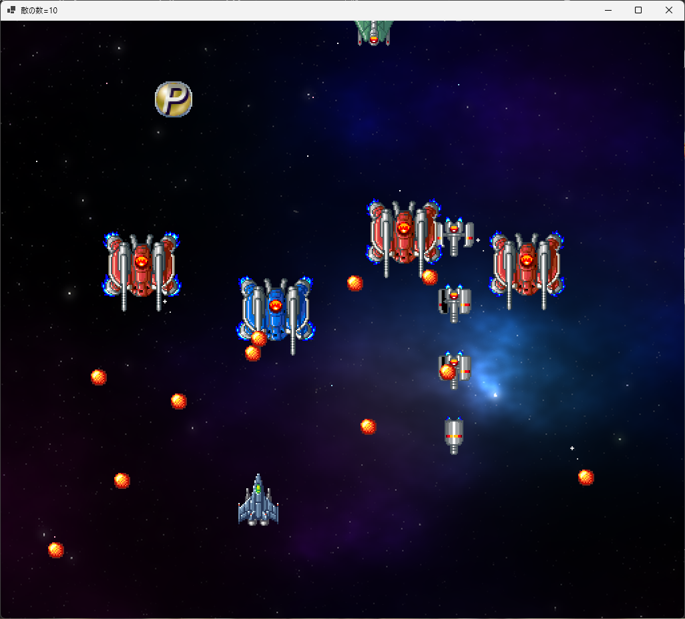</div>

### 3.4 敵の種類によって弾丸の発射間隔を変える

敵の数は少し減りましたが、まだ敵の攻撃が激しすぎる気がします。<br>
そこで、同時発生数の多い小型の敵について、弾丸の発射間隔を長くしましょう。

```diff
   StartY = y; // 発生時のY座標を記録
   Hp = 1;     // 基本の耐久値を設定
-
-  // 砲塔を追加する
-  TurretList.push_back(Turret(2.0f, 300.0f, target));

   // キャラクターを作る
   if (Type == EnemyType::SmallGray) {
     Character = { x, y, animeSmallGray, 7 };
     HitboxLocal = { -28, 28, -28, 28 }; // キャラ中心の衝突判定
+    TurretList.push_back(Turret(3.0f, 300.0f, target));
     MoveSpeedY = 200.0f;
   }
   else if (Type == EnemyType::MediumRed) {
     Character = { x, y, animeMediumRed, 10 };
     HitboxLocal = { -56, 56, -56, 38 }; // キャラ中心の衝突判定
+    TurretList.push_back(Turret(1.0f, 500.0f, target));
     Hp = 20;

     // 画面中央より左に発生したら右へ、右に発生したら左へ移動させる
     MoveSpeedX = 50.0f;
     if (x >= RenderWidth * 0.5f) {
```

<pre class="tnmai_assignment">
<strong>【課題05 残りの敵の砲塔を作る】</strong>
中型で青色の敵と、小型で緑色の敵について、砲塔を作るプログラムを追加しなさい。
発射間隔の弾丸の速度は以下の値にすること。
  中型で青色の敵: 発射間隔=2秒、弾丸の速度=秒速300ドット
  小型で緑色の敵: 発射間隔=3秒、弾丸の速度=秒速400ドット
</pre>

課題が完了したら、`>ローカルWindowsデバッガー`ボタンをクリックしてアプリを実行してください。<br>
小型の敵が撃ってくる弾丸の数が減って、少し戦いやすくなっていたら成功です。

<div align="center">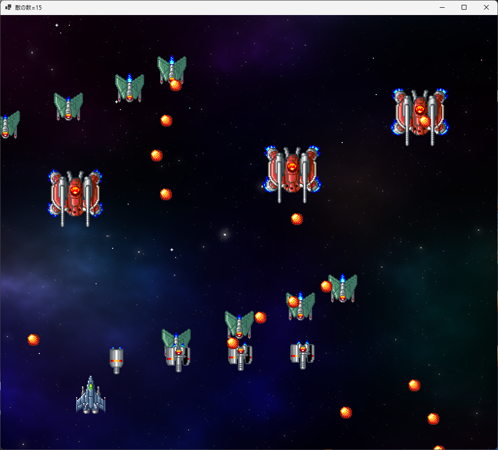</div>

### 3.5 砲塔のバリエーションを作る

敵の発生数や、弾丸の発射間隔を調整したことで、以前よりずっと遊びやすくなりました。<br>
ですが、少し簡単にしすぎたかもしれません。

そこで、砲塔に複数の弾丸を発射する機能を追加して、敵の攻撃の種類を増やしましょう。<br>
砲台のコンストラクタに、以下の３つのパラメータを追加します。

* 発射数: 一度に発射される弾丸の数
* 発射開始角度: 弾丸の発射角度の初期変化量
* 角度変化量： １発毎の発射角度の変化量

例えば「発射数=5，発射開始角度=30度、角度変化量=15度」、計算で求めた発射角度が60度の場合、<br>
１発目の弾丸は`60 + 30`で90度の方向に発射されます。２発目は`60 + 30 + (-15)`で75度です。<br>
同様にして、３発目は60度、４発目は45度、５発目は30度の方向に発射されます。

「発射数」の変数名は`Count`(カウント、「個数」という意味)とします。<br>
「発射開始角度」の変数名は`AngleStart`(アングル・スタート、「角度の開始」という意味)とします。<br>
「角度変化量」の変数名は`AngleChange`(アングル・チェンジ、「角度の変化」という意味)とします。

<div style="page-break-after: always"></div>

それでは、メンバ変数とコンストラクタ引数を追加ましょう。<br>
`Turret.h`を開き、`Turret`クラスに次のプログラムを追加してください。

```diff
   float Interval;    // 発射間隔(秒)
   float BulletSpeed; // 弾丸の速度
   float Timer;       // 発射タイマー
   const Character* Target; // 攻撃目標
+  int Count;         // 発射数
+  float AngleStart;  // 発射開始角度(ラジアン)
+  float AngleChange; // 角度変化量(ラジアン)

   Turret() = default; // デフォルトコンストラクタ

   // コンストラクタ
-  Turret(float interval, float speed, const Character* target);
+  Turret(float interval, float speed, const Character* target,
+    int count, float start, float change);

   // 砲塔の状態を更新する
   void Update(float deltaTime,
     const Character& character, std::vector<Bullet>& bulletList);
```

次に、`Turret.cpp`を開き、`Game.h`をインクルードします。<br>
それから、コンストラクタの定義を次のように変更してください。

```diff
 #include "Turret.h"
+#include "Game.h"

 // コンストラクタ
-Turret::Turret(float interval, float speed, const Character* target)
+Turret::Turret(float interval, float speed, const Character* target,
+  int count, float start, float change)
 {
   Interval = interval;
   BulletSpeed = speed;
   Timer = 0.0f;
   Target = target;
+  Count = count;
+  AngleStart = start;
+  AngleChange = change;
 }

 // 砲塔の状態を更新する
 void Turret::Update(float deltaTime,
   const Character& character, std::vector<Bullet>& bulletList)
```

続いて、弾丸を複数発射できるように、弾丸発射プログラムを変更します。<br>
`Update`関数に、次のプログラムを追加してください。

```diff
     float dx = Target->X - character.X; // 敵から攻撃目標までの距離(X軸方向)
     float dy = Target->Y - character.Y; // 敵から攻撃目標までの距離(Y軸方向)
     angle = atan2f(dy, dx);
   }
+
+  // 発射開始角度を足す
+  angle += AngleStart;
+
+  for (int a = 0; a < Count; a++) {
     // 弾丸の速度を計算
     float sx = cosf(angle) * BulletSpeed;
     float sy = sinf(angle) * BulletSpeed;

     // 弾丸を発射
     bulletList.push_back(Bullet(character.X, character.Y, sx, sy,
       BulletType::EnemyBullet));
+    angle += AngleChange; // 次の弾丸の発射角度を計算
+  }
 }
```

これで、砲塔から複数の弾丸を発射できるようになりました。

### 3.6 砲塔のパラメータを設定する

敵に砲塔を作るプログラムに、新しいパラメータを設定しましょう。<br>
`Enemy.cpp`を開き、キャラクターを作るプログラムを次のように変更してください。

```diff
   if (Type == EnemyType::SmallGray) {
     Character = { x, y, animeSmallGray, 7 };
     HitboxLocal = { -28, 28, -28, 28 }; // キャラ中心の衝突判定
-    TurretList.push_back(Turret(3.0f, 300.0f, target));
+    TurretList.push_back(Turret(3.0f, 300.0f, target, 1, 0, 0));
     MoveSpeedY = 200.0f;
   }
   else if (Type == EnemyType::MediumRed) {
     Character = { x, y, animeMediumRed, 10 };
     HitboxLocal = { -56, 56, -56, 38 }; // キャラ中心の衝突判定
-    TurretList.push_back(Turret(2.0f, 500.0f, target));
+    TurretList.push_back(Turret(2.0f, 500.0f, target, 8, 0, Pi / 4));

     // 画面中央より左に発生したら右へ、右に発生したら左へ移動させる
     MoveSpeedX = 50.0f;
```

<pre class="tnmai_assignment">
<strong>【課題06 残りの敵の砲塔にパラメータを追加する】</strong>
中型で青色の敵と、小型で緑色の敵について、砲塔作成時に以下のパラメータを追加しなさい。
※発射間隔、速度、ターゲットは変更しないこと。
  <strong>中型で青色の敵</strong>: 発射数=3発、発射開始角度=0.2f 角度変化量=-0.2f
  <strong>小型で緑色の敵</strong>: 発射数=l発、発射開始角度=0 角度変化量=0
</pre>

課題が完了したら、`>ローカルWindowsデバッガー`ボタンをクリックしてアプリを実行してください。<br>
中型で赤色の敵が８方向弾を発射し、中型で青色の敵が自機に向かって３方向弾を発射したら成功です。

<div align="center">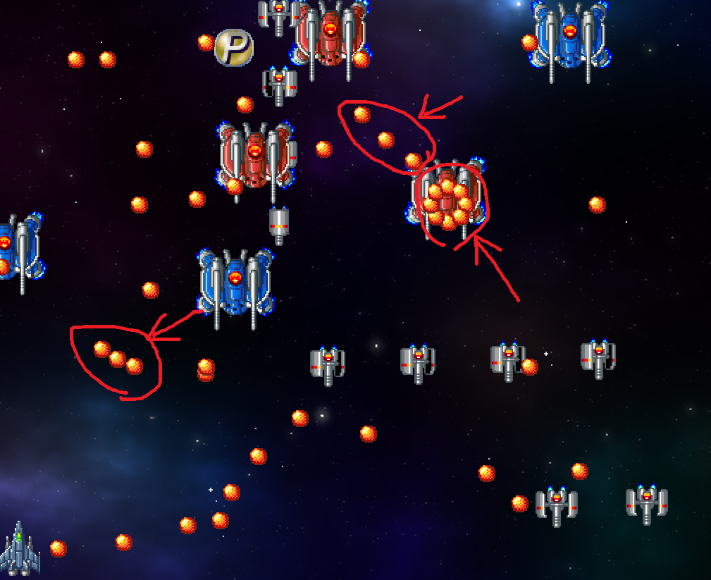</div>

<pre class="tnmai_assignment">
<strong>【課題07 小型で黄色の敵を増やす】</strong>
以下の仕様に従って、<code>Enemy</code>クラスに「小型で黄色の敵」を追加しなさい。

  アニメーション範囲の名前: <code>animeSmallYellow</code>
  アニメーション範囲: (0, 64, 32, 48), (32, 64, 32, 48)
  秒間アニメーション枚数: 10
  敵の種類の列挙子の名前: <code>SmallYellow</code>
  衝突判定: (-24, 24, -32, 32)
  耐久値: 6
  砲塔: 発射間隔=1.5秒、速度=秒速400ドット、ターゲット=なし、
  &emsp;&emsp;&ensp;発射数=3発、初期角度=0.3f、変更角度=-0.3f
  移動パターン: U字ターン(中型で赤色の敵と同じ)、横の移動速度=秒速0.0ドット
  &emsp;&emsp;&emsp;&emsp;&emsp;&ensp;U字の頂点のY座標=192、変数tの式=<code>Timer * 0.75f - 1.0f</code>
  行動終了の条件: 画面上に消えたとき
</pre>

<pre class="tnmai_assignment">
<strong>【課題08 小型で黄色の敵のパターンを作る】</strong>
以下の仕様に従って、<code>EnemySpawner</code>クラスに「小型で黄色の敵」のパターンを追加しなさい。
<code>Form1</code>にある敵発生装置を作るプログラムの「敵発生パターンの数」も変更すること。
  パターン番号: 5
  発生数: 3
  発生位置: <code>SpawnX</code>が画面中央より左側の場合、敵のX座標を<code>SpawnX + Count * 192</code>とする
  &emsp;&emsp;&emsp;&emsp;&ensp;<code>SpawnX</code>が画面中央より右側の場合、敵のX座標を<code>SpawnX - Count * 192</code>とする
  次の発生までの時間: 1.0秒
</pre>
