[C#言語2026 第17回]

# ボス敵とステージクリア

## 1 敵の発生を制御する

&emsp;1回目: 背景の表示、敵の表示、敵のクラス化、敵を増やす<br>
&emsp;2回目: 流れる星の表示、敵を動かす、敵の発生を制御する、敵の行動パターンを増やす<br>
&emsp;3回目: 自機の表示、弾丸を発射する、敵と弾丸の衝突判定、爆発を表示<br>
&emsp;4回目: 自機のパワーアップ、敵の弾丸を発射する、自機と敵の弾丸の衝突判定、ゲームオーバー、敵の調整<br>
&emsp;**今回: 得点の表示、敵出現順の制御、ボス敵の表示、レベルクリア、レベルを増やす**

### 1.1 敵発生装置の表を作る

敵をランダムに発生させる方法の長所は「さまざまな状況を自動的に作り出せる」ことです。<br>
ですが、それは **面白いゲーム展開になるかどうかは運次第** ということも意味します。<br>
そのため、ランダムだけで毎回「面白いゲーム展開」を生み出すのは難しいです。

そこで、大半のシューティングゲームでは、 **発生する敵の種類や場所を事前に決めて** います。<br>
敵の配置を決めておけば、毎回「開発者の意図した面白いゲーム展開」を再現できるからです。

敵の配置を決めてしまうと毎回同じゲーム展開になりそうですが、実はなりません。<br>
なぜなら、「毎回同じ動きができるプレイヤーはほとんどいない」からです。<br>
そのため、敵の配置を決めても、完全に同じゲーム展開になることは少ないのです。

どの程度厳密に決めるかはゲーム次第です。種類や場所を完全に決めているゲームもあります。<br>
おおよその位置や順序だけ決まっていて、多少のランダム性を持つゲームもあります。

発生する敵の種類や場所は、以下のデータをまとめた **敵発生表** によって決められます。

* 敵を発生されるタイミング(背景の移動量、経過時間など)
* 敵を発生させる位置
* 発生させる敵(または敵発生パターン)の種類

これらを表にまとめる方法はゲームによって異なります。<br>
例えば、ひとつひとつの敵を丁寧に手作業で配置することもできますが、手間がかかります。<br>

<div style="page-break-after: always"></div>

そこで、今回は敵発生装置の配置を大まかに決めて、細かい部分はランダムに任せることにします。<br>
配置は、画面を縦に5分割して、各列に敵の発生パターンを指定する形式にしましょう。<br>
この表は次のようになるでしょう。

| 作成する座標 |左端| 左 |中央| 右 |右端|
|------------:|:--:|:--:|:--:|:--:|:--:|
|         200 |  - |  1 |  - |  2 |  - |
|         650 |  - |  - |  0 |  - |  - |
|         800 |  2 |  - |  - |  - |  3 |
|        1000 |  - |  4 |  5 |  4 |  - |
|         ︙  | ︙ |  ︙ | ︙ | ︙ | ︙ |

この表を管理して、敵発生装置を作成するクラスを作りましょう。<br>
クラス名は`EventTable`(イベント・テーブル、「出来事の表」という意味)とします。<br>
**「敵発生装置を作る」という出来事が、いつどこで起きるかを表にしたもの** というイメージです。

ソリューションエクスプローラーの「ヘッダーファイル」を右クリックして、`EventTable.h`を追加してください。<br>
`EventTable.h`を開き、`EventTable`クラスの定義を追加してください。

```diff
 #pragma once
+#include "EnemySpawner.h"
+#include <vector>
+#include <random>
+
+// イベント(敵発生装置を作るとか)の表を管理するクラス
+class EventTable
+{
+public:
+  int Index = 0;     // 参照する行の番号
+  std::mt19937 Rand; // 乱数
+
+  EventTable() = default; // デフォルトコンストラクタ
+
+  // 敵発生表の状態を更新する
+  void Update(float y, std::vector<EnemySpawner>& enemySpawnerList);
+};
```

引数を使って初期化するデータがないので、デフォルトコンストラクタ以外のコンストラクタは不要です。

<div style="page-break-after: always"></div>

### 1.2 イベント表を作る

次に、イベント表を作ります。ソリューションエクスプローラーの「ソースファイル」を右クリックして、<br>
`EventTable.cpp`を追加してください。`EventTable.cpp`を開き、次のプログラムを追加してください。

```diff
+#include "EventTable.h"
+#include "Game.h"
+using namespace std;
+
+// イベントデータ
+struct EventData {
+  float y;        // イベントを発生させる座標
+  int pattern[5]; // 敵発生装置のパターン(左端, 左, 中央, 右, 右端)
+};
+
+// レベル1のイベント表
+//   { 発生させる座標, 左端のパターン, 左, 中央, 右, 右端 }
+//   パターン番号 -1 は「イベントなし」の意味
+const std::vector<EventData> tableLevelOne = {
+  {  100, -1,  0, -1,  0, -1 },
+  {  300, -1, -1,  1, -1, -1 },
+  {  500,  2, -1, -1,  1, -1 },
+  {  700, -1,  4, -1,  4, -1 },
+  {  900,  0, -1, -1,  2, -1 },
+  { 1100, -1, -3, -1, -1,  0 },
+};
```

### 1.3 表クラスを更新する関数を作る

続いて、`EventTable`の状態を更新する`Update`(アップデート)関数を定義します。<br>
`Update`関数のパラメータは「Y座標」と「敵発生装置のリスト」です。<br>
パラメータのY座標が、表に書かれたY座標以上になったら、表に従って敵発生装置を作成します。

「レベル1のイベント表」の下に、次のプログラムを追加してください。

```diff
   {  700, -1,  4, -1,  4, -1 },
   {  900,  0, -1, -1,  2, -1 },
   { 1100, -1, -3, -1, -1,  0 },
 };
+
+// 敵発生表の状態を更新する
+void EventTable::Update(float y, vector<EnemySpawner>& enemySpawnerList)
+{
+  // イベント表を選択
+  const vector<EventData>& table = tableLevelOne;
+
+  //行番号が表の行数以上、またはスクロール座標が現在の行のY座標未満なら何もしない
+  if (Index >= table.size() || y < table[Index].y) {
+    return;
+  }
+
+  // スクロール座標が現在の行のY座標を超えたので、敵発生装置を作成する
+  for (int a = 0; a < 5; a++) {
+    int pattern = table[Index].pattern[a]; // 上から Index 行目、左から a 列目のデータを取得
+
+    // パターン番号が0以上の場合だけ敵発生装置を作成する
+    if (pattern >= 0) {
+      // 区切りの間のどこかに敵発生装置を作成
+      const float range = (RenderWidth - 224) / 5; // 1列のX座標の範囲
+      const float x =
+        112 + range * a + uniform_real_distribution<float>(0, range)(Rand);
+      enemySpawnerList.push_back(EnemySpawner(x, -32, pattern));
+    }
+  }
+  Index += 1; // 表の次の行へ進む
+}
```

敵発生装置が作られる範囲は、画面の左右端`112`ドットを除いた長さを５分割したものです。<br>
`112`は、小型の敵１体分以上の余白で、`RenderWidth`を５で割りきれる数値を選びました。

### 1.4 イベント表を使う

それでは、敵発生装置を作るプログラムを、完全ランダムから表を使う方法に変えましょう。<br>
`Game.cpp`を開き、`EventTable.h`をインクルードしてください。

```diff
 #include "Player.h"
 #include "Bullet.h"
 #include "Item.h"
+#include "EventTable.h"
 #include <string>
 #include <algorithm>
```

そして、敵の変数を宣言するプログラムを、次のように変更してください。

```diff
 std::vector<Enemy> enemyList;
 std::vector<Bullet> enemyBulletList; // 敵の弾丸のリスト
 std::vector<EnemySpawner> enemySpawnerList; // 敵発生装置のリスト
-float enemySpawnTimer = 0.0f; // 敵発生タイマー
+EventTable eventTable; // イベント表

 // 自機の変数
 Player player(RenderWidth * 0.5f, RenderHeight * 0.75f);
```

次に、`UpdatePlay`関数にある「敵発生装置を作る」プログラムを、次のように変更してください。

```diff
   enemyBulletList.erase(std::remove_if(
     enemyBulletList.begin(), enemyBulletList.end(),
     [](const Bullet& e) { return e.IsFinished; }), enemyBulletList.end());

-  // 敵発生装置を作る
-  enemySpawnTimer += deltaTime;
-  if (enemySpawnTimer >= 1.0f) {
-    enemySpawnTimer -= 1.0f; // 敵発生タイマーの時間を戻す
-
-    // 発生位置のX座標 
-    float x = std::uniform_real_distribution<float>(32, RenderWidth - 32)(random);
-
-    // 敵発生パターン
-    int pattern = std::uniform_int_distribution<>(0, 4)(random);
-
-    enemySpawnerList.push_back(EnemySpawner(x, -32, pattern));
-  }
+  // イベント表に従って敵発生装置を作る
+  float scrollLength =
+    static_cast<float>(bmpBackground->GetHeight()) - RenderHeight; // スクロールする高さ
+  float scrollY = scrollLength + backgroundY; // スクロールした長さ
+  eventTable.Update(scrollY, enemySpawnerList);

   // 敵発生装置を更新する
   for (int a = 0; a < enemySpawnerList.size(); a++) {
```

`scrollLength`(スクロール・レングス、「移動する長さ」)は、背景を移動させる長さをあらわします。<br>
`scrollY`(スクロール・ワイ)は、現在のフレームまでに移動した長さをあらわします。<br>
この`scrollY`を、イベント表のY座標の数値と比較することで、敵発生装置を作成します。

続いて、`UpdateDead`関数にある`enemySpawnTimer`の初期化を削除し、<br>
イベント表を初期化するプログラムを追加してください。

```diff
     enemyList.Clear();
     enemySpawnerList.Clear();
     enemyBulletList.Clear();
-    enemySpawnTimer = 0.0f;
+    eventTable.Index = 0; // 最初の行に戻す

     // 自機のデータを初期化する
     player.Character.X = RenderWidth * 0.5f;
     player.Character.Y = RenderHeight * 0.75f;
```

プログラムが書けたら`>ローカルWindowsデバッガー`ボタンをクリックしてアプリを実行してください。<br>
表に書いた順番で敵が出現したら成功です。

<div align="center">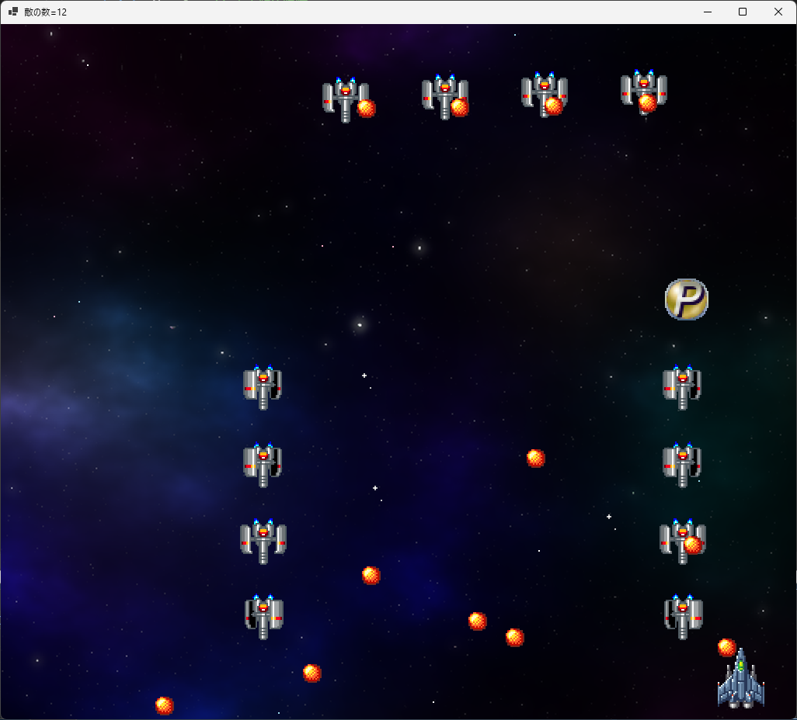</div>

<pre class="tnmai_assignment">
<strong>【課題01 表の行数を増やす】</strong>
以下の図を参考に、<code>tableLevelOne</code>の内容を変更しなさい。
<table>
<tr><th>Y座標</th><th>左端</th><th>左</th><th>中</th><th>右</th><th>右端</th></tr>
<tr><td> 100</td><td>-1</td><td>0</td><td>-1</td><td>0</td><td>-1</td></tr>
<tr><td> ︙</td><td>︙</td><td>︙</td><td>︙</td><td>︙</td><td>︙</td></tr>
<tr><td>1100</td><td>-1</td><td>3</td><td>-1</td><td>-1</td><td> 0</td></tr>
</table>&emsp;&emsp;&emsp;&emsp;(ここから下を追加)
<table>
<tr><td>1300 </td><td> 4&emsp;</td><td>1&nbsp;</td><td>-1</td><td>-1</td><td> 4&emsp;</td></tr>
<tr><td>1500</td><td>-1</td><td>1</td><td>-1</td><td> 3</td><td>-1</td></tr>
<tr><td>1700</td><td>-1</td><td>1</td><td>-1</td><td>-1</td><td> 0</td></tr>
<tr><td>1900</td><td> 0</td><td>1</td><td>-1</td><td> 1</td><td>-1</td></tr>
<tr><td>2100</td><td> 4</td><td>1</td><td>-1</td><td>-1</td><td> 4</td></tr>
<tr><td>2200</td><td>-1</td><td>4</td><td>-1</td><td> 4</td><td>-1</td></tr>
<tr><td>2300</td><td>-1</td><td>1</td><td> 3</td><td>-1</td><td>-1</td></tr>
<tr><td>2400</td><td>-1</td><td>0</td><td>-1</td><td> 0</td><td>-1</td></tr>
</table></pre>

<div style="page-break-after: always"></div>

## 2 得点と命中エフェクト

### 2.1 得点を作る

ゲームの目的は **レベルをクリアすること** です。敵を倒すのは「手段」に過ぎません。<br>
ですが、シューティングゲームを作る以上は、 **弾丸を発射して敵を倒してほしい** ものです。<br>
そこで、敵を倒すと得点が入るようにして、高得点を目指す遊び方ができるようにしましょう。

メリハリを付けるため、 **簡単に倒せる敵は得点を低め** に、 **倒しにくい敵は得点を高め** にしたいです。<br>
そこで、`Enemy`クラスに「敵の種類に対応する得点」を返す関数を追加します。<br>
関数名は、`GetScore`(ゲット・スコア、「得点を取得」という意味)とします。

`Enemy.h`を開き、`Draw`関数の宣言の下に、次のプログラムを追加してください。

```diff
   void Update(float deltaTime, std::vector<Bullet>& bulletList);

   // 敵を描く
   void Draw(Gdiplus::Graphics& g, Gdiplus::Bitmap* bmp);
+
+  // 敵の得点を取得
+  int GetScore() const;
 };
```

次に`Enemy.cpp`を開き、`Draw`関数の定義の下に、`GetScore`関数の定義を追加してください。

```diff
 void Enemy::Draw(Gdiplus::Graphics& g, Gdiplus::Bitmap* bmp)
 {
   Character.Draw(g, bmp);
 }
+
+// 敵の得点を取得
+int Enemy::GetScore() const
+{
+  if (Type == EnemyType::MediumRed) {
+    return 800;
+  }
+  else if (Type == EnemyType::MediumBlue) {
+    return 1000;
+  }
+  return 100;
+}
```

続いて、「得点をあらわす変数」を追加します。変数名は`score`(スコア、「得点」という意味)とします。<br>
`Game.cpp`を開き、自機の変数を宣言するプログラムに、「得点」をあらわす変数を追加してください。<br>

```diff
 Player player(RenderWidth * 0.5f, RenderHeight * 0.75f);
 std::vector<Bullet> playerBulletList; // 自機の弾丸のリスト
 std::vector<Item> itemList; // アイテムのリスト
+int score = 0; // 得点

 // 爆発などのエフェクトのリスト
 std::vector<Character> effectList;
```

それでは、敵を倒したときに、`score`変数の数値を増やしましょう。`UpdatePlay`関数にある<br>
「HPが0以下になった敵を破壊する」プログラムに、得点を増やすプログラムを追加してください。

```diff
      // HPが0以下になった敵を破壊する
      if (enemy.Hp <= 0) {
+       score += enemy.GetScore(); // 得点を増やす
        enemy.IsFinished = true;

        // 爆発エフェクトを追加する
        if (enemy.Type == EnemyType::MediumRed || enemy.Type == EnemyType::MediumBlue) {
```

これで、敵を倒すと得点が増えるようになりました。

### 2.2 得点を表示する

得点を画面に表示して、プレイヤーが何点取れたか分かるようにしましょう。<br>
まず、フォント変数を追加します。名前は`fontScore`(フォント・スコア、「得点用フォント」という意味)とします。<br>
`Game.cpp`を開き、フォント変数を宣言するプログラムに、次のプログラムを追加してください。

```diff
 // フォント変数
 Font* fontHeading; // 見出し用フォント
+Font* fontScore;   // 得点用フォント

 // 画像用変数
 Bitmap* bmpBackground; // 背景画像
```

<div style="page-break-after: always"></div>

次にフォントを読み込みます。`Init`関数に次のプログラムを追加してください。

```diff
   const float deviceDpi = static_cast<float>(GetDpiForWindow(hWnd));
   const float dpiScale = USER_DEFAULT_SCREEN_DPI / deviceDpi;
   fontHeading = new Font(L"Impact", 64 * dpiScale);
+  fontScore = new Font(L"Verdana", 28 * dpiScale, FontStyleItalic);

   // 画像を読み込む
   Bitmap* tmp = new Bitmap(L"assets/images/bg_space.png");
```

得点には、`Verdana`(ヴァーダナ)フォントを選び、勢いを感じさせるため斜体にしています。<br>

> `Verdana`は「ディスプレイに表示したときの読みやすさ」を意識して作られたフォントです。

それでは、作成したフォントを使って得点を表示しましょう。<br>
文字列を描く`Graphics::DrawString`関数の引数は、先頭に`L`の付いた「ワイド文字列」です。<br>
`int`型の得点をワイド文字列に変換するには、`swprintf`(エス・ダブリュー・プリント・エフ)関数を使います。

&emsp;**swprintf(変換先のワイド文字配列, 書式指定ワイド文字列, ...)**

`PaintPlay`関数にある「敵の弾丸を描く」プログラムの下に、得点を表示するプログラムを追加してください。

```diff
   for (int a = 0; a < enemyBulletList.size(); a++) {
     enemyBulletList[a].Draw(g, bmpObjects);
   }
+
+  // 得点を描く
+  wchar_t wsScore[20];
+  swprintf(wsScore, 20, L"%08d", score);
+  SolidBrush sbWhite(Color::White);
+  g.DrawString(wsScore, -1, fontScore, PointF(128, 16), &sbWhite);
 }

 // クリア状態を描く
 void PaintClear(Graphics& g)
```

プログラムが書けたら`>ローカルWindowsデバッガー`ボタンをクリックしてアプリを実行してください。<br>
ウィンドウの左上に得点が表示されたら成功です。

<div align="center">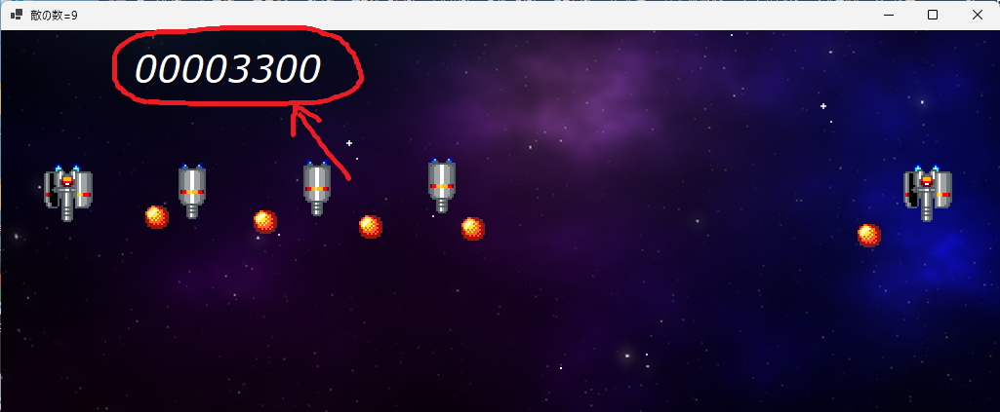</div>

### 2.3 得点をリセットする

ゲームオーバーになってからゲームを再開すると、 **得点が以前のまま残っている** ことに気づくでしょう。<br>
何度も再開するだけで高得点が取れるのはまずいので、 **再開するときに得点を`0`に戻す** ことにします。<br>
`UpdateDead`関数にある「自機のデータを初期化する」プログラムに、次のプログラムを追加してください。

```diff
     player.Character.Y = RenderHeight * 0.75f;
     player.ShotLevel = 0;
     playerBulletList.clear();
+    score = 0; // 得点をリセットする

     // その他のデータを初期化する
     itemList.clear();
```

プログラムが書けたら`>ローカルWindowsデバッガー`ボタンをクリックしてアプリを実行してください。<br>
ゲームオーバーになってゲームを再開したとき、得点が`0`に戻っていれば成功です。

### 2.4 弾丸が当たったときに得点を増やす

中型の敵は、弾丸を何発も撃ち込まないと倒せません。**倒せなくても撃ち込む意義が生まれる** ように、<br>
弾丸が当たったら得点を`10`増やしましょう。`UpdatePlay`関数にある「HPが0以下になった敵を破壊する」<br>
ifブロックの下に、次のelseブロックを追加してください。

```diff
             effectList.push_back(c);
           }
           break; // 弾丸のループを終了する
         }
+        else {
+          // 敵のHPが残っている場合
+          score += 10; // 得点を少し増やす
+        }
       }
     } // for playerBulletList
   } // for enemyList
```

プログラムが書けたら`>ローカルWindowsデバッガー`ボタンをクリックしてアプリを実行してください。<br>
中型の敵に弾丸を当てたとき、得点が10点ずつ増えたら成功です。

<div align="center">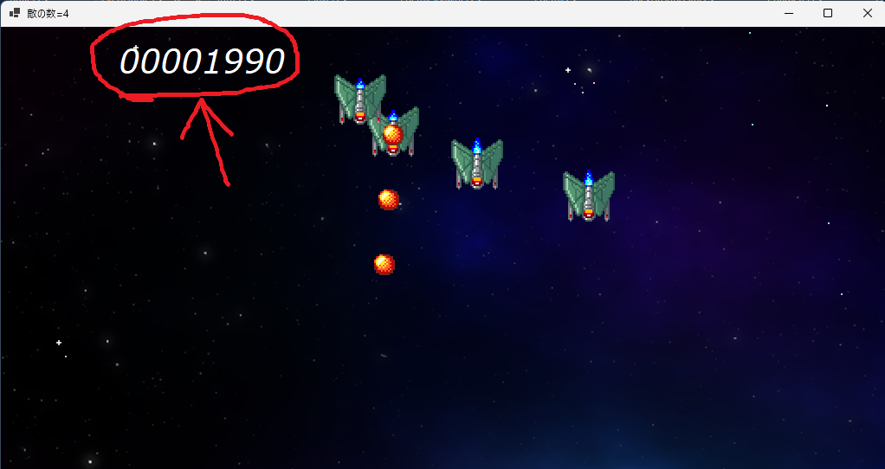</div>

### 2.5 命中エフェクトを表示する

弾丸が当たると得点が入るなら、弾丸が当たったことが分かるようにエフェクトを表示するべきでしょう。<br>
まずはエフェクトのアニメーション範囲を作成しましょう。アニメーション範囲の名前は`animeHitEffect`<br>
(アニメ・ヒット・エフェクト、「命中エフェクトのアニメ」という意味)とします。

「中くらいの爆発のアニメーション範囲」の宣言の下に、命中エフェクトのアニメーション範囲を追加してください。

```diff
   Rect(832, 384, 16, 16), Rect(800, 368, 32, 32), Rect(752, 368, 48, 48),
   Rect(704, 368, 48, 48), Rect(656, 368, 48, 48),
 };
+
+// 弾丸の命中エフェクトのアニメーション範囲
+std::vector<Rect> animeHitEffect = {
+  Rect(32, 464, 16, 16), Rect(48, 464, 16, 16),
+  Rect(64, 464, 16, 16), Rect(80, 464, 16, 16),
+};

 // 乱数
 std::mt19937 random;
```

次に、「敵のHPが残っている」場合のプログラムに、「命中エフェクトを表示」するプログラムを追加してください。

```diff
       else {
         // 敵のHPが残っている場合
         score += 10; // 得点を少し増やす
+
+        // 命中エフェクトを表示
+        Character c = {bullet.Character.X, bullet.Character.Y - 16, animeHitEffect, 20};
+        c.AnimeIsLoop = false;
+        effectList.push_back(c);
       }
     }
   } // for playerBulletList
```

Y座標を`弾丸のY座標 - 16`にしたのは、命中エフェクトを「弾丸の先端部分」に表示するためです。<br>
プログラムが書けたら`>ローカルWindowsデバッガー`ボタンをクリックしてアプリを実行してください。<br>
中型の敵に弾丸を当てたとき、小さな命中エフェクトが表示されたら成功です。

<div align="center">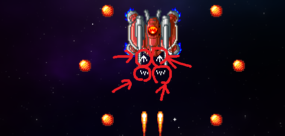</div>

<div style="page-break-after: always"></div>

## 3 ボス・キャラクターを出す

### 3.1 ボスキャラの見た目と番号を決める

シューティングゲームで盛り上がる場面といえは、レベルの最後に待ち受ける「ボスキャラ」との戦いです。<br>
今どきのゲームとしては、ボスキャラを避けて通るわけにはいきません。ボスキャラを作成しましょう。<br>
ボスキャラ作成は、以下の４段階で行います。

> 1. ボスキャラの見た目を作る
> 2. ボスキャラの動きを作る
> 3. ボスキャラの攻撃を作る
> 4. ボスキャラの破壊演出を作る

まずは「ボスキャラの見た目」を作ります。画像は、`tile_objects.png`の右上のキャラクターを使います。<br>
アニメーション範囲の名前は`animeBoss1`(アニメ・ボス・ワン、「レベル1のボスのアニメ」という意味)とします。

`Enemy.cpp`を開き、敵のアニメーション範囲の定義に、ボスキャラのアニメーション範囲を追加してください。

```diff
 std::vector<Rect> animeSmallYellow = {
   Rect(0, 64, 32, 48),
   Rect(32, 64, 32, 48),
 };
+
+// レベル1ボスのアニメーション範囲の配列
+std::vector<Rect> animeBoss1 = { Rect(1024 - 256, 0, 256, 128) };

 // コンストラクタ
 Enemy::Enemy(float x, float y, EnemyType t, const ::Character* target)
```

それから、ボスキャラの列挙子を決めておきます。変数名は`Boss1`(ボス・ワン)とします。<br>
`Enemy.h`を開き、`EnemyType`列挙型に、`Boss1`変数を追加してください。

```diff
   MediumRed,  // 中型で赤色(ミディアム・レッド)
   MediumBlue, // 中型で青色(ミディアム・ブルー)
   SmallGreen, // 小型で緑色(スモール・グリーン)
   SmallYellow,// 小型で黄色(スモール・イエロー)
+  Boss1,      // レベル1のボス
 };

 // 敵クラス
 class Enemy
```

それでは、ボスキャラを作るプログラムを書きましょう。`Enemy.cpp`を開き、コンストラクタにある<br>
`SmallYellow`の敵を作るプログラムの下に、ボスキャラを作るプログラムを追加してください。

```diff
     Character = { x, y, animeSmallYellow, 10 };
     HitboxLocal = { -24, 24, -32, 32 }; // キャラ中心の衝突判定
     Hp = 6;
     TurretList.push_back(Turret(1.5f, 400.0f, nullptr, 3, 0.3f, -0.3f));
   }
+  else if (Type == EnemyType::Boss1) {
+    Character = { RenderWidth * 0.5f, -256.0f, animeBoss1, 0 };
+    HitboxLocal = { -240, 240, -96, 96 }; // キャラ中心の衝突判定
+    Hp = 800; // ５連装x秒間８連射のとき20秒で倒せる耐久値
+  }

   // 実際の衝突判定を計算
   Hitbox = {
     HitboxLocal.Left + Character.X, HitboxLocal.Right + Character.X,
```

ボスキャラのHPは`800`にしました。これは、５連装の状態の自機が、20秒間攻撃し続ければ倒せる値です。

### 3.2 ボスキャラの動きを作る

次はボスキャラの動きを作りますが、ボスというのは図体が大きく、画面内を動く余地は少ないものです。<br>
そのため、ゆっくり左右に反復移動するだけとか、ゆっくり楕円運動するだけということが多いです。<br>
今回作るボスキャラも、**中央上から下に少し移動したあと、左右を往復する** 程度にしておきます。

まずは、下に移動するためのY方向の速度を設定します。<br>
コンストラクタにあるボスキャラを作成するプログラムに、次のプログラムを追加してください。

```diff
   else if (Type == EnemyType::Boss1) {
     Character = { RenderWidth * 0.5f, -256.0f, animeBoss1, 0 };
     HitboxLocal = { -240, 240, -96, 96 }; // キャラ中心の衝突判定
     Hp = 800; // ５連装x秒間８連射のとき20秒で倒せる耐久値
+    MoveSpeedY = 200.0f; // 下へ移動
   }

   // 実際の衝突判定を計算
   Hitbox = {
     HitboxLocal.Left + Character.X, HitboxLocal.Right + Character.X,
```

<div style="page-break-after: always"></div>

次に、`Update`関数にある「小型で黄色の敵」を動かすプログラムの下に、<br>
ボスキャラを動かすプログラムを追加してください。

```diff
     // 画面の上に消えたら行動終了
     if (Character.Y < -64) {
       IsFinished = true;
     }
   }
+  else if (Type == EnemyType::Boss1) {
+    // 動作開始座標(この座標から左右移動を開始する)
+    float baseX = RenderWidth * 0.5f;
+    float baseY = 200.0f;
+
+    // 動作開始座標に到達するまで下に移動したあと、ゆっくりと左右に移動する
+    float downEndTime = 3.0f; // 下へ移動する期間
+    if (Timer < downEndTime) {
+      // ボスを下へ移動
+      Character.Y += MoveSpeedY * deltaTime;
+
+      // 動作開始Y座標を超えないようにする
+      if (Character.Y >= baseY) {
+        Character.Y = baseY;
+      }
+    }
+    else {
+      // ボスを左右に移動
+      float t = Timer - downEndTime; // 左右移動開始からの経過秒数
+      float a = 8.0f;   // 1回の左右移動にかかる秒数
+      float b = 256.0f; // 振幅
+      Character.X = baseX + sinf(Pi * 2.0f / a * t) * b;
+    }
+  }

   // 砲塔の状態を更新
   for (int a = 0; a < TurretList.size(); a++) {
     TurretList[a].Update(deltaTime, Character, bulletList);

```

これでボスキャラの動きは完成です。ボスを発生させて、動作を確認しましょう。<br>
それには、敵発生装置にボスキャラのパターンを追加する必要があります。

**ボスキャラのパターン番号** は、イベント表のなかで目立つように`99`とします。<br>
ボスキャラの発生数は1個で、上側の画面外の中央に出現させます。

<div style="page-break-after: always"></div>

`EnemySpawner.cpp`を開き、コンストラクタにボスキャラの発生数を追加してください。

```diff
   else if (Pattern == 5) {
     Count = 3; // 小型で黄色の敵の発生数
   }
+  else if (Pattern == 99) {
+    Count = 1; // レベル1のボスの発生数
+  }
   Timer = 0.0f;
   IsFinished = false;
 }
```

`Update`メソッドにあるパターン5番の敵発生プログラムの下に、ボスを発生させるプログラムを追加してください。

```diff
       x = SpawnX - Count * 192.0f;
     }
     enemyList.push_back(Enemy(x, SpawnY, EnemyType::SmallYellow, target));
     Timer += 1.0f; // 次の発生までの時間を設定
   }
+  else if (Pattern == 99) {
+    // レベル1のボスを、上側の画面外中央に発生
+    enemyList.push_back(Enemy(RenderWidth * 0.5f, -256, EnemyType::Boss1, target));
+  }

   Count -= 1; // 発生数を1減らす

   // 発生数が 0 になったら発生終了にする
   if (Count <= 0) {
```

ボスキャラの発生位置がランダムだと演出的に扱いづらいため、画面外中央に固定しています。

続いて、イベント表に「ボスキャラの発生装置」を追加します。<br>
`EventTable.cpp`を開き、レベル1のイベント表の最初の行を、次のように変更してください。

```diff
 // レベル1のイベント表
 //   { 発生させる座標, 左端のパターン, 左, 中央, 右, 右端 }
 //   パターン番号 -1 は「イベントなし」の意味
 const vector<EventData> tableLevelOne = {
-  {  100, -1,  0, -1,  0, -1 },
+  {  100, -1, -1, 99, -1, -1 },
   {  300, -1, -1,  1, -1, -1 },
   {  500,  2, -1, -1,  1, -1 },
   {  700, -1,  4, -1,  4, -1 },
```

プログラムが書けたら`>ローカルWindowsデバッガー`ボタンをクリックしてアプリを実行してください。<br>
ゲーム開始直後にボスキャラが表示され、ゆっくり左右に移動したら成功です。

<div align="center">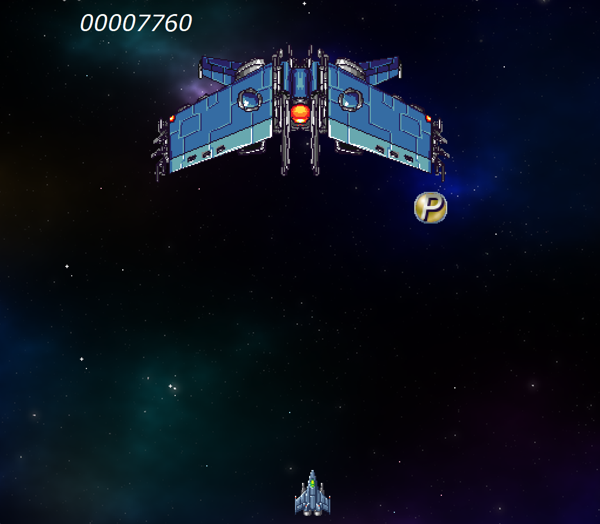</div>

### 3.3 ボスキャラに縦の動きを追加する

左右に動くだけではつまらないので、上下の動きも追加しましょう。<br>
ボスを左右に移動させるプログラムの下に、次のプログラムを追加してください。

```diff
       float t = Timer - downEndTime; // 左右移動開始からの経過秒数
       float a = 8.0f;   // 1回の左右移動にかかる秒数
       float b = 256.0f; // 振幅
       Character.X = baseX + sinf(Pi * 2.0f / a * t) * b;
+
+      // ボスを上下に移動
+      Character.Y = baseY - b + cosf(Pi * 2.0f / a * t) * b;
     }
   }

   // 砲塔の状態を更新
```

プログラムが書けたら`>ローカルWindowsデバッガー`ボタンをクリックしてアプリを実行してください。<br>
ボスキャラが「円運動」をしながら画面上に出て行き、また戻ってきたら成功です。

<div align="center">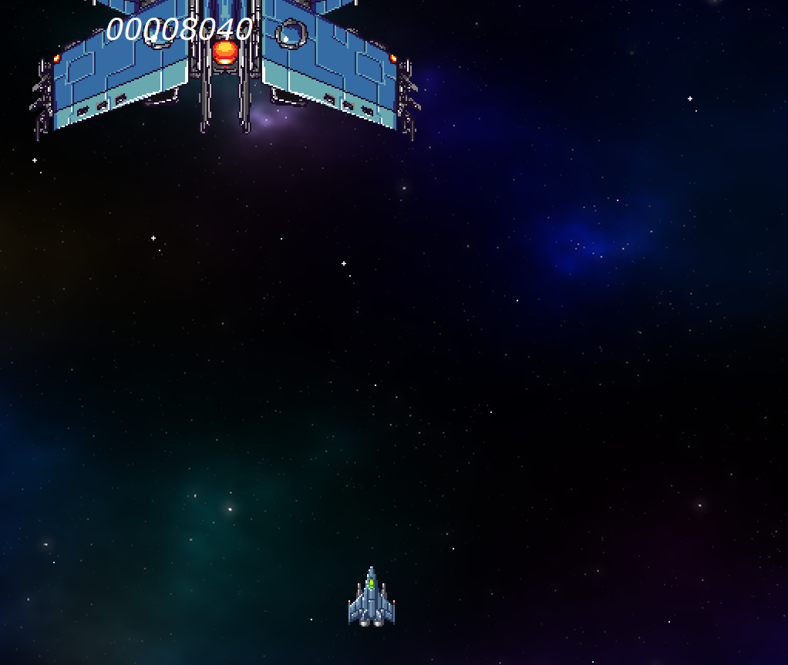</div>

### 3.4 ボスキャラの動きを楕円にする

円運動では、ボスキャラが画面外に見えなくなる期間が長いです。縦方向を狭くして、楕円運動をさせましょう。<br>
ボスを上下に移動させるプログラムに、次のプログラムを追加してください。

```diff
       float a = 8.0f;   // 1回の左右移動にかかる秒数
       float b = 256.0f; // 振幅
       Character.X = baseX + sinf(Pi * 2.0f / a * t) * b;

       // ボスを上下に移動
+      b = 64.0f; // 上下の振幅
       Character.Y = baseY - b + cosf(Pi * 2.0f / a * t) * b;
     }
   }
```

プログラムが書けたら`>ローカルWindowsデバッガー`ボタンをクリックしてアプリを実行してください。<br>
ボスキャラの動きが「縦に潰れた楕円の形」になっていたら成功です。

<div align="center">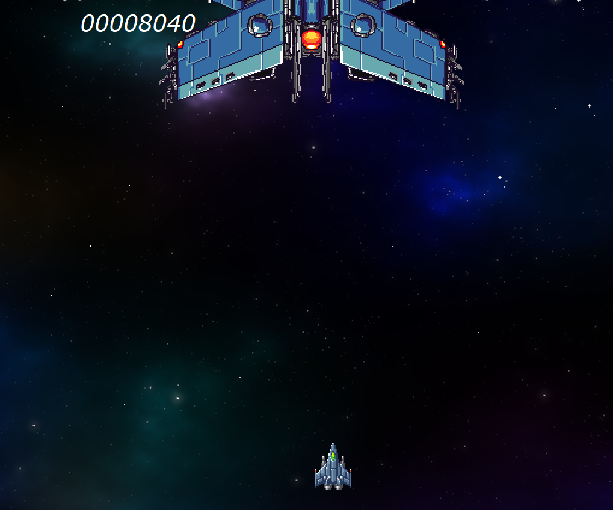</div>

### 3.5 上下移動にかかる秒数を変える

現在、1回の左右移動と上下移動は、どちらも`8.0f`秒かかります。<br>
**上下移動の秒数を、左右移動と違う値にする** と、また違った動きが作れます。<br>
例えば、上下移動の秒数を左右移動の半分にしてみましょう。

ボスを上下に移動するプログラムに、秒数の変数`a`を半分にするプログラムを追加してください。

```diff
       float a = 8.0f;   // 1回の左右移動にかかる秒数
       float b = 256.0f; // 振幅
       Character.X = baseX + sinf(Pi * 2.0f / a * t) * b;

       // ボスを上下に移動
+      a = 4.0f;  // 1回の上下移動にかかる秒数
       b = 64.0f; // 上下の振幅
       Character.Y = baseY - b + cosf(Pi * 2.0f / a * t) * b;
```

プログラムが書けたら`>ローカルWindowsデバッガー`ボタンをクリックしてアプリを実行してください。<br>
ボスキャラの動きが「楕円の下半分の形」になっていたら成功です。

<pre class="tnmai_assignment">
<strong>【課題02 上下移動にかかる秒数を変える】</strong>
左右移動と上下移動の秒数を、以下のA～Dのいずれかの組み合わせに変更しなさい。<table><tr><th></th><th>左右</th><th>上下</th></tr>
  <tr><th>組み合わせA</th><td>8.0f</td><td>2.0f</td></tr>
  <tr><th>組み合わせB</th><td>9.0f</td><td>3.0f</td></tr>
  <tr><th>組み合わせC</th><td>9.0f</td><td>1.5f</td></tr>
  <tr><th>組み合わせD</th><td>10.0f</td><td>4.0f</td></tr></table></pre>

### 3.6 砲塔の座標を変えられるようにする

プレイヤーはボスキャラを見たら、ボスらしい多彩な攻撃をしてくることを期待するでしょう。<br>
そこで、ボスキャラに強力な砲塔を配備しましょう。

ところで、現在の砲塔クラスは、常に敵の座標から弾丸を発射します。<br>
「敵の座標 = 画像の中心」なので、 **常に画像の中心から弾丸が発射される** ことになります。<br>
小型や中型の敵であれば、中心から発射できれば十分かもしれません。

ですが、ボスのように大きいキャラの場合、発射位置を変更できるほうが多彩な攻撃を作れます。

そこで、砲塔クラスに **弾丸の発射位置を調整する機能** を追加します。<br>
必要なのは、 **キャラ中心の座標から砲塔への相対座標** です。<br>
X軸方向の相対座標の名前は`X`(エックス)、Y軸方向の相対座標の名前は`Y`(ワイ)とします。

`Turret.h`を開き、変数の宣言に、相対座標をあらわす変数`X`と`Y`を追加してください。

```diff
   const Character* Target; // 攻撃目標
   int Count;         // 発射数
   float AngleStart;  // 発射開始角度(ラジアン)
   float AngleChange; // 角度変化量(ラジアン)
+  float X; // 発射位置の相対X座標
+  float Y; // 発射位置の相対Y座標

   // コンストラクタ
   Turret(float interval, float speed, Character* target,
```

次に`Turret.cpp`を開き、コンストラクタに相対座標を`0.0f`で初期化するプログラムを追加してください。

```diff
   Target = target;
   Count = count;
   AngleStart = start;
   AngleChange = change;
+  X = 0.0f;
+  Y = 0.0f;
 }

 // 砲塔の状態を更新する
 void Turret::Update(float deltaTime,
```

相対座標が`(0, 0)`の場合、これまでどおり「画像の中心」から弾丸が発射されます。

それでは、相対座標を加えた砲塔の座標を計算し、その座標から弾丸を発射しましょう。<br>
砲塔の座標をあらわす変数の名前は、`turretX`(ターレット・エックス)と`turretY`(ターレット・ワイ)とします。

`Update`関数にある「発射タイマーの時間を戻す」プログラムの下に、<br>
「砲塔の座標を計算する」プログラムを追加してください。

```diff
   // 発射タイマーの時間を戻す
   Timer += Interval;
+
+  // 砲塔の座標を計算
+  float turretX = character.X + X;
+  float turretY = character.Y + Y;

   // 発射角度を計算
   float angle = 0.5f * Pi; // 攻撃目標がない場合、下向きに撃つ
```

計算した座標を使うように、発射角度の計算と弾丸発射プログラムを変更しましょう。<br>
発射角度を計算するプログラムを、砲塔の座標を使うように変更してください。

```diff
   float angle = 0.5f * Pi; // 攻撃目標がない場合、下向きに撃つ
   if (Target != nullptr) {
     // 攻撃目標がある場合、攻撃目標に向かう角度を計算
-    float dx = Target->X - character.X; // 敵から攻撃目標までの距離(X軸方向)
-    float dy = Target->Y - character.Y; // 敵から攻撃目標までの距離(Y軸方向)
+    float dx = Target->X - turretX; // 敵から攻撃目標までの距離(X軸方向)
+    float dy = Target->Y - turretY; // 敵から攻撃目標までの距離(Y軸方向)
     angle = atan2f(dy, dx);
   }
```

続いて、弾丸を発射するプログラムを、砲塔の座標を使うように変更してください。

```diff
     float sx = cosf(angle) * BulletSpeed;
     float sy = sinf(angle) * BulletSpeed;

     // 弾丸を発射
-    bulletList.Add(new(character.X, character.Y, sx, sy,
+    bulletList.Add(new(turretX, turretY, sx, sy,
       BulletType::EnemyBullet));
     angle += AngleChange; // 次の弾丸の発射角度を計算
```

これで、砲塔の相対座標を考慮して、弾丸が発射されるようになりました。

### 3.7 ボスキャラに砲塔を増やす

砲塔の相対座標の機能を、ボスキャラで試しましょう。<br>
`Enemy.cpp`を開き、コンストラクタにあるボスキャラを作るプログラムに、次のプログラムを追加してください。

```diff
     HitboxLocal = { -240, 240, -96, 96 }; // キャラ中心の衝突判定
     Hp = 800; // ５連装x秒間８連射のとき20秒で倒せる耐久値
     MoveSpeedY = 200.0f; // 下へ移動
+
+    // 3方向に弾丸を撃つ砲塔を、中央に追加
+    Turret t1 = { 3.0f, 300.0f, target, 3, 0.4f, -0.4f };
+    t1.Timer = 2.0f; // 周期をずらす
+    TurretList.push_back(t1);
+
+    // 16方向に弾丸を撃つ砲塔を、中央左に追加
+    Turret t2 = { 3.0f, 400.0f, nullptr, 16, 0, 2.0f * Pi / 16.0f };
+    t2.X = 92.0f;
+    t2.Y = -32.0f;
+    TurretList.push_back(t2);
+
+    // 16方向に弾丸を撃つ砲塔を、中央右に追加
+    Turret t3 = { 3.0f, 400.0f, nullptr, 16, 0, 2.0f * Pi / 16.0f };
+    t3.X = -92.0f;
+    t3.Y = -32.0f;
+    TurretList.push_back(t3);
   }

   // 実際の衝突判定を計算
   Hitbox = {
```

弾丸を16方向に発射するために、`Turret`コンストラクタの「角度変化量」は`2π / 16`に設定します。<br>
`2π`は **弧度(ラジアン)法の円周の長さ** で、 **度数法の360度** に相当します。

プログラムが書けたら`>ローカルWindowsデバッガー`ボタンをクリックしてアプリを実行してください。<br>
ボスキャラの中央から3方向、左右２ヶ所から16方向に弾丸が発射されたら成功です。

<div align="center">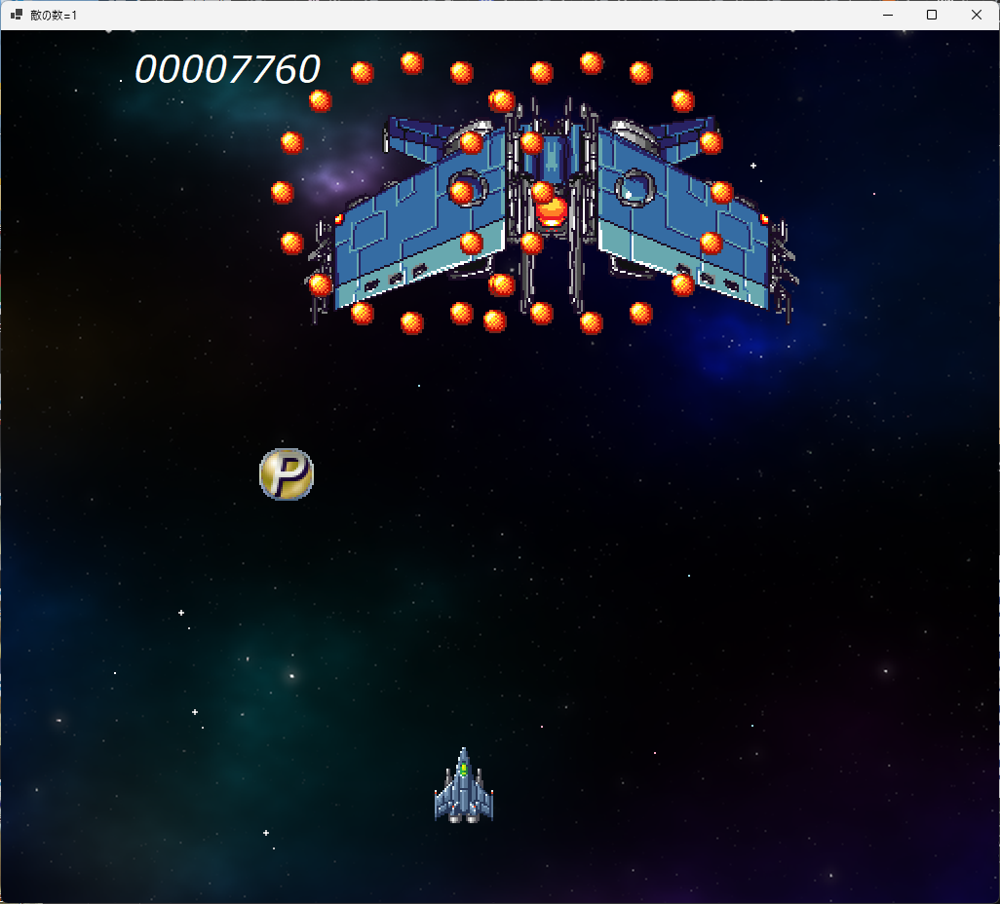</div>

### 3.8 HPが減ってきたら砲塔を増やす

ボスキャラとの先頭は、５発同時発射までパワーアップしていても20秒かかります。<br>
ですが、同じ攻撃を20秒避け続けるのはあまり面白くありません。<br>
そこで、ボスキャラのHPが半分になったら、砲塔を追加して攻撃力を強化しましょう。

ボスキャラの左右の翼のような部分に３つずつ、合計で６個の砲塔を追加します。<br>
`Update`関数の`Boss1`を更新するプログラムに、次のプログラムを追加してください。

```diff
       a = 3.0f;  // １回の上下移動にかかる秒数
       b = 64.0f; // 上下の振幅
       Character.Y = baseY - b + cosf(Pi * 2.0f / a * t) * b;
+
+      // HPが半分以下になったら、左右の翼に砲塔を追加する
+      // 既に砲塔を追加済の場合は何もしない
+      if (TurretList.size() == 3 && Hp <= 400) {
+        const ::Character* target = TurretList[0].Target;
+        for (int c = 0; c < 3; c++) {
+          Turret t1 = { 2.0f, 500.0f, target, 1, 0, 0 };
+          t1.X = 128.0f + c * 32.0f;
+          t1.Y = 56.0f;
+          TurretList.push_back(t1);
+
+          Turret t2 = { 2.0f, 500.0f, target, 1, 0, 0 };
+          t2.X = -128.0f - c * 32.0f;
+          t2.Y = 56.0f;
+          TurretList.push_back(t2);
+        }
+      } // if (HP半分以下)
     }
   }
```

プログラムが書けたら`>ローカルWindowsデバッガー`ボタンをクリックしてアプリを実行してください。<br>
ボスキャラを攻撃し続けると、しばらくして両翼から弾丸が発射されはじめたら成功です。

> ボスキャラの`Hp`を`450`に下げると確認しやすいです。後で忘れずに`Hp`を`800`に戻すこと。

<div align="center">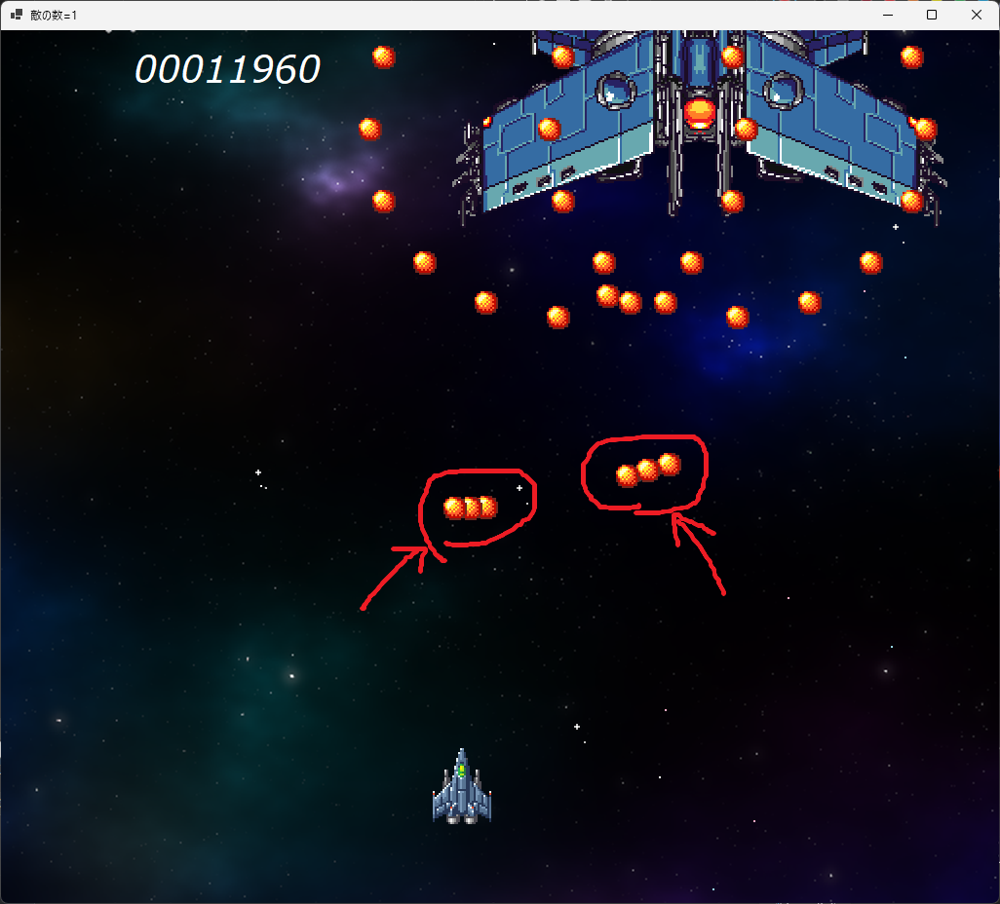</div>

### 3.9 弾丸の発射間隔をずらす

ボスキャラを特徴づけるのは、 **プレイヤーに強い印象を与える個性的な攻撃方法** です。<br>
個性的な攻撃方法は、簡単な工夫で作り出せます。

例として、追加の砲塔の発射タイミングをずらしてみましょう。<br>
これは、砲塔のタイマーを少しずつ変えることで実現できます。<br>
「左右の翼に砲塔を追加する」プログラムに、次のプログラムを追加してください。

```diff
         for (int c = 0; c < 3; c++) {
           Turret t1 = { 2.0f, 500.0f, target, 1, 0, 0 };
           t1.X = 128.0f + c * 32.0f;
           t1.Y = 56.0f;
+          t1.Timer = c * 0.1f;
           TurretList.push_back(t1);
 
           Turret t2 = { 2.0f, 500.0f, target, 1, 0, 0 };
           t2.X = -128.0f - c * 32.0f;
           t2.Y = 56.0f;
+          t2.Timer = c * 0.1f;
           TurretList.push_back(t2);
         }
       } // if (HP半分以下)
```

<div style="page-break-after: always"></div>

プログラムが書けたら`>ローカルWindowsデバッガー`ボタンをクリックしてアプリを実行してください。<br>
両翼から発射される弾丸が、少しずつタイミングをずらして発射されたら成功です。

<div align="center">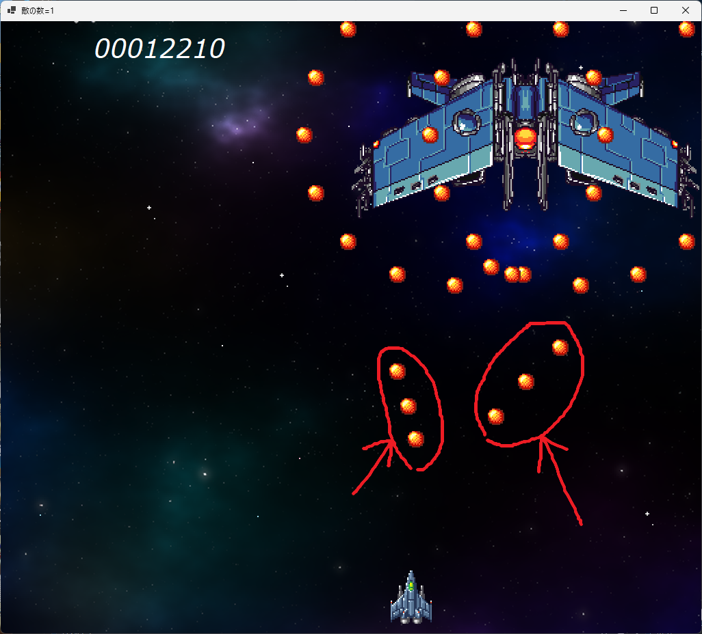</div>

<pre class="tnmai_assignment">
<strong>【課題03 HPが1/4以下になったら砲塔を追加する】</strong>
ボスキャラのHPが200以下になったとき、新しい砲塔を２つ追加しなさい。
砲塔の仕様は以下のとおりです。

  右側の砲塔の座標: (224, 80)
  左側の砲塔の座標: (-224, 80)

  左右共通の仕様
    発射間隔:   1.5秒
    弾丸の速度: 秒速500ドット
    ターゲット: 0番目の砲塔と同じターゲットを狙う
    同時発射数: 2発
    初期角度:  -0.3ラジアン
    角度変化量: 0.6ラジアン
    タイマーの初期値: 0秒
</pre>

<div style="page-break-after: always"></div>

## 4 レベルを増やす

### 4.1 ボスキャラを倒したらクリア状態にする

ボスキャラはレベルの最後に登場します。そして、ボスキャラを倒せば、そのレベルは終了です。<br>
ボスキャラを倒したら、ゲームを「クリア状態」にしましょう。

「クリア状態にする」方法はいくつか考えられますが、今回は以下の方法を使います。

> 1. 倒した敵の種類が`Boss1`だった場合、クリア状態にするまでの「待ち時間」を設定する
> 2. 「待ち時間」が設定されていたら、待ち時間を減らす
> 3. 2で「待ち時間」を減らした結果、「待ち時間」が0以下になったらクリア状態にする

それでは、「待ち時間」をあらわす変数を作りましょう。<br>
名前は`levelClearTimer`(レベル・クリア・タイマー、「レベルクリア状態にするタイマー」という意味)とします。<br>
`Game.cpp`を開き、「自機の変数」に`levelClearTimer`変数の宣言を追加してください。

```diff
 Player player(RenderWidth * 0.5f, RenderHeight * 0.75f);
 std::vector<Bullet> playerBulletList;
 std::vector<Item> itemList;
 int score = 0; // 得点
+float levelClearTimer = 0.0f; // クリア状態にするまでの残り時間

 // 爆発などのエフェクトのリスト
 std::vector<Character> effectList;
```

そして、「HPが0以下になった敵を破壊する」if文に、次のプログラムを追加してください。

```diff
         if (enemy.Hp <= 0) {
           score += enemy.GetScore(); // 得点を増やす
           enemy.IsFinished = true; // 敵を終了状態にする
+
+          // 倒したのがボスキャラなら、「クリア状態にするまでの待ち時間」を設定する
+          if (enemy.Type == EnemyType::Boss1) {
+            levelClearTimer = 4.0f; // 爆発の終了待ちと、倒した後の余韻の時間を持たせる
+          }

           // 爆発エフェクトを追加する
           if (enemy.Type == Enemy.MediumBlue || enemy.Type == Enemy.MediumRed) {
```

続いて、「待ち時間」を減らして、「待ち時間が0以下になったらクリア状態にするプログラム」を追加します。<br>
自機と敵の衝突判定を行うプログラムの下に、次のプログラムを追加してください。

```diff
         if (enemy.Hitbox.Intersect(player.Hitbox))
         {
           gameState = gsDead; // 死亡状態にする
           break;
         }
       } // for enemyList
+
+      // レベルクリアタイマーが0より大きい場合、タイマーを減らす
+      // 減らした結果、タイマーが0になったらクリア状態にする
+      if (levelClearTimer > 0.0f) {
+        levelClearTimer -= deltaTime;
+        if (levelClearTimer <= 0.0f) {
+          gameState = gsClear; // クリア状態にする
+        }
+      } // for levelClearTimer
     }

     // クリア状態を更新する
     //   deltaTime  状態を進める秒数
```

これで、ボスキャラを倒したらクリア状態に変わるはずです。<br>
あとは、ボスキャラを倒してレベルクリアタイマーの動作を確認するだけ、なのですが⋯。<br>
問題は「ボスキャラを倒す」のにかなり時間がかかることです。

そこで、ボスキャラのHPを減らします。<br>
`Enemy.cpp`を開き、コンストラクタにある`Boss1`を作成するプログラムを、次のように変更してください。

```diff
   else if (Type == EnemyType::Boss1) {
     Character = { RenderWidth * 0.5f, -256.0f, animeBoss1, 0 };
     HitboxLocal = { -240, 240, -96, 96 }; // キャラ中心の衝突判定
-    Hp = 800; // ５連装x秒間８連射のとき20秒で倒せる耐久値
+    Hp = 10; // ５連装x秒間８連射のとき20秒で倒せる耐久値
     MoveSpeedY = 200.0f; // 下へ移動

     // 3方向に弾丸を撃つ砲塔を、中央に追加
     Turret t1 = { 3.0f, 300.0f, target, 3, 0.4f, -0.4f };
     t1.Timer = 2.0f; // 周期をずらす
```

<div style="page-break-after: always"></div>

プログラムが書けたら`>ローカルWindowsデバッガー`ボタンをクリックしてアプリを実行してください。<br>
ボスキャラに10発打ち込むと破壊できて、少し待つと画面が停止したら成功です。

<div align="center"></div>

### 4.2 自機が死んだらクリアタイマーを初期化する

ボスを倒したあと、クリア状態になる前に、自機が敵弾に当たってしまうと、ゲームオーバーになります。<br>
その後、ゲームを再開すると、突然クリア状態に変化してしまいます。<br>
原因は、 **死んだときにレベルクリアタイマーを初期化していない** からです。

そこで、 **死んだときにレベルクリアタイマーを初期化** しましょう。<br>
`Game.cpp`を開き、「自機と敵の弾丸の衝突判定」と「自機と敵の衝突判定」の両方に、<br>
レベルクリアタイマーを初期化するプログラムを追加してください。

```diff
   for (int a = 0; a < enemyBulletList.size(); a++) {
     Bullet& bullet = enemyBulletList[a];
     if (bullet.Hitbox.Intersect(player.Hitbox)) {
+      levelClearTimer = 0.0f; // クリア状態にならないようにする
       gameState = gsDead; // 死亡状態にする
       break;
     }
   } // for enemyBulletList

   // 自機と敵の衝突判定
   for (int a = 0; a < enemyList.size(); a++) {
     Enemy& enemy = enemyList[a];
     if (enemy.Hitbox.Intersect(player.Hitbox)) {
+      levelClearTimer = 0.0f; // クリア状態にならないようにする
       gameState = gsDead; // 死亡状態にする
       break;
     }
   } // for enemyList
```

プログラムが書けたら`>ローカルWindowsデバッガー`ボタンをクリックしてアプリを実行してください。<br>
ボスキャラを破壊したあとでわざと敵弾に当たって、ゲームオーバーにしてください。<br>
その後、ゲームを再開したときにクリア状態にならなければ成功です。

>**【別解: 自機を無敵化する】**<br>
> クリア状態と死亡状態の競合を避ける別の方法として、「レベルクリアタイマーが動作しているときは、<br>
> 自機と敵弾、自機と敵との衝突判定を行わない」というやり方もあります。

### 4.3 クリア状態を表示する

レベルをクリアしたことが分かるように、クリア画面に画像と文字を表示しましょう。<br>
まずはクリア画面用のフォントを準備します。

フォント変数の名前は`fontClear`(フォント・クリア、「クリア画面のフォント」という意味)とします。<br>
`Game.cpp`を開き、「フォント変数」の宣言に、次のプログラムを追加してください。

```diff
 // フォント変数
 Font* fontHeading; // 見出し用フォント
 Font* fontScore;   // 得点用フォント
+Font* fontClear;   // レベルクリア表示用フォント

 // 画像用変数
 Bitmap* bmpBackground; // 背景画像
 Bitmap* bmpObjects;    // キャラクター画像
```

次に、`Init`関数にある「フォントを作成」するプログラムに、クリア画面用のフォントを作成するプログラムを追加してください。

```diff
   extern HWND hWnd;
   const float deviceDpi = static_cast<float>(GetDpiForWindow(hWnd));
   const float dpiScale = USER_DEFAULT_SCREEN_DPI / deviceDpi;
   fontHeading = new Font(L"Impact", 64 * dpiScale);
   fontScore = new Font(L"Verdana", 28 * dpiScale, FontStyleItalic);
+  fontClear = new Font(L"Verdana", 64 * dpiScale, FontStyleBold | FontStyleItalic);

   // 画像を読み込む
   Bitmap* tmp = new Bitmap(L"assets/images/bg_space.png");
   bmpBackground =
```

ゲームクリアの表示には、得点と同じ`Verdana`フォントを使い、太字にして勝利の雰囲気を添えています。

<div style="page-break-after: always"></div>

それでは、作成したフォントを使ってクリア画面を表示しましょう。<br>
`PaintClear`関数に、次のプログラムを追加してください。

```diff
 // クリア状態を描く
 void PaintClear(Graphics& g)
 {
+  PaintPlay(g);
+
+  SolidBrush sbLightBlue(Color::LightBlue);
+  g.DrawString(L"LEVEL CLAER!", -1, fontClear, PointF(160, 400), &sbLightBlue);
 }

 // 死亡状態を描く
 void PaintDead(Graphics& g)
```

プログラムが書けたら`>ローカルWindowsデバッガー`ボタンをクリックしてアプリを実行してください。<br>
ボスキャラを破壊した後、画像と文字付きのクリア画面が表示されたら成功です。

<div align="center">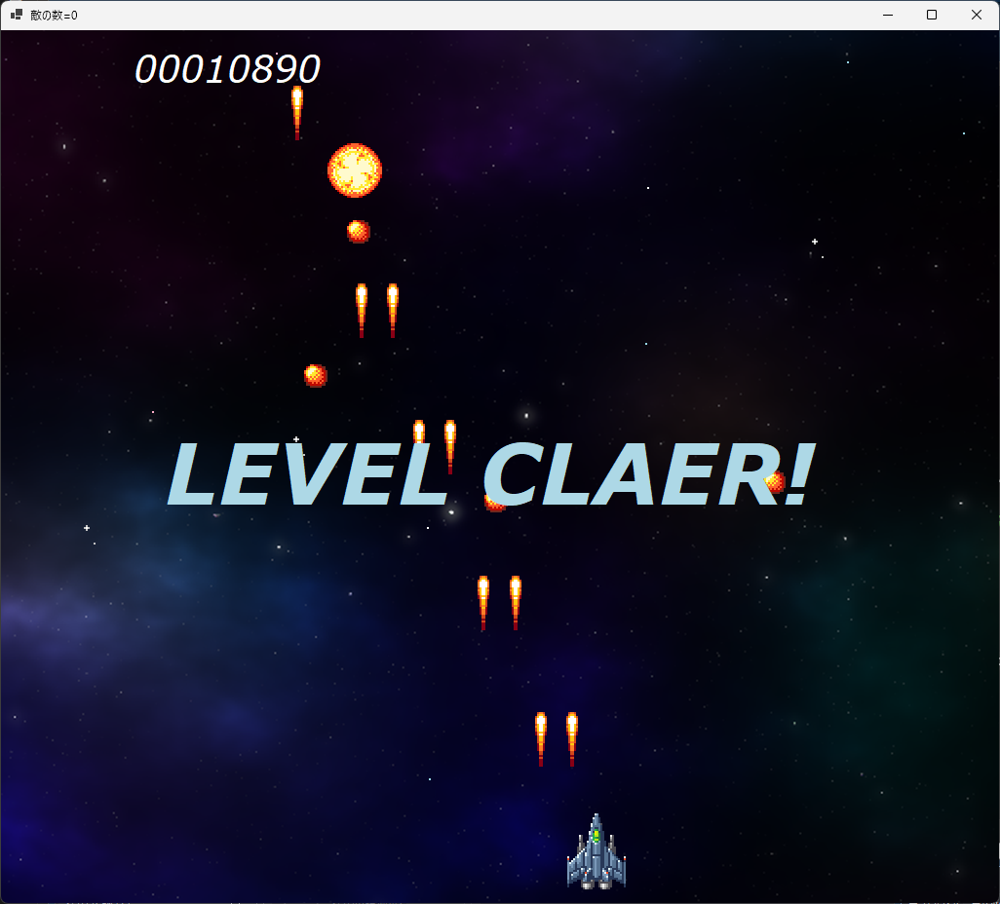</div>

### 4.4 ゲームを再開できるようにする

クリア画面からゲームを再開するために、死亡状態と同様にデータを初期化します。<br>
初期化のようなプログラムは、ひとつの場所にまとまっていることが重要です。<br>
「コピー&貼り付け」などで作ると、コピペ先をひとつでも変更し忘れるとバグになるからです。

そこで、初期化用の関数を作って、初期化をひとつの場所にまとめます。<br>
関数名は`InitLevelData`(イニット・レベル・データ、「レベルのデータを初期化する」という意味)とします。<br>

<div style="page-break-after: always"></div>

`Game.cpp`のインクルード文の下に、`InitLevelData`のプロトタイプ宣言を追加してください。

```diff
 #include <objidl.h>
 #include <gdiplus.h>
 using namespace Gdiplus;
+
+// レベルデータを初期化する
+void InitLevelData();

 // ゲーム状態
 const int gsPlay = 0;   // プレイ状態
```

`InitLevelData`の定義は、`UpdateDead`にあるデータ初期化プログラムを流用して作ります。<br>
`UpdateDead`関数の一部を、`InitLevelData`関数に分解してください。

```diff
 void UpdateDead(float deltaTime)
 {
   if (GetAsyncKeyState(VK_RETURN) < 0) {
+    InitLevelData();
+    player.ShotLevel = 0; // 自機のレベルをリセットする
+    score = 0; // 得点をリセットする
+    gameState = gsPlay; // ゲームを開始する
+  }
+}
+
+// レベルデータを初期化する
+void InitLevelData()
+{
     // 敵のデータを初期化する
     enemyList.clear();
     enemySpawnerList.clear();
     enemyBulletList.clear();
     eventTable.Index = 0; // 最初の行に戻す

     // 自機のデータを初期化する
     player.Character.X = RenderWidth * 0.5f;
     player.Character.Y = RenderHeight * 0.75f;
-    player.ShotLevel = 0;
     playerBulletList.clear();
-    score = 0; // 得点をリセットする

     // その他のデータを初期化する
     itemList.clear();
     effectList.clear();

     // 背景のY座標を、一番下の1画面がちょうどウィンドウ内に表示されるように設定
     backgroundY =
       -(static_cast<float>(bmpBackground->GetHeight()) - RenderHeight);
-
-    gameState = gsPlay; // ゲームを開始する
-  }
 }

 // プレイ状態を描く
```

この例のように、既存の関数の一部を、別の関数に分解できる場合があります。<br>
死亡状態とクリア状態で扱いが異なる変数は、`InitLevelData`関数の外で個別に初期化します。

それでは、クリア状態からゲームを再開させましょう。<br>
`UpdateClear`関数に次のプログラムを追加してください。

```diff
 // クリア状態を更新する
 //   deltaTime  状態を進める秒数
 void UpdateClear(float deltaTime)
 {
+  if (GetAsyncKeyState(VK_RETURN) < 0) {
+    InitLevelData();
+    gameState = gsPlay; // ゲームを開始する
+  }
 }

 // 死亡状態を更新する
 //   deltaTime  状態を進める秒数
```

クリア状態からのゲーム再開では、自機のレベルと得点は引き継ぎたいので初期化しません。

プログラムが書けたら`>ローカルWindowsデバッガー`ボタンをクリックしてアプリを実行してください。<br>
クリア画面で`Enter`キーを押したとき、ゲームが再開されたら成功です。

<div align="center">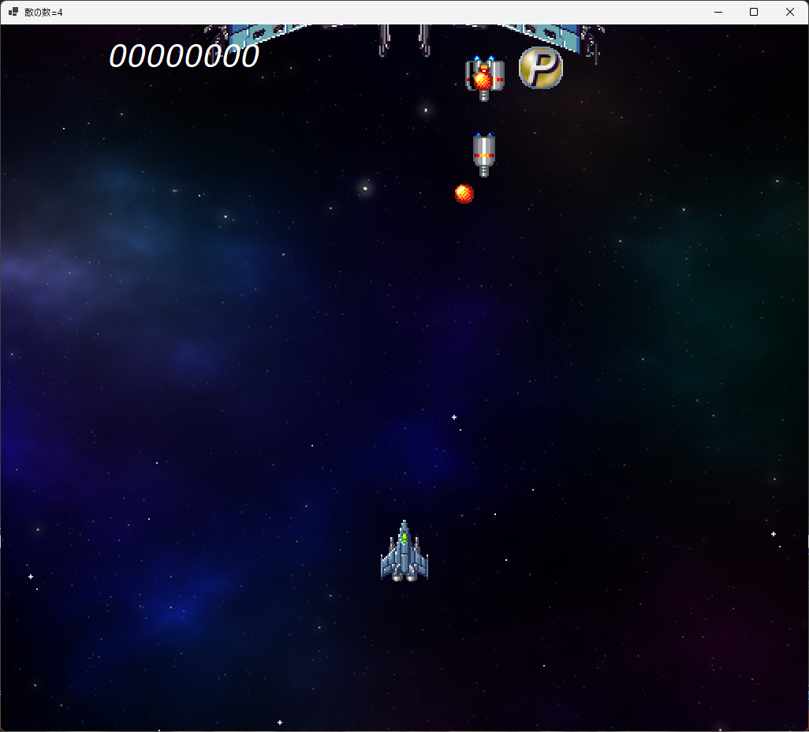</div>

### 4.5 新しいレベルを作る

レベルをクリアできるようになると、同じレベルが繰り返されるだけでは飽きてしまいます。<br>
そこで、新しいレベルを追加しましょう。「新しいレベル」を作るには、以下のデータが必要です。

* 現在のレベルをあらわす変数
* レベルの背景の画像
* レベルのイベント表

まずは「現在のレベルをあらわす変数」を作りましょう。変数名は`gameLevel`(ゲーム・レベル)とします。<br>
`Game.cpp`を開き、「自機の変数」の宣言に、ゲームレベルをあらわす変数を追加してください。

```diff
 std::vector<Bullet> playerBulletList;
 std::vector<Item> itemList;
 int score = 0; // 得点
 float levelClearTimer = 0.0f; // クリア状態にするまでの残り時間
+int gameLevel = 0; // 現在プレイ中のレベル

 // 爆発などのエフェクトのリスト
 std::vector<Character> effectList;
```

### 4.6 背景の画像を増やす

次に「レベルの背景の画像」を増やします。手順は次のようになります。

> 1. 背景の画像ファイル名を配列にする
> 2. `InitLevelData`関数で、レベルに対応する背景を読み込む

「背景の画像ファイル名の配列」の名前は`bgFilenameList`(ビージー・ファイルネーム・リスト、<br>
「背景のファイル名のリスト」)とします。`bg`は、`background`(バックグラウンド)の短縮形です。

背景の変数を宣言するプログラムを、次のように変更してください。

```diff
 // 画像用変数
 Bitmap* bmpBackground;
 Bitmap* bmpObjects;
+
+// 背景の画像ファイル名のリスト
+const std::wstring bgFilenameList[] = {
+  L"assets/images/bg_space.png",
+  L"assets/images/bg_frontline.png",
+};

 // 敵の変数
 std::vector<Enemy> enemyList;
```

次に、`InitLevelData`関数にある「その他のデータを初期化する」プログラムの下に、<br>
背景の画像ファイルを読み込むプログラムを追加してください。

```diff
   // その他のデータを初期化する
   itemList.clear();
   effectList.clear();
+
+  // 現在のレベルに対応する画像ファイルを読み込む
+  int bgNumber = gameLevel % std::size(bgFilenameList);
+  Bitmap* tmp = new Bitmap(bgFilenameList[bgNumber].data());
+  bmpBackground =
+    tmp->Clone(0, 0, tmp->GetWidth(), tmp->GetHeight(), PixelFormat32bppPARGB);
+  delete tmp;

   // 背景のY座標を、一番下の1画面がちょうどウィンドウ内に表示されるように設定
   backgroundY =
     -(static_cast<float>(bmpBackground->GetHeight()) - RenderHeight);
```

背景の画像ファイル読み込みと、背景のY座標の設定は`Init`関数でも行っています。<br>
同じプログラムが２箇所にあるのはバグの元なので、`InitLevelData`関数に統一します。<br>
そして、`Init`関数で`InitLevelData`関数を呼び出すようにします。

`Init`関数を、次のように変更してください。

```diff
   fontHeading = new Font(L"Impact", 64 * dpiScale);
   fontScore = new Font(L"Verdana", 28 * dpiScale, FontStyleItalic);
   fontClear = new Font(L"Verdana", 64 * dpiScale, FontStyleBold | FontStyleItalic);

   // 画像を読み込む
-  Bitmap* tmp = new Bitmap(L"assets/images/bg_space.png");
-  bmpBackground =
-    tmp->Clone(0, 0, tmp->GetWidth(), tmp->GetHeight(), PixelFormat32bppPARGB);
-  delete tmp;
-
-  tmp = new Bitmap(L"assets/images/tile_objects.png");
+  Bitmap* tmp = new Bitmap(L"assets/images/tile_objects.png");
   bmpObjects =
     tmp->Clone(0, 0, tmp->GetWidth(), tmp->GetHeight(), PixelFormat32bppPARGB);
   delete tmp;

-  // 背景のY座標を、一番下の1画面がちょうどウィンドウ内に表示されるように設定
-  backgroundY =
-    -(static_cast<float>(bmpBackground->GetHeight()) - RenderHeight);
+  InitLevelData();
   return true;
 }
```

それから、レベルをクリアしたときに現在のレベルを1増やします。<br>
`UpdateClear`関数に、現在のレベルを1増やすプログラムを追加してください。

```diff
 void UpdateClear(float deltaTime)
 {
   if (GetAsyncKeyState(VK_RETURN) < 0) {
+    gameLevel += 1; // 次のレベルに進む
     InitLevelData();
     gameState = gsPlay; // ゲームを開始する
   }
 }
```

プログラムが書けたら`>ローカルWindowsデバッガー`ボタンをクリックしてアプリを実行してください。<br>
クリア画面で`Enter`キーを押したとき、背景が変化したら成功です。

<div align="center">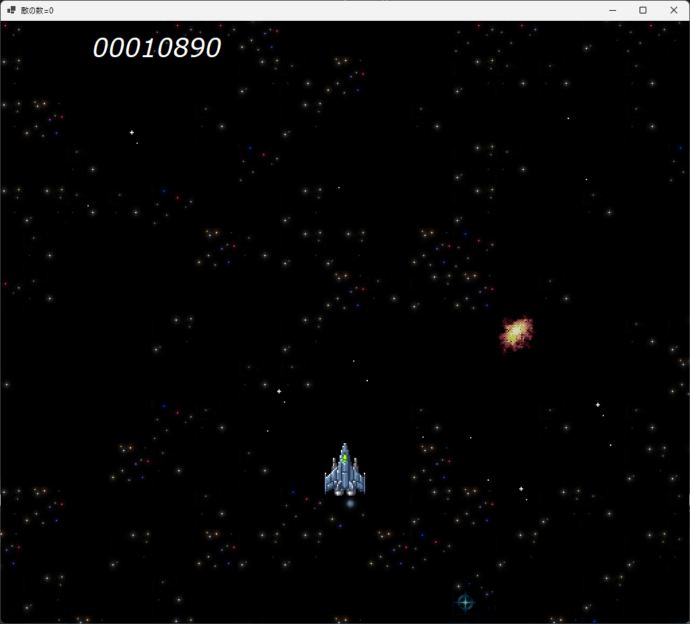</div>

### 4.7 イベント表を増やす

背景だけ変えても、同じ敵が同じ順番で出てくるのではすぐ飽きるのは変わりません。<br>
レベルごとに異なるイベント表を使うように、`EventTable`クラスに以下のデータを追加します。

* 新しいイベント表
* イベント表のリスト
* 現在のレベルをあらわす変数

新しいイベント表の名前は`tableLevelTwo`(テーブル・レベル・ツー、「レベル2の表」という意味)とします。<br>
イベント表のリストの名前は`tableList`(テーブル・リスト、「表のリスト」という意味)とします。<br>
現在のレベルをあらわす変数の名前は`Level`(レベル)とします。

`EventTable.h`を開き、`Level`メンバ変数を追加してください。

```diff
 class EventTable
 {
 public:
+  int Level = 0;     // 現在のレベル
   int Index = 0;     // 参照する行の番号
   std::mt19937 Rand; // 乱数
```

次に`EventTable.cpp`を開き、レベル1のイベント表の定義の下に、次のプログラムを追加してください。

```diff
   { 2200, -1,  4, -1,  4, -1 },
   { 2300, -1,  1,  3, -1, -1 },
   { 2400, -1,  0, -1,  0, -1 },
 };
+
+// レベル2のイベント表
+const vector<EventData> tableLevelTwo = {
+  {  100, -1,  4, -1,  4, -1 },
+  {  300,  4, -1, -1, -1,  4 },
+  {  500, -1, -1,  4, -1, -1 },
+  {  700, -1,  3, -1, -1, -1 },
+  {  900, -1, -1, -1,  3, -1 },
+  { 1100, -1, -1,  5,  3, -1 },
+};
+
+// イベント表のリスト
+const vector<EventData> tableList[] = {
+  tableLevelOne,
+  tableLevelTwo,
+};

 // 敵発生表の状態を更新する
 void EventTable::Update(float y, vector<EnemySpawner>& enemySpawnerList)
```

続いて、`Update`関数にある「イベント表を選択」するプログラムを、次のように変更してください。

```diff
 void EventTable::Update(float y, vector<EnemySpawner>& enemySpawnerList)
 {
   // イベント表を選択
-  const vector<EventData>& table = tableLevelOne;
+  const vector<EventData>& table = tableList[Level % std::size(tableList)];

   //行番号が表の行数以上、またはスクロール座標が現在の行のY座標未満なら何もしない
   if (Index >= table.size() || y < table[Index].y) {
```

最後に、クリア状態と、死亡状態のときに、`Level`変数と`Index`変数を設定します。<br>
`Game.cpp`を開き、`InitLevelData`関数に次のプログラムを追加してください。

```diff
   enemyList.clear();
   enemySpawnerList.clear();
   enemyBulletList.clear();
+  eventTable.Level = gameLevel; // 現在のレベルを設定する
   eventTable.Index = 0; // 最初の行に戻す
 
   // 自機のデータを初期化する
   player.Character.X = RenderWidth * 0.5f;
   player.Character.Y = RenderHeight * 0.75f;
```

これで、レベルに対応するイベント表が使われるようになりました。

プログラムが書けたら`>ローカルWindowsデバッガー`ボタンをクリックしてアプリを実行してください。<br>
クリア画面で`Enter`キーを押したとき、背景だけでなく発生する敵も変化したら成功です。

<div align="center">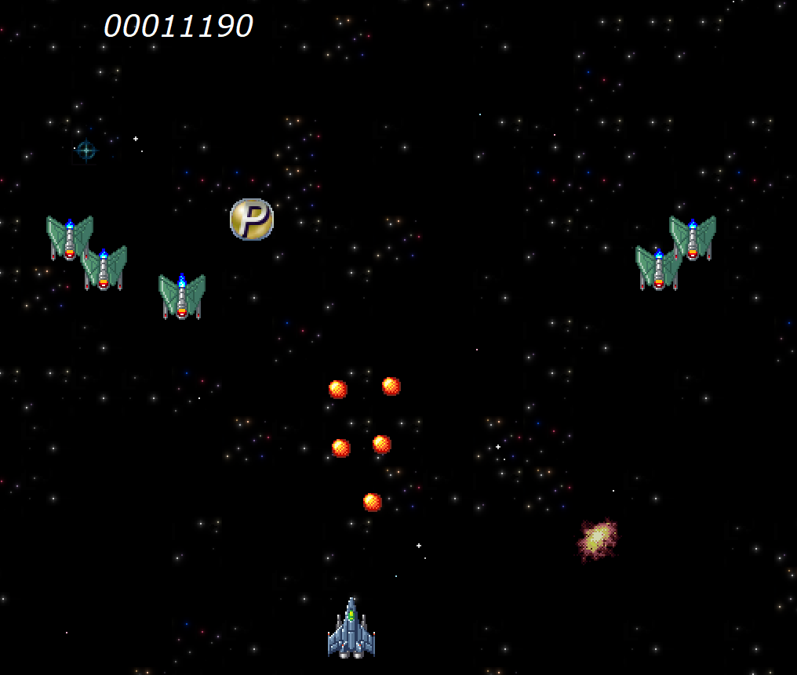</div>

<pre class="tnmai_assignment">
<strong>【課題04 ボスキャラの発生位置をレベルの最後にする】</strong>
<code>EventTable.cs</code>にある<code>tableLevelOne</code>について、
ボスキャラの発生位置を、次のように変更しなさい。
  ・Y座標100で登場するボスのパターン番号99番を、パターン番号１番に変更
  ・Y座標2600の行を追加し、中央にボスのパターン番号99番を配置(残りは-1にする)
</pre>

<pre class="tnmai_assignment">
<strong>【課題05 大きな爆発アニメーションを作る】</strong>
<code>Game.cpp</code>に、大きな爆発のアニメーション範囲の変数を追加しなさい。

  アニメーション範囲の変数名: <code>animeBigBlast</code>
  アニメーション範囲:
    (560, 480, 32, 32), (592, 464, 48, 48), (640, 448, 64, 64),
    (704, 416, 96, 96), (800, 400, 112, 112), (912, 400, 112, 112),
  秒間アニメーション枚数: 8
</pre>

<pre class="tnmai_assignment">
<strong>【課題06 ボスキャラを倒したとき、大きな爆発を表示する】</strong>
<code>Game.cpp</code>にある「爆発エフェクトを追加する」プログラムについて、
if文を使って「敵の種類が<code>Boss1</code>の場合、大きな爆発を表示する」プログラムを追加しなさい。
</pre>

<pre class="tnmai_assignment">
<strong>【課題07 ボスキャラの得点を設定する】</strong>
<code>Enemy.cs</code>にある<code>GetScore</code>メソッドに、
if文を使って「レベル1のボスの場合、得点を<code>1万点</code>にする」プログラムを追加しなさい。
</pre>

<pre class="tnmai_assignment">
<strong>【課題08 レベル2のイベント表を完全なものにする】</strong>
レベル2のイベント表<code>tableLevelOne</code>に、Y座標200ドットごとに行を追加して、
レベル1より少し難しい(敵が多く発生する)レベルを完成させなさい。
  - 敵配置の基本は<strong>敵を左右交互に発生させる</strong>こと
  - <code>bg_frontline.png</code>の高さは８画面で、移動する範囲は<code>6272</code>ドット
  - 最後に<strong>ボスキャラを発生</strong>させて、レベルをクリアできるようにする
</pre>

<pre class="tnmai_assignment">
<strong>【課題09 効果音、BGMを再生する】</strong>
NuGetを使って<code>SFML.Audio</code>パッケージを追加し、効果音やBGMを再生しなさい。
  - 効果音: 自機が弾丸を発射したとき、爆発を作るとき、パワーアップしたとき
  - BGM: プレイ中、クリア、死亡
</pre>

<pre class="tnmai_assignment">
<strong>【課題10 さらに要素を追加する】</strong>
以下の要素を、できる限り多くゲームに追加しなさい。

  - タイトル画面を追加する
  - タイトル画面でEnterキーを押したとき、効果音を鳴らす
  - 見た目の異なる弾丸を作り、ボスキャラの16方向弾の見た目を変える
  - 新しい敵その１(小型、画面の左右から発生し、横向きU字ターンで移動、画像は任意)
  - 新しい敵その２(小型、画面の上から発生し、発生時の自機の座標に向かって突進、画像は任意)
  - レベル2用の新しいボスキャラを作る(敵番号は任意、パターン番号は98とする)
    画像はWebで探して、<code>tile_objects.png</code>の空き領域に貼り付けて使う
  - レベル3を作る
  - レベル4を作る
  - レベルが進むにつれて、砲台の発射間隔と弾丸の速度が上がるようにする
  - 最終レベルクリア後にゲームクリア画面を表示する
  - 各レベルのボスが順番に登場するレベルを作る

敵などの画像を増やすには、<code>https://itch.io/game-assets</code>にアクセスし、
上部のタグ欄をクリックして<code>Shoot'Em Up</code>を選びます。
itch.ioではダウンロードの際、寄付金額を選ぶウィンドウが開きます。寄付せずダウンロードするには、
上部の<code>No thanks, just take me to the downloads</code>をクリックします。
</pre>
